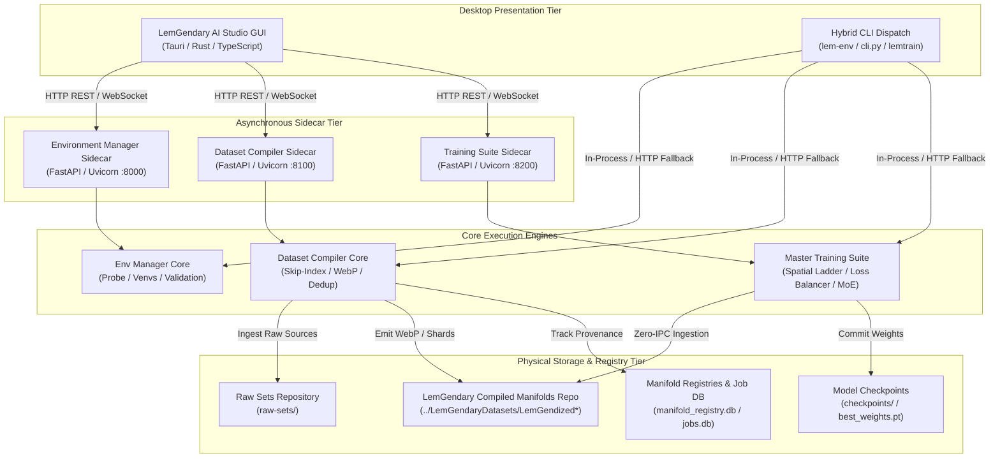

# LemGendary Ecosystem: Master Architecture Map & Multi-Sidecar Topology

## Category 01 ARCH | LemGendary AI Documentation Hub

**Integrated Subpages**: [Environment Manager](./PAPER_ENV_MANAGER.md) ·
[Dataset Compiler Suite](./PAPER_DATASET_COMPILER.md) · [Physical Degradation
Engine](./PAPER_DEGRADATION_ENGINE.md) · [Master Training
Suite](./PAPER_TRAINING_SUITE.md) · [LemGendary AI Studio GUI
Architecture](./PAPER_AI_STUDIO_GUI.md) · [Unified Versioning
Policy](./VERSIONING_POLICY.md)

**Version**: `v16.9.65-STABLE` · **Component Versions**: Environment
Manager `v16.9.80`, Dataset Compiler Suite `v16.9.84`, Model Training Suite
`v16.9.157`, AI Studio GUI `v2.10.57` · **Last Reviewed / Verified**: 2026-11-12
· **Status**: Canonical

---

## Table of Contents

- [1. Abstract](#1-abstract)
  - [1.1 High-Level System Topology](#11-high-level-system-topology)
- [2. The Multi-Sidecar Daemon Topology](#2-the-multi-sidecar-daemon-topology)
  - [2.1 Environment Manager Sidecar
    (`127.0.0.1:8000`)](#21-environment-manager-sidecar-1270018000)
  - [2.2 Dataset Compiler Sidecar
    (`127.0.0.1:8100`)](#22-dataset-compiler-sidecar-1270018100)
  - [2.3 Master Training Suite Sidecar
    (`127.0.0.1:8200`)](#23-master-training-suite-sidecar-1270018200)
- [3. Repository Boundaries & Subsystem
  Responsibilities](#3-repository-boundaries--subsystem-responsibilities)
- [4. Physical Storage Hierarchy](#4-physical-storage-hierarchy)
- [5. Fault Tolerance & Resumption
  Guarantees](#5-fault-tolerance--resumption-guarantees)
- [6. Cross-Repository Security
  Contract](#6-cross-repository-security-contract)
- [7. Bug Reporting Flow](#7-bug-reporting-flow)
- [8. Conclusion](#8-conclusion)

---

## 1. Abstract

The LemGendary AI Ecosystem is a decoupled, multi-tier machine learning platform.
A desktop operator cockpit (LemGendary AI Studio GUI) and command line tools
drive three local sidecar services, the LemGendary Environment Manager (port
8000), the LemGendary Dataset Compiler Suite (port 8100) and the LemGendary
Model Training Suite (port 8200), which in turn run the environment, data
synthesis and training engines on shared storage. The sidecars bind to the
loopback interface and share one security contract: an origin allow-list, a
client header for write requests and a strict Content Security Policy in the
GUI. Bug reports are packaged locally by the Environment Manager and sent
through the operator's own mail client.

### 1.1 High-Level System Topology

---

## 2. The Multi-Sidecar Daemon Topology

To allow desktop applications, external CLI scripts, and cloud orchestrators to
control the ecosystem without blocking execution or encountering Python GIL
contentions, the ecosystem deploys three specialized asynchronous sidecar
daemons across standardized local ports (`8000`, `8100`, and `8200`).

The ports, the project list, the pipeline step names and the Kaggle owner
are defined once, in `lemgendary-env-manager/ecosystem/ecosystem.json`
(served by `GET /api/ecosystem`). The LemGendary Dataset Compiler Suite and
the LemGendary Model Training Suite read it through their `ecosystem`
loaders, the LemGendary AI Studio GUI through its snapshot
`src/generated/ecosystem.json`, and the `ecosystem_ssot` validation gate
(error severity since Environment Manager v16.9.52) fails validation when a
value is written anywhere else.

### 2.1 Environment Manager Sidecar (`127.0.0.1:8000`)

- **Framework**: FastAPI + Uvicorn with a lifespan handler that starts the other
  sidecars.
- **Responsibilities**:
  - Real-time hardware discovery (`nvidia-smi`, `rocm-smi`, DirectX DXGI) and
    driver-aware PyTorch index selection (`cu134`, `cu126`, `cu121` or
    `cu118`; ROCm, Apple MPS and CPU hosts get their own index).
  - Virtual environment provisioning (non-destructive by default; `clean` is
    opt-in), one-way manifest sync with a downgrade guard, and version drift
    analytics.
  - Package updates as background jobs (`POST /api/update`, `GET
    /api/update/status`; one at a time, `409` otherwise).
  - Constant-time liveness probe `GET /api/ping`; `GET /api/health` is the full
    audit.
  - Masked, write-only secrets vault and the bug report endpoint
    (`POST /api/bug-report`).
  - Ecosystem-wide pre-commit compliance validation gating.
  - Live log broadcasting over WebSocket: `ws://127.0.0.1:8000/ws/log`.

### 2.2 Dataset Compiler Sidecar (`127.0.0.1:8100`)

- **Framework**: FastAPI + Uvicorn backed by SQLite job state tracking
  (`.lgd_server/jobs.db`).
- **Responsibilities**:
  - Background manifold compilation, degradation synthesis, and container export
    dispatching.
  - Dynamic job lifecycle management (queued, active, completed, failed,
    interrupted).
  - Real-time byte-metered transfer telemetry and WebP transcoding velocity
    streaming (`ws://127.0.0.1:8100/api/ws/jobs/{id}/logs`).

### 2.3 Master Training Suite Sidecar (`127.0.0.1:8200`)

- **Framework**: FastAPI + Uvicorn backed by ACID SQLite persistent job queue in
  `.lemtrain_server/jobs.db` (WAL mode).
- **Responsibilities**:
  - Headless training job dispatching, hyperparameter validation, and GPU device
    orchestration.
  - Real-time loss telemetry, spatial ladder transitions, epoch milestones, and
    checkpoint commits.
  - Live log broadcasting over WebSocket:
    `ws://127.0.0.1:8200/api/ws/jobs/{job_id}/logs` and
    `ws://127.0.0.1:8200/api/ws/logs`.
  - Optional local token (`.lemtrain_server/token`, header `X-LemTrain-Token`)
    and process PID management. Enforcing the token on every route is still
    open.

---

## 3. Repository Boundaries & Subsystem Responsibilities

| Subsystem | Repository | Role | Key Invariants |
| :--- | :--- | :--- | :--- |
| **Presentation** | `lemgendary-ai-studio-gui` | Operator cockpit | See (1) |
| **Toolchain & Env** | `lemgendary-env-manager` | Foundation mgr | See (2) |
| **Data Compiler** | `lemgendary-datasets` | Synthesis, ingestion | See (3) |
| **Training Suite** | `lemgendary-training-suite` | Model training | See (4) |
| **Documentation** | `lemgendary-docs` | Docs hub | See (5) |

1. **Presentation** (Tauri / TypeScript): bound to the sidecars' `openapi.json`
   contracts; no business logic in the frontend. Every sidecar request goes
   through `sidecarFetch`, which adds the client header. WebSocket lifecycle
   recovery guarantees no step card remains in `RUNNING` after pipeline
   completion (`success`, `warning`, or `error`).
2. **Toolchain & Env**: `pyproject.toml` declares Python `>=3.12`, matching
   the Python 3.12 APIs the code uses and the bootstrap check. Enforces the
   zero-emoji and zero-suppression rules. Linting via Ruff (`>=0.9.0`) and the
   Pylint gate with each project's `.pylintrc`. OpenCV variant equivalence in
   the health auditor. Driver-aware CUDA index selection
   (`select_cuda_torch_index()`). The central `requirements/` files are the
   manifest single source of truth.
3. **Data Compiler**: $\mathcal{O}(1)$ skip-indexing, WebP $q=92/95$, canonical
   formats WebDataset (`.data`/`.tar`), LitData (`.bin`), Parquet and
   Directory. MosaicML MDS is discontinued: existing MDS shards were transcoded
   to WebDataset, `mosaicml-streaming` was removed from the datasets
   requirements, and since Environment Manager v16.9.81 `runtime_env.yaml` no
   longer lists it. Shard labels are JSON only (`<key>.json`, Dataset Compiler
   v16.9.98).
4. **Training Suite**: Zero-IPC ThreadPool dataloaders, spatial resolution
   ladders under the pair-rule ratchet (resolution never decreases; the data
   fraction only rises within one resolution step and may reset when resolution
   steps up), bounded epoch budget, nuclear-hardened checkpoints.
   `torch==2.15.0` from the PyTorch wheel index the hardware probe picks,
   `transformers==5.22.1`.
5. **Documentation**: WCAG 2.1 AA accessible, responsive dual-viewport HTML5
   generated on the approved template, Markdown and HTML kept in sync.

---

## 4. Physical Storage Hierarchy

The ecosystem maintains strict directory isolation across local storage volumes:

- `raw-sets/`: Mutable upstream source archives (TAR, ZIP, Kaggle drops).
- `../LemGendaryDatasets/` (LemGendary Compiled Manifolds Repo):
  Deterministic training manifolds. Contains only suffix-free modernized
  datasets (e.g. `LemGendizedNimaAesthetic/`) and
  preserved legacy folders.
- `checkpoints/`: Epoch-specific model weight tensors (`.pt`, `.safetensors`)
  and optimizer states.
- `.lgd_server/` and `.lemtrain_server/`: Ephemeral daemon state of the dataset
  and training sidecars (`server.pid`, `token`, `jobs.db`, job logs).
- `bug-reports/`: Bug report archives at the workspace root, outside every
  repository.

---

## 5. Fault Tolerance & Resumption Guarantees

1. **Compilation Interruption**: If a compilation job halts midway, the SQLite
   transaction register and $\mathcal{O}(1)$ skip-indexer allow immediate
   resumption without re-processing existing files.
2. **Modernization Interruption**: `tools/modernize_manifold.py` validates
   terminal manifests and skips already-transcoded `.webp` images in seconds.
3. **Training Crash Recovery**: `lemgendary-training-suite` saves emergency
   state dumps upon unhandled exceptions and rewinds learning rate schedules on
   gradient collapse.
4. **Environment Safety**: A default pipeline run keeps valid virtual
   environments and running sidecars; a manifest sync that would lower a pin
   leaves both files unchanged and reports drift.

---

## 6. Cross-Repository Security Contract

All three sidecars and the GUI implement the same contract, each sidecar in a
single module (`env_manager/security.py`, `api/security.py`,
`training/server/security.py`):

- **Loopback Binding**: each sidecar listens on `127.0.0.1` by default.
- **Origin Allow-List**: only AI Studio GUI origins are accepted
  (`tauri://localhost`, `http://tauri.localhost`, `https://tauri.localhost`,
  `http://localhost:1420`, `http://127.0.0.1:1420`). Any other `Origin` gets
  `403`, WebSocket handshakes from a foreign origin are refused, and CORS lists
  the same origins with `allow_credentials=False`.
- **Client Header**: browser requests that use `POST`, `PUT`, `PATCH` or
  `DELETE` must send `X-LemGendary-Client: ai-studio-gui`, which forces a CORS
  preflight. The GUI adds it to every sidecar request in one helper
  (`sidecarFetch` in `src/api/http.ts`). Requests without an `Origin` (CLI,
  scripts, tests) are not affected.
- **Content Security Policy**: the Tauri configuration sets `default-src
  'self'`, `script-src 'self'`, `object-src 'none'` and `frame-src 'none'`, and
  limits `connect-src` to Tauri IPC, the three sidecar ports on `127.0.0.1` and
  `localhost`, and `https://fonts.gstatic.com`. A separate `devCsp` adds what
  the Vite dev server needs.
- **Secrets**: the Environment Manager returns secrets masked (`has_value`,
  `value_hint`) and accepts them write-only; secret files are ignored by git in
  every repository.

---

## 7. Bug Reporting Flow

1. The operator opens "Report Issue" in the AI Studio GUI, writes a description,
   picks the module and adds up to 5 annotated screenshots, optionally a
   recording of the app window (desktop app on Windows, MP4, at most 60 s) and,
   optionally, the recent telemetry as CSV.
2. The GUI posts the multipart form to the Environment Manager
   (`POST /api/bug-report`).
3. The Environment Manager checks fields, sizes and file signatures, writes
   `report.csv` and saves `bug_report_<timestamp>_<id>.zip` to `bug-reports/` at
   the workspace root.
4. It opens the operator's mail client (`mailto:` with recipient and subject)
   and reveals the archive in the file manager. The operator attaches the ZIP
   and sends it; no SMTP credentials exist anywhere in the ecosystem.

---

## 8. Conclusion

The ecosystem separates presentation, sidecar services, execution engines and
storage into independent repositories with defined contracts. Three loopback
sidecars share one security contract, the GUI talks to them only through
generated API contracts and a single request helper, and environment, data and
training state stays recoverable after interruptions.
