# LemGendary AI Studio GUI: Comprehensive Operator Manual

## Category 03 | LemGendary AI Documentation Hub | Master Operations Manual

**Authoritative Desktop Client Release**: `v2.0.0` (Tauri v2 Native Desktop Cockpit)
**Target Backend Ecosystem**: `v16.9.16-STABLE` (Tripartite Sidecar Topology: Ports 8000, 8100, 8200)
**Parent Authority**: [Master Ecosystem Architecture](file:///c:/Development/python/model-training/lemgendary-docs/MD-Papers/ECOSYSTEM_ARCHITECTURE.md) · [Document Authority Hierarchy & Versioning Policy](file:///c:/Development/python/model-training/lemgendary-docs/MD-Papers/VERSIONING_POLICY.md)

---

## Table of Contents

- [1. Abstract & The Gardening Model Philosophy](#1-abstract--the-gardening-model-philosophy)
- [2. Interface Topology & Visual Navigation Matrix](#2-interface-topology--visual-navigation-matrix)
  - [2.1 Workspace Global Shell Elements & Numbered Navigation Guide](#21-workspace-global-shell-elements--numbered-navigation-guide)
  - [2.5 Tripartite Sidecar Process Control & Auto-Start](#25-tripartite-sidecar-process-control--auto-start)
  - [2.6 Centralized State Architecture (Zustand) & Modular Micro-Components](#26-centralized-state-architecture-zustand--modular-micro-components)
- [3. Universal Configuration & Secrets Vault](#3-universal-configuration--secrets-vault)
  - [3.1 Central Manifest Registry Editor](#31-central-manifest-registry-editor)
  - [3.2 Secrets & Cloud Tokens Vault](#32-secrets--cloud-tokens-vault)
- [4. One-Click Environment Setup: The 7-Stage Clean Install Pipeline](#4-one-click-environment-setup-the-7-stage-clean-install-pipeline)
  - [4.1 Pipeline Orchestrator Control Card](#41-pipeline-orchestrator-control-card)
  - [4.2 Individual Pipeline Step Execution Cards](#42-individual-pipeline-step-execution-cards)
  - [4.3 Hardware Acceleration Sentinel Card](#43-hardware-acceleration-sentinel-card)
  - [4.4 Managed Workspace Projects Health Cards](#44-managed-workspace-projects-health-cards)
- [5. Dataset Compilation Pipeline: Modernization, Direct Kaggle Ingestion & Streaming Manifolds](#5-dataset-compilation-pipeline-modernization-direct-kaggle-ingestion--streaming-manifolds)
  - [5.1 Dataset Compiler & Modernization Control Card](#51-dataset-compiler--modernization-control-card)
  - [5.2 Production Manifolds Catalog, Upstream Lineage & One-Click Cloud Sync](#52-production-manifolds-catalog-upstream-lineage--one-click-cloud-sync)
  - [5.3 Modernization Queue & Scale Reduction Workflows](#53-modernization-queue--scale-reduction-workflows)
  - [5.4 Embedded Dataset Telemetry Console](#54-embedded-dataset-telemetry-console)
- [6. Model Training Pipeline: Architectures, Ladders & Sawtooth Governor](#6-model-training-pipeline-architectures-ladders--sawtooth-governor)
  - [6.1 Model Training Suite & Model Orchestration Toolbar](#61-model-training-suite--model-orchestration-toolbar)
  - [6.2 Registered Architectures & Checkpoint Telemetry Grid](#62-registered-architectures--checkpoint-telemetry-grid)
  - [6.3 Three-Tab Real-Time Telemetry Stream & Responsive Cancellation](#63-three-tab-real-time-telemetry-stream--responsive-cancellation)
  - [6.4 Revamped Training Dashboard Topology & Interactive SOTA Inspection](#64-revamped-training-dashboard-topology--interactive-sota-inspection)
- [7. Evaluation, Export & Cloud Publishing to Kaggle and Google Drive](#7-evaluation-export--cloud-publishing-to-kaggle-and-google-drive)
- [8. Health Matrix & Cross-Project Version Drift Analytics](#8-health-matrix--cross-project-version-drift-analytics)
  - [8.1 Toolchain Prerequisites, Python Drift Matrix & Desktop GUI NPM Packages](#81-toolchain-prerequisites-python-drift-matrix--desktop-gui-npm-packages)
  - [8.2 Ecosystem Maintenance & Governance Controls](#82-ecosystem-maintenance--governance-controls)
- [9. Contextual UX Help & Interactive Hover Guidance System](#9-contextual-ux-help--interactive-hover-guidance-system)
  - [9.1 Interactive Hover Popovers & Safety Diagnostics](#91-interactive-hover-popovers--safety-diagnostics)
- [10. Permanent Offline Documentation Hub & Online Synchronization](#10-permanent-offline-documentation-hub--online-synchronization)
  - [10.1 Local Static Offline Documentation Server](#101-local-static-offline-documentation-server)
  - [10.2 Live GitHub Pages Online Synchronization](#102-live-github-pages-online-synchronization)
- [11. Tripartite Multi-Sidecar Network Architecture](#11-tripartite-multi-sidecar-network-architecture)
- [12. Automated Testing & Ecosystem Quality Assurance](#12-automated-testing--ecosystem-quality-assurance)

---

## 1. Abstract & The Gardening Model Philosophy

The **LemGendary AI Studio Desktop GUI** is a hardware-aware, nuclear-hardened command center engineered to make deep learning dataset synthesis, neural network training, and cloud deployment accessible to everyone from senior machine learning researchers to high school students and non-technical hobbyists.

### The Gardening Model Rule

To ensure absolute operational clarity, every control, workflow, and safeguard in this manual is designed according to the **Gardening Model Rule**:

> *If a 75-year-old grandmother wants to train an AI model using photos of her garden roses, tomato plants, and soil to automatically detect plant diseases and enhance low-light garden photographs, she should be able to complete the entire pipeline from environment setup to Kaggle cloud publishing purely by clicking intuitive buttons in the GUI, with zero command-line commands, zero code editing, and zero risk of freezing her computer.*

The system achieves this through three foundational engineering principles:

1. **Deterministic One-Click Automation**: All complex toolchains, Python virtual environments, CUDA drivers, wheel resolutions, and dependencies are provisioned automatically through the 7-Stage Clean Install Pipeline.
2. **Nuclear Memory Protection (The Sawtooth Governor)**: When training complex vision models, the GUI continuously probes hardware VRAM. If memory approaches capacity, the system automatically downscales batch sizes and applies dynamic gradient accumulation, guaranteeing that your machine never suffers an Out-of-Memory (OOM) crash or system freeze.
3. **Comprehensive Contextual Guidance**: Every single interactive button, switch, input field, and status indicator is accompanied by a contextual hover icon (`?`) delivering instant, plain-English explanations of what the control does, what files are affected, and what safeguards are active.

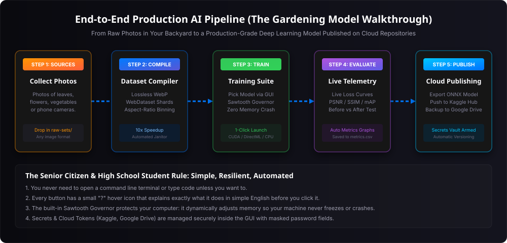

---

## 2. Interface Topology & Visual Navigation Matrix

The AI Studio interface is organized into persistent visual regions designed for ergonomic operation. Every element, card, and control in the live interface is indexed below with corresponding operational workflows and safety boundaries.

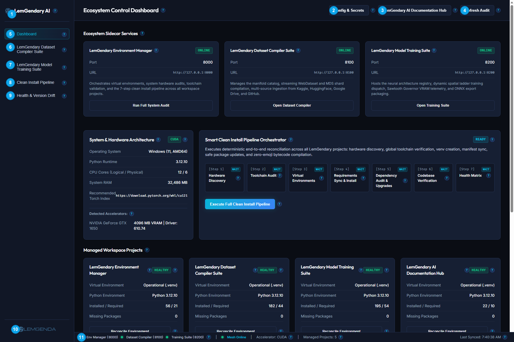

### 2.1 Workspace Global Shell Elements & Numbered Navigation Guide

The live screen capture above displays the complete primary application frame including header, persistent sidebar navigation, active dashboard viewport, and the sticky status footer:

1. **Brand Title & Brand Icon**: Displays `LemGendary AI` alongside the official vector icon (`lemgenda-icon.svg`). Clicking the header identity opens the official portal `https://www.lemgenda.hr/`.
2. **Config & Secrets Header Action Button**: Opens the Universal Configuration, Registry Editor & Secrets Vault Modal for editing YAML manifests and managing Kaggle, Google Drive, GitHub, and MT5 API tokens directly from the top navigation bar.
3. **Docs Hub (Offline) Action Button**: Launches the local offline Documentation Hub served by the desktop client and Environment Manager sidecar at `http://localhost:1420/documentation-hub/index.html`. Guarantees full offline documentation access during field deployments.
4. **Refresh Audit Telemetry Button**: Triggers an instantaneous asynchronous background scan across physical accelerators, GPU VRAM, system memory, project virtual environments, and manifest version drift.
5. **Dashboard Tab Selector**: Switches primary viewport to the main system dashboard, rendering hardware sentinel cards, sidecar process tiles, project health cards, and the real-time event console.
6. **Dataset Compiler Tab Selector**: Switches primary viewport to the LemGendary Dataset Compiler Suite (`.\lemgendary-datasets\`), streaming manifold compiler, direct Kaggle ingestion interface, Kaggle synchronization hub, and verified manifold catalog.
7. **Model Training Tab Selector**: Switches primary viewport to the LemGendary Model Training Suite (`.\lemgendary-training-suite\`), neural architecture matrix, Sawtooth Governor VRAM controls, progressive spatial ladders, and training dispatch orchestrator.
8. **Clean Install Pipeline Tab Selector**: Switches primary viewport to the dedicated 7-stage deterministic environment provisioning and toolchain verification sequence.
9. **Health & Version Drift Tab Selector**: Switches primary viewport to host prerequisite audits, Python cross-project version drift comparison matrix, Desktop GUI Project Packages (NPM) audit, and ecosystem maintenance actions.
10. **Brand Signature Logo Sidebar Footer**: Anchors the persistent sidebar with the official vector brand signature (`lemgenda-logo.svg`), providing a direct link to `https://www.lemgenda.hr/`.
11. **System Status Bar Indicator**: Live sticky footer status indicator permanently visible at the bottom of the viewport, reporting real-time connectivity and operational health across all active sidecar services.

| Callout # | UI Element | Control Type | Triggered Endpoint / Action | Operator Guide & Behavioral Safeguards |
| :--- | :--- | :--- | :--- | :--- |
| **1** | Brand Title & Icon | Navigation Link | `window.open('https://www.lemgenda.hr/')` | Displays official brand icon and title; links to web home. |
| **2** | Config & Secrets | Header Action Button | `setIsConfigEditorOpen(true)` | Launches modal dialog for manifest editing and secret management. |
| **3** | Docs Hub (Offline) | Action Button | `window.open('/documentation-hub/')` | Opens browser window to local offline documentation server. |
| **4** | Refresh Audit | Action Button | `POST /api/audit` | Queries all three sidecars to refresh hardware metrics and venv health. |
| **5** | Dashboard Tab | Navigation Button | `setCurrentTab("dashboard")` | Navigates to central system overview, hardware sentinel, and launcher tiles. |
| **6** | Dataset Compiler Tab | Navigation Button | `setCurrentTab("datasets")` | Navigates to LemGendary Dataset Compiler Suite and manifold catalog. |
| **7** | Model Training Tab | Navigation Button | `setCurrentTab("training")` | Navigates to LemGendary Model Training Suite and model orchestration grid. |
| **8** | Clean Install Tab | Navigation Button | `setCurrentTab("pipeline")` | Navigates to the automated 7-step clean install pipeline. |
| **9** | Health & Drift Tab | Navigation Button | `setCurrentTab("health")` | Navigates to Python drift matrix, Desktop GUI NPM packages, and maintenance. |
| **10** | Brand Signature Logo | Navigation Link | `window.open('https://www.lemgenda.hr/')` | Persistent sidebar brand signature linking to corporate portal. |
| **11** | System Status Bar | Status Indicator | Real-time WebSocket Heartbeat | Sticky footer reporting global operational health and network readiness. |

---

### 2.5 Tripartite Sidecar Process Control & Auto-Start

The Ecosystem Sidecar Services grid permanently monitors and coordinates the three local microservices:

- **LemGendary Environment Manager (`Port 8000`)**: Core orchestrator and validation authority (`.\lemgendary-env-manager\`).
- **LemGendary Dataset Compiler Suite (`Port 8100`)**: Manifold compiler and streaming storage server (`.\lemgendary-datasets\`).
- **LemGendary Model Training Suite (`Port 8200`)**: Neural architecture training and evaluation engine (`.\lemgendary-training-suite\`).

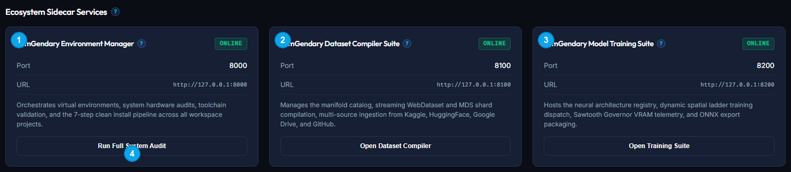

#### Ecosystem Sidecar Cards Numbered Reference

1. **Environment Manager Service Card**: Identifies the primary port 8000 governance daemon governing virtual environments, hardware discovery, and registry validation (`ONLINE`, PID, uptime, active endpoints).
2. **Dataset Compiler Suite Service Card**: Identifies the port 8100 service managing WebDataset, Parquet, and MDS manifolds (`ONLINE`, PID, uptime, direct navigation button).
3. **Model Training Suite Service Card**: Identifies the port 8200 service managing PyTorch neural architectures, Sawtooth Governor VRAM safeguards, and training ladders (`ONLINE`, PID, uptime, direct navigation button).
4. **Run Full System Audit Action Button**: Dispatches deterministic hardware, dependency, and manifest inspection across all workspace projects (`POST /api/audit`).
5. **Bidirectional Sidecar Controls (Start / Stop Service)**: Each card provides contextual daemon lifecycle management: offline cards render primary "Start Service" buttons, while active (`ONLINE`) cards render danger "Stop Service" (`.btn-danger`) buttons, terminating sidecar background daemons cleanly (`POST /api/services/{id}/stop`) without requiring shell or taskkill commands.

| Callout # | UI Element | Control Type | Triggered Endpoint / Action | Operator Guide & Behavioral Safeguards |
| :--- | :--- | :--- | :--- | :--- |
| **1** | Env Manager Card | Service Tile | `GET http://127.0.0.1:8000/health` | Shows connection readiness, PID, and uptime. Probed every 4 seconds. |
| **2** | Compiler Suite Card | Service Tile | `GET http://127.0.0.1:8100/health` | Shows compiler daemon readiness with direct navigation button. |
| **3** | Training Suite Card | Service Tile | `GET http://127.0.0.1:8200/health` | Shows training daemon readiness with direct navigation button. |
| **4** | Run Full System Audit | Action Button | `POST http://127.0.0.1:8000/api/audit` | Dispatches non-blocking complete audit across all workspace repositories. |
| **5** | Start / Stop Service | Action Button | `POST /api/services/{id}/start` or `/stop` | Contextual lifecycle trigger to launch or safely terminate individual sidecars directly from UI. |

---

### 2.6 Centralized State Architecture (Zustand) & Modular Micro-Components

To ensure instantaneous UI responsiveness, eliminate prop drilling, and prevent race conditions when streaming high-frequency training metrics, the application state is managed by a centralized Zustand store (`src/store/useStudioStore.ts`):

1. **Ecosystem Mesh Health**: Persists real-time connection status across the tripartite sidecars (Ports 8000, 8100, 8200) with automatic re-poll triggers.
2. **Global Telemetry Ring Buffer**: Maintains high-throughput terminal events with ANSI color parsing, regex filtering, and clipboard synchronization.
3. **Hardware Accelerators**: Caches GPU VRAM profiles, temperature sensors, and compute utilization matrices.
4. **Active Job Management**: Coordinates running training and compilation processes with instant stop signals.
5. **Shared Micro-Components**:
   - `ValidationBanner.tsx`: Centralized banner component with auto-detected severity (`info`, `success`, `warning`, `error`), dismiss handlers, and full accessibility semantics.
   - `HoverPinPopover.tsx`: High-performance CSS hover and native semantic `<button>` pin popovers for SOTA targets and upstream sources.

---

## 3. Universal Configuration & Secrets Vault

Deep learning workflows require interacting with external registries, storage backends, and cloud repositories. The AI Studio GUI integrates an in-app Universal Configuration & Secrets Vault modal accessible via the `Config & Secrets` header button.

### 3.1 Central Manifest Registry Editor

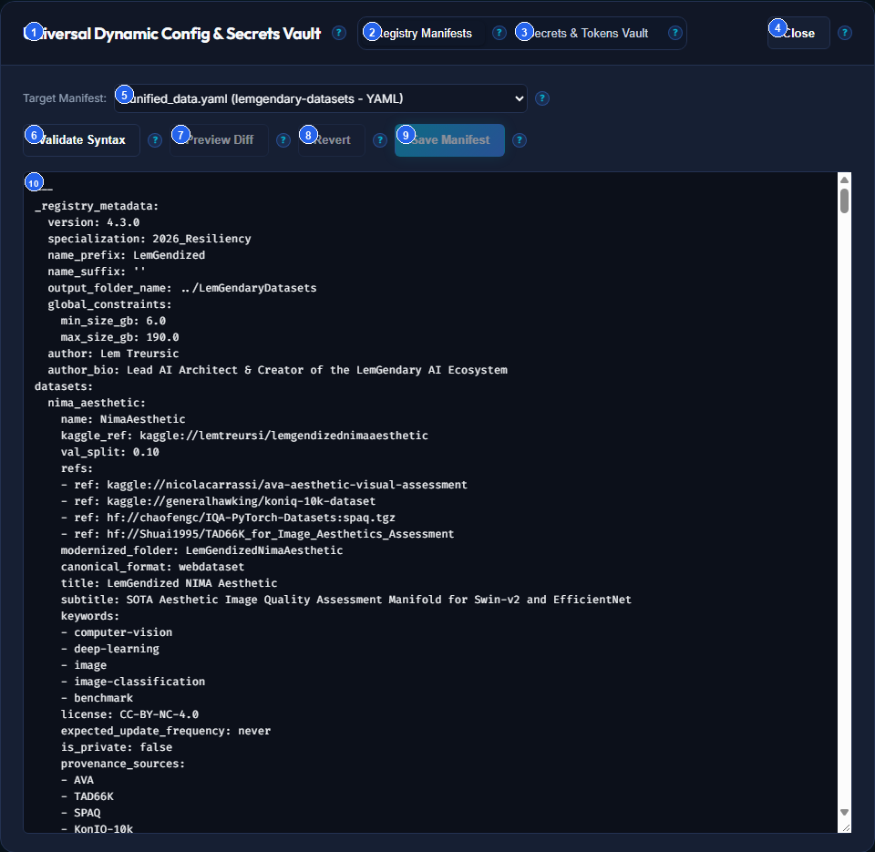

#### Manifest Registry Editor Numbered Reference

1. **Configuration Editor Modal Title**: Header identifying the central configuration and manifest governance workspace.
2. **Registry Manifests Subtab Switcher**: Selects the central YAML configuration and registry manifest editing workspace.
3. **Secrets & Tokens Vault Subtab Switcher**: Switches modal view to encrypted cloud credentials and API token management.
4. **Target Manifest Selector Dropdown**: Selects from ecosystem manifests including `unified_data.yaml` (dataset definitions), `unified_models_v2.yaml` (architecture registry), `unified_requirements.yaml` (dependency SSOT), and `.secrets.yaml`.
5. **Validate Syntax Button**: Executes in-memory YAML parsing and schema validation without writing to disk, reporting structural errors before persistence.
6. **Hot-Reload Services Button**: Triggers in-flight configuration reload across active sidecar daemons without restarting processes.
7. **Create Backup Button**: Generates a timestamped snapshot of the active configuration manifest prior to edits.
8. **Save Manifest Button**: Persists verified modifications to disk using atomic temporary write staging and creates a backup copy.
9. **Monospace Manifest Code Editor**: Full-height in-browser text editor providing direct inspection and modification of central configuration files.
10. **Modal Close Button**: Safely dismisses configuration modal and returns to previous workspace view.

| Callout # | UI Element | Control Type | Triggered Endpoint / Action | Operator Guide & Behavioral Safeguards |
| :--- | :--- | :--- | :--- | :--- |
| **1** | Modal Title | Modal Heading | None | Identifies configuration workspace and active target file. |
| **2** | Manifests Tab | Subtab Button | `setActiveTab("manifests")` | Activates central YAML code editor and schema linter. |
| **3** | Secrets Tab | Subtab Button | `setActiveTab("secrets")` | Activates credentials and token management profiles. |
| **4** | Manifest Dropdown | Select Dropdown | `fetchManifest(selected)` | Loads selected file into memory and populates editor view. |
| **5** | Validate Syntax | Action Button | `POST /api/manifests/validate` | Validates YAML syntax and schema without altering files on disk. |
| **6** | Hot-Reload Services | Action Button | `POST /api/manifests/reload` | Triggers sidecar configuration reload without process restarts. |
| **7** | Create Backup | Action Button | `POST /api/manifests/backup` | Writes timestamped backup copy to `backups/` directory. |
| **8** | Save Manifest | Primary Button | `POST /api/manifests/save` | Writes changes atomically and triggers hot-reload across active sidecars. |
| **9** | Monospace Editor | Textarea Editor | `setCurrentContent(e.target.value)` | Displays raw configuration text with monospaced indentation. |
| **10** | Modal Close | Action Button | `setIsConfigEditorOpen(false)` | Closes dialog without persisting uncommitted text. |

---

### 3.2 Secrets & Cloud Tokens Vault

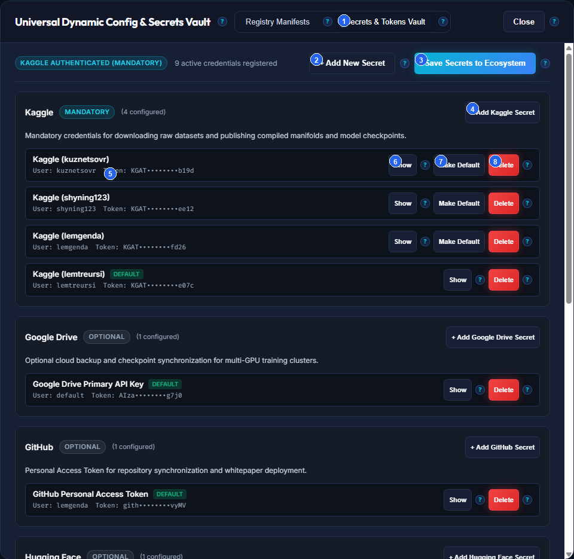

#### Secrets & Tokens Vault Numbered Reference

1. **Configuration Editor Modal Title**: Header confirming active credentials and token management workspace.
2. **Active Cloud Service Profile Badge**: Visual badge identifying service provider (e.g. `Kaggle`, `Google Drive`, `GitHub`, `MetaTrader 5`).
3. **Requirement Level Badge**: Clearly flags mandatory vs optional platform dependencies (`MANDATORY` for Kaggle API access, `OPTIONAL` for secondary mirrors).
4. **Toggle Add New Secret Form Button**: Expands interactive credential registration form to add additional service accounts.
5. **Save All Secrets & Synchronize Button**: Persists all registered credentials to encrypted `.secrets.yaml` and propagates legacy single-token files (`.kaggle_token`, `.kaggle_users`, `.mt5_credentials`).
6. **New Secret Service Type Dropdown**: Selects target cloud platform for new credential entry.
7. **Secret Label / Description Input**: Human-readable label for credential identification (e.g. `Personal Primary Account`).
8. **Account Username / Identifier Input**: Cloud service username or account identifier.
9. **API Token / Credential Secret Input Field**: Cloud API token, key, or private secret password.
10. **Add Secret Submit Button**: Adds the validated credential pair to the active in-memory vault profile.

| Callout # | UI Element | Control Type | Triggered Endpoint / Action | Operator Guide & Behavioral Safeguards |
| :--- | :--- | :--- | :--- | :--- |
| **1** | Modal Title | Modal Heading | None | Identifies secrets management dialog. |
| **2** | Service Badge | Status Pill | None | Displays service profile identity. |
| **3** | Requirement Level | Badge Indicator | None | Differentiates mandatory core services from optional cloud mirrors. |
| **4** | + Add New Secret | Action Button | `setIsAddingSecret(!isAddingSecret)` | Toggles new credential registration form with service dropdown. |
| **5** | Save All Secrets | Primary Button | `POST /api/secrets/save` | Encrypts vault to disk, writes backup, and syncs legacy credential files. |
| **6** | Service Type | Select Dropdown | `setNewService(e.target.value)` | Selects target cloud platform: Kaggle, Google Drive, GitHub, MT5. |
| **7** | Secret Label | Text Input | `setNewLabel(e.target.value)` | Descriptive tag for account differentiation. |
| **8** | Account Username | Text Input | `setNewUsername(e.target.value)` | Service login or API user identifier. |
| **9** | Secret Token | Password Input | `setNewSecret(e.target.value)` | Secret token or private key string. Masked in UI. |
| **10** | Add Secret Submit | Primary Button | Form Submission | Appends verified credential to active profile staging area. |

---

## 4. One-Click Environment Setup: The 7-Stage Clean Install Pipeline

Before training an AI model, your computer must have the correct software libraries installed. Traditionally, this required typing dozens of cryptic terminal commands. The AI Studio eliminates this completely through the automated 7-Stage Clean Install Pipeline.

### 4.1 Pipeline Orchestrator Control Card

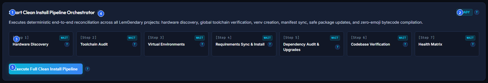

#### Clean Install Pipeline Numbered Reference

1. **Pipeline Orchestrator Title & Help Glyph**: Header detailing deterministic 7-step environment recreation and toolchain verification.
2. **Execute Full Clean Install Pipeline Button**: Launches sequential execution of all seven stages in background worker threads without opening terminal consoles.
3. **Active Stage Progress Bar**: Visual meter showing real-time pipeline execution progress from Stage 1 through Stage 7.
4. **Pipeline Execution State Badge**: Displays cyan `READY` when idle, or amber `PIPELINE ACTIVE` during background execution.

| Callout # | UI Element | Control Type | Triggered Endpoint / Action | Operator Guide & Behavioral Safeguards |
| :--- | :--- | :--- | :--- | :--- |
| **1** | Pipeline Title | Section Heading | None | Contextual heading explaining zero-command environment setup. |
| **2** | Execute Full Pipeline | Primary Button | `POST /api/pipeline/trigger` | Starts autonomous 7-step provisioning sequence without terminal commands. |
| **3** | Progress Bar | Visual Meter | Real-time WebSocket updates | Displays active completion percentage across all steps. |
| **4** | State Badge | Status Badge | `GET /api/pipeline/status` | Confirms whether pipeline workers are idle or running. |

#### Real-Time Telemetry Progress Tracker & Installation Safeguards

During Step 4 requirements and package synchronization, dependency installations can take several minutes to resolve and compile binary wheels. To provide continuous visual feedback and guarantee operators know the pipeline is actively working rather than stuck, an animated progress tracker (`TelemetryProgressTracker`) mounts directly above the monospace telemetry stream:

- **Amber Pipeline Theme**: Highlights active pipeline operations with high-contrast amber styling (`var(--accent-amber, #ffd166)`) and a glowing gradient progress bar (`linear-gradient(90deg, #f59e0b 0%, #ffd166 60%, #00f0ff 100%)`).
- **Real-Time Requirement Counts**: Live progress ratio metrics (e.g. `[12/28 requirements]`) show precisely how many dependencies have been processed.
- **Wheel Download Metrics & ETA**: Displays active package names, download transfer speeds (e.g. `14.2 MB/s`), byte ratios, and estimated time remaining.
- **Indeterminate In-Flight Indicators**: When dependencies are resolving or building wheels, the progress bar displays an animated in-flight pulse, assuring operators of active execution.
- **Card-Level Progress Indicators**: Each running step card in the 7-stage grid displays an animated progress bar along its bottom edge while executing.

---

### 4.2 Individual Pipeline Step Execution Cards

In addition to running the full automated sequence, operators can execute individual stages in isolation for granular troubleshooting, inspection, and rapid re-verification:

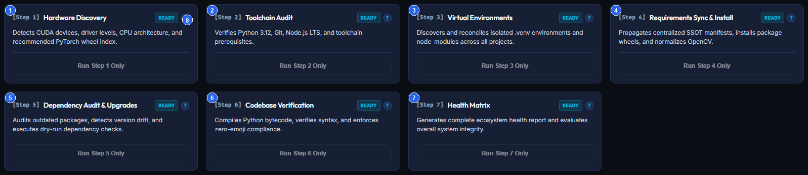

#### Pipeline Step Execution Cards Numbered Reference

1. **Stage 1 Card Title (Hardware Discovery)**: Probes host platform, CPU architecture, system RAM, NVIDIA driver levels, CUDA compute capabilities, cuDNN, and TensorRT availability.
2. **Stage 1 Run Step Action Button**: Dispatches isolated execution of Step 1 (`POST /api/pipeline/run-step?step=1`), refreshing system hardware telemetry without touching virtual environments.
3. **Stage 2 Card Title (Toolchain Audit)**: Validates host toolchain requirements (Python 3.10+, Git SCM, Node.js, and npm).
4. **Stage 2 Run Step Action Button**: Dispatches isolated execution of Step 2 (`POST /api/pipeline/run-step?step=2`), verifying host prerequisites against ecosystem requirements.
5. **Stage 3 Card Title (Virtual Environments)**: Audits and safely provisions isolated Python virtual environments (`.venv`) across all managed repositories.
6. **Stage 3 Run Step Action Button**: Dispatches isolated execution of Step 3 (`POST /api/pipeline/run-step?step=3`), recreating missing or corrupted `.venv` folders idempotently.
7. **Stage 4 Card Title (Requirements Sync & Install)**: Propagates centralized dependencies from `unified_requirements.yaml`, installs binary wheels, and normalizes OpenCV.
8. **Stage 4 Run Step Action Button**: Dispatches isolated execution of Step 4 (`POST /api/pipeline/run-step?step=4`), synchronizing packages and installing missing dependencies.
9. **Stage 5 Card Title (Dependency Audit & Upgrades)**: Audits outdated packages, detects version drift, and executes dry-run dependency checks across workspaces.
10. **Stage 5 Run Step Action Button**: Dispatches isolated execution of Step 5 (`POST /api/pipeline/run-step?step=5`), validating package upgrade paths without touching live installations.
11. **Stage 6 Card Title (Codebase Verification)**: Compiles Python bytecode across all repositories, verifies AST syntax, and enforces zero-emoji compliance.
12. **Stage 6 Run Step Action Button**: Dispatches isolated execution of Step 6 (`POST /api/pipeline/run-step?step=6`), running bytecode compilation and linting verification gates.
13. **Stage 7 Card Title (Health Matrix)**: Generates complete ecosystem health report, evaluates cross-project drift, and certifies overall system integrity.
14. **Stage 7 Run Step Action Button**: Dispatches isolated execution of Step 7 (`POST /api/pipeline/run-step?step=7`), executing full ecosystem certification and emitting consolidated health metrics.

| Callout # | UI Element | Control Type | Triggered Endpoint / Action | Operator Guide & Behavioral Safeguards |
| :--- | :--- | :--- | :--- | :--- |
| **1** | Stage 1 Title | Card Heading | None | Identifies hardware and compute acceleration discovery stage. |
| **2** | Stage 1 Run Step | Action Button | `POST /api/pipeline/run-step?step=1` | Runs hardware probe in background worker thread. |
| **3** | Stage 2 Title | Card Heading | None | Identifies toolchain prerequisite verification stage. |
| **4** | Stage 2 Run Step | Action Button | `POST /api/pipeline/run-step?step=2` | Runs toolchain prerequisites audit. |
| **5** | Stage 3 Title | Card Heading | None | Identifies virtual environments provisioning stage. |
| **6** | Stage 3 Run Step | Action Button | `POST /api/pipeline/run-step?step=3` | Recreates and verifies project `.venv` structures. |
| **7** | Stage 4 Title | Card Heading | None | Identifies requirements synchronization and wheel install stage. |
| **8** | Stage 4 Run Step | Action Button | `POST /api/pipeline/run-step?step=4` | Installs verified dependencies from unified manifests. |
| **9** | Stage 5 Title | Card Heading | None | Identifies dependency audit and upgrade analysis stage. |
| **10** | Stage 5 Run Step | Action Button | `POST /api/pipeline/run-step?step=5` | Executes dry-run dependency checks across workspaces. |
| **11** | Stage 6 Title | Card Heading | None | Identifies bytecode compilation and syntax verification stage. |
| **12** | Stage 6 Run Step | Action Button | `POST /api/pipeline/run-step?step=6` | Verifies syntax compilation and enforces zero-emoji compliance. |
| **13** | Stage 7 Title | Card Heading | None | Identifies system health matrix certification stage. |
| **14** | Stage 7 Run Step | Action Button | `POST /api/pipeline/run-step?step=7` | Generates complete ecosystem health report and certifies status. |

---

### 4.3 Hardware Acceleration Sentinel Card

The Hardware Acceleration Sentinel Card is permanently visible on the central Dashboard, delivering an un-truncated live readout of physical compute capabilities:

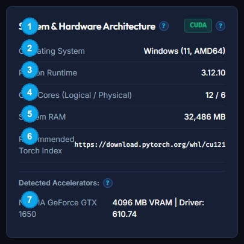

#### Hardware Architecture Card Numbered Reference

1. **Primary Accelerator Backend Badge & Header**: Highlights active execution engine (`CUDA`, `DIRECTML`, `ROCM`, or `CPU`) alongside the `System & Hardware Architecture` section header and contextual probe guidance tooltip.
2. **Host Operating System Row**: Confirms operating system release and kernel architecture (`Windows (11, AMD64)`).
3. **Python Runtime Row**: Displays active Python interpreter revision (`3.12.10`), verifying compliance with the 3.10+ ecosystem baseline.
4. **CPU Cores Allocation Row**: Reports available host processor allocation across logical threads and physical compute cores (`12 / 6`).
5. **System RAM Capacity Row**: Displays physical host RAM capacity (`32,486 MB`) available for data streaming and dataset decompression.
6. **Recommended PyTorch Wheel Index Row**: Authoritative repository link for CUDA 12.1 binary packages (`https://download.pytorch.org/whl/cu121`).
7. **Detected Accelerators & Dedicated VRAM Row**: Details physical GPU device model (`NVIDIA GeForce GTX 1650`), installed driver level (`610.74`), and dedicated video memory capacity (`4096 MB VRAM`).

| Callout # | UI Element | Control Type | Triggered Endpoint / Action | Operator Guide & Behavioral Safeguards |
| :--- | :--- | :--- | :--- | :--- |
| **1** | Accelerator Badge & Header | Status Pill & Header | `env_manager.system_probe` | Displays primary execution backend and sentinel header. |
| **2** | Operating System | Metric Row | `platform.platform()` | Confirms operating system version and kernel architecture. |
| **3** | Python Runtime | Metric Row | `sys.version` | Verifies Python 3.10+ interpreter compliance. |
| **4** | CPU Cores (Logical / Physical) | Metric Row | `os.cpu_count()` / `psutil` | Reports available logical threads and physical cores. |
| **5** | System RAM | Metric Row | `psutil.virtual_memory()` | Displays host memory capacity for batch streaming. |
| **6** | Recommended Torch Index | Metric Row | `env_manager.system_probe` | Official PyTorch binary wheel repository URL. |
| **7** | Detected Accelerators & VRAM | Device Metric Row | NVML / CUDA probe | Details physical GPU model, driver level, and dedicated VRAM. |

---

### 4.4 Managed Workspace Projects Health Cards

The Project Environments overview on the Dashboard displays dedicated cards for each sub-project in the ecosystem. All cards display clean relative paths without exposing sensitive host absolute paths:

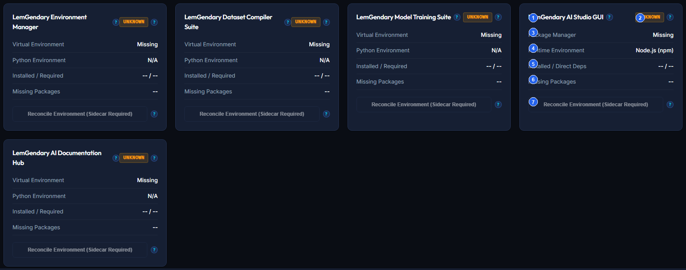

#### Managed Projects Grid Numbered Reference

1. **Managed Workspace Project Title**: Card identifying the managed project with canonical uniform naming (e.g. `1. LemGendary Environment Manager`, `2. LemGendary Dataset Compiler Suite`, `3. LemGendary Model Training Suite`, `4. LemGendary AI Studio GUI`, `5. LemGendary AI Documentation Hub`).
2. **Project Health Badge**: Displays green `HEALTHY` when virtual environment and installed packages match manifest specifications.
3. **Installed Packages & Status Metric Row**: Displays total installed library count and environment synchronization status.
4. **Reconcile Virtual Environment Button**: Triggers single-project dependency alignment to restore missing wheels and reconcile version drift.

| Callout # | UI Element | Control Type | Triggered Endpoint / Action | Operator Guide & Behavioral Safeguards |
| :--- | :--- | :--- | :--- | :--- |
| **1** | Project Title | Card Heading | None | Canonical uniform project title; relative path shown. |
| **2** | Health Badge | Status Badge | `GET /api/health` | Shows isolated `.venv` validity and manifest conformance. |
| **3** | Packages Metric | Metric Row | `pip list` / manifest scan | Displays total installed package count and synchronization status. |
| **4** | Reconcile Button | Action Button | `POST /api/pipeline/reconcile?project={name}` | Recreates `.venv` and reconciles missing wheels for selected project. |

---

## 5. Dataset Compilation Pipeline: Modernization, Direct Kaggle Ingestion & Streaming Manifolds

High-velocity deep learning requires converting raw, loose image files into modern streaming containers. Traditional loose-image folders cause OS filesystem freezes when training models on hundreds of thousands of images. The LemGendary Dataset Compiler tab provides a complete visual control center for dataset synthesis, direct cloud ingestion, and bidirectional Kaggle synchronization.

### 5.1 Dataset Compiler & Modernization Control Card

The top card of the Dataset Compiler tab governs manifold synthesis and streaming storage conversion:

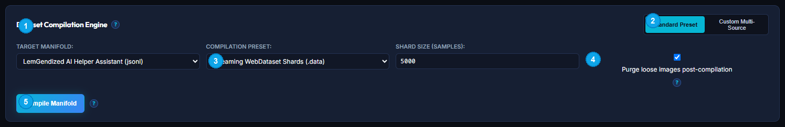

#### Dataset Compiler Control Card Numbered Reference

1. **Dataset Compilation Engine Title & Help Glyph**: Header detailing container synthesis alongside the contextual guidance tooltip (`?`).
2. **Standard Preset Mode Toggle Button**: Switches to standard preset mode compiling pre-configured datasets registered in `unified_data.yaml`.
3. **Custom Multi-Source Mode Toggle Button**: Switches to custom multi-source mode, enabling custom dataset naming, multi-directory aggregation, and format selection.
4. **Target Manifold Dropdown Selector**: Selects source manifold to compile from registered definitions in `unified_data.yaml`.
5. **Compilation Preset Dropdown Selector**: Selects target container architecture (`Streaming WebDataset (.data)`, `Columnar Parquet`, `MosaicML MDS`, `LitData`).
6. **Samples Per Shard Numeric Input Field**: Specifies container partition size (default: `5,000` samples per shard partition).
7. **Purge Loose Images Checkbox**: Toggles post-compilation purging of uncompressed source images to eliminate dual-storage disk amplification.
8. **Compile Manifold Primary Action Button**: Dispatches multi-threaded background workers (`POST http://127.0.0.1:8100/api/gui/quick-compile`) executing parallel WebP transcoding and container partition writing.

| Callout # | UI Element | Control Type | Triggered Endpoint / Action | Operator Guide & Behavioral Safeguards |
| :--- | :--- | :--- | :--- | :--- |
| **1** | Title & Help Glyph | Section Heading | None | Contextual heading explaining streaming container compilation. |
| **2** | Standard Preset Button | Mode Button | `onChangeCompileMode("standard")` | Sets compilation form to standard manifest preset workflow. |
| **3** | Custom Multi-Source Button | Mode Button | `onChangeCompileMode("custom")` | Reveals custom source aggregation and format customization fields. |
| **4** | Target Manifold | Select Dropdown | `onSelectManifold(e.target.value)` | Chooses dataset registered in `unified_data.yaml`. |
| **5** | Compilation Preset | Select Dropdown | `onSelectPreset(e.target.value)` | Selects container format: WebDataset, Parquet, MDS, or LitData. |
| **6** | Samples Per Shard | Number Input | `onChangeShardSize(Number(e.target.value))` | Sets chunk partition size between 100 and 50,000 samples. |
| **7** | Purge Loose Images | Checkbox Toggle | `onTogglePurgeLooseImages(e.target.checked)` | Deletes uncompressed raw files after verified shard creation. |
| **8** | Compile Manifold | Primary Button | `POST /api/gui/quick-compile` | Initiates parallel container compilation and WebP transcoding. |

---

### 5.2 Production Manifolds Catalog, Upstream Lineage & One-Click Cloud Sync

The Production Manifolds section catalogs all verified streaming datasets inside `./LemGendaryDatasets/`, providing instant access to upstream lineage and integrated card-level Kaggle synchronization:

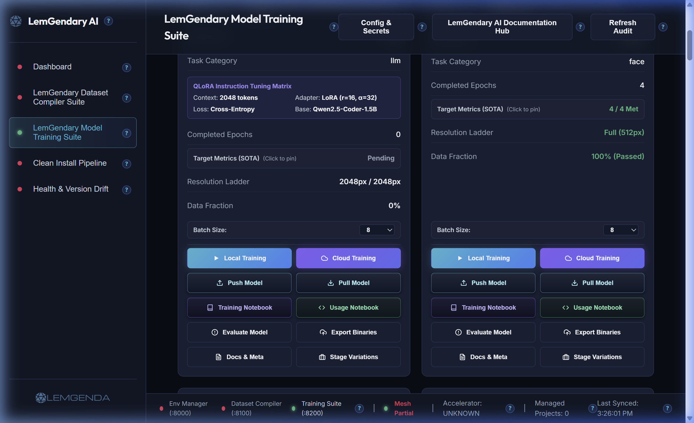

#### Production Manifolds Catalog Numbered Reference

1. **Production Manifolds Section Header & Total Counter**: Displays hub section title alongside active and total verified dataset count (`Dataset Compiler & Manifold Hub (21 / 21)`).
2. **Sub-Tab Navigation Switcher Buttons**: Three-way tab switcher selecting between `Manifolds Catalog`, `Modernization Queue`, and `Scale Reduction` views.
3. **Global Header Action Buttons**:
   - `Update All Kaggle Metadata`: Synchronizes descriptors across all registered datasets in Kaggle Cloud (`POST /api/kaggle/update-metadata` with `all_datasets: true`).
   - `Regen Index`: Rescans `./LemGendaryDatasets/` on disk and regenerates `unified_data.yaml` index.
   - `Refresh Catalog`: Polls port 8100 sidecar to detect local disk changes and remote cloud sync status.
4. **Live Search Input & Multi-Dimension Filter Dropdowns**: Real-time manifold name search paired with `Status` (All, Compiled, Uncompiled), `Format` (All, WebDataset, Parquet, MDS), and `Task` (All, Restoration, Detection, Classification, Segmentation, Forex) dropdowns.
5. **Verified Manifold Card Identity & Status Badge**: Displays canonical dataset display name, green `COMPILED` status pill, storage format, sample count, and disk footprint.
6. **Upstream Sources & Lineage Popover Button**: Interactive popover trigger revealing raw source dataset provenance, sample contributions, licensing, and raw data lineage.
7. **Manifold Card Action Buttons Group**:
   - `Update Metadata` (Button): Dispatches `POST /api/kaggle/update-metadata` for the single selected manifold.
   - `Audit Notebooks` (Link): Direct external link opening Kaggle Registry Metadata Training audit notebook.
   - `Download` (Button): Pulls remote streaming shards from Kaggle Cloud Storage with hash validation (`POST /api/kaggle/download`).
   - `Upload` (Button): Packages and uploads local compiled shards directly to Kaggle Cloud Datasets (`POST /api/kaggle/upload`).

| Callout # | UI Element | Control Type | Triggered Endpoint / Action | Operator Guide & Behavioral Safeguards |
| :--- | :--- | :--- | :--- | :--- |
| **1** | Hub Header & Count | Section Heading | None | Labels verified manifold inventory and total dataset count. |
| **2** | Sub-Tabs Switcher | Tab Buttons | `onTabChange()` | Toggles catalog, transcode modernization queue, and scale reduction. |
| **3** | Global Header Actions | Action Buttons | `POST /api/kaggle/...` | Batch metadata update, index regeneration, and catalog refresh. |
| **4** | Search & Filter Dropdowns | Input & Selects | Client-side filter | Filters manifolds by search query, compilation status, format, and task. |
| **5** | Manifold Identity & Status | Card Header | Sourced from `unified_data.yaml` | Displays verified samples, disk storage footprint, format, and shards. |
| **6** | Upstream Sources Popover | Popover Trigger | `HoverPinPopover.tsx` | Displays upstream provenance, licensing, and raw data lineage. |
| **7** | Card Action Buttons | Button Group | `POST /api/kaggle/...` | Single-dataset metadata update, audit link, cloud download, and shard upload. |

---

### 5.3 Modernization Queue & Scale Reduction Workflows

The additional sub-tabs in the Production Manifolds section provide advanced dataset operations:

1. **Modernization Queue & Transcode Tab**: Detects datasets containing legacy PNG/JPEG images that need transcoding to modern WebP format. Operators can adjust the parallel worker thread pool count (1 to 16, default 8), run a simulated dry run, or batch transcode all datasets with optional automated push to Kaggle.
2. **Scale Reduction (Downsample) Tab**: Derives spatially downscaled and sample-reduced dataset variants for rapid experimentation (`10% Preview`, `25% Fast Test`, `50% Balanced`, `75% High Res`) using Lanczos-3 spatial downsampling.

---

### 5.4 Embedded Dataset Telemetry Console

The Dataset Compiler panel features a dedicated live streaming telemetry console docked directly at the bottom of the viewport. Integrated with the modern `@radix-ui/react-progress` engine (installed and governed via LemGendary Environment Manager), active operations feature an accessible, glowing two-line progress architecture:

1. **Line 1 (Unconstrained Operational Metrics)**: Displays operation title, target dataset archive, exact percentage, transfer size / file counts, real-time bandwidth transfer rate, and dynamic ETA cleanly spaced without text clipping or truncation.
2. **Line 2 (Visual Progress Bar Only)**: Full-width hardware-accelerated glowing progress indicator strictly isolating the visual progress bar on its own dedicated line.
3. **In-Place Stream De-duplication**: Intermediate progress updates for in-flight archiving, extraction, and cloud synchronization are rolled up in-place, eliminating scrolling clutter while preserving discrete step start, verification, and completion records.

---

## 6. Model Training Pipeline: Architectures, Ladders & Sawtooth Governor

Once your dataset is compiled, you are ready to train a production-grade neural network. The LemGendary Model Training Suite (`.\lemgendary-training-suite\`) provides dynamic hyperparameter management and nuclear memory safeguards.

### 6.1 Model Training Suite & Model Orchestration Toolbar

The top toolbar of the Model Training panel provides high-level search, domain filtering, and global batch automation across all 22 registered neural architectures:

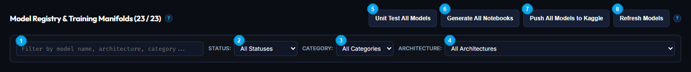

#### Training Orchestrator Toolbar Numbered Reference

1. **Model Name Search Input Field**: Real-time live search filter narrowing the architecture catalog by model key, architecture, or category (`Filter by model name, architecture, category...`).
2. **Status Filter Dropdown**: Dropdown selector filtering architectures by training and weights status (`All Statuses`, `Fully Trained`, `Partially Trained`, `Weights Ready`, `Initializing`).
3. **Category Filter Dropdown**: Dropdown selector restricting catalog display to specific ML task domains (`All Categories`, `enhance`, `face`, `forex`, `llm`, `restoration`, `yolo`).
4. **Architecture Filter Dropdown**: Dropdown selector filtering the registry by specific neural backbone architecture.
5. **Unit Test All Models Action Button**: Submits an asynchronous background job (`POST /api/training/unit-test-all`) executing a rapid 1-epoch diagnostic pass sequentially across all registered models.
6. **Generate All Notebooks Action Button**: Batch regenerates and synchronizes Jupyter training, inference, and usage notebooks across all models (`POST /api/notebooks/generate-all`).
7. **Push All Models to Kaggle Action Button**: Enqueues background fleet synchronization (`POST /api/training/kaggle/push-all`) staging isolated variations, verifying isolation, and publishing all registered models, checkpoints, and variations to Kaggle Models Hub.
8. **Refresh Models Action Button**: Polls the Training Suite sidecar daemon on port 8200 to refresh model weights status, metrics.csv progress, and resolution ladder completion.

| Callout # | UI Element | Control Type | Triggered Endpoint / Action | Operator Guide & Behavioral Safeguards |
| :--- | :--- | :--- | :--- | :--- |
| **1** | Model Search Filter | Text Input | Client-side filter | Filters architecture catalog in real time by name, architecture, or category. |
| **2** | Status Filter | Select Dropdown | Client-side filter | Restricts catalog display by training lifecycle and weights state. |
| **3** | Category Filter | Select Dropdown | Client-side filter | Restricts catalog display to specific ML task domains. |
| **4** | Architecture Filter | Select Dropdown | Client-side filter | Restricts catalog display to specific neural backbone architecture. |
| **5** | Unit Test All Models | Secondary Button | `POST /api/training/unit-test-all` | Dispatches rapid 1-epoch fleet diagnostic smoke test across all models. |
| **6** | Generate All Notebooks | Secondary Button | `POST /api/notebooks/generate-all` | Batch regenerates Jupyter training, inference, and usage notebooks across all models. |
| **7** | Push All Models to Kaggle | Secondary Button | `POST /api/training/kaggle/push-all` | Stages isolated variations and publishes all registered models to Kaggle Models Hub. |
| **8** | Refresh Models | Secondary Button | `GET /api/models` / `:8200` poll | Polls sidecar daemon to refresh weights status, metrics, and ladder completion. |

---

### 6.2 Registered Architectures & Checkpoint Telemetry Grid

Each registered model card provides comprehensive telemetry, binary export readiness, and interactive SOTA target inspection:

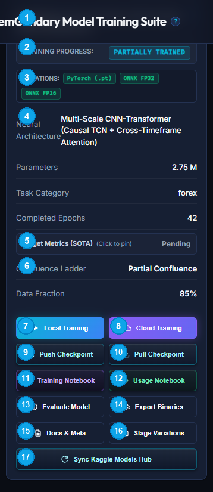

#### Architecture Telemetry Card Numbered Reference

1. **Model Identity, Help Glyph & Target Pin**: Displays canonical model title (`LemGendary Forex Predictor`), contextual help tooltip (`?`), and target pinning toggle button.
2. **Training Progress & Checkpoint State Pill**: Displays multi-pillar training status badge (`PARTIALLY TRAINED`, `FULLY TRAINED`, or `NOT STARTED`).
3. **Binary Format Variations Badges**: Visual indicators confirming compiled formats ready for inference (`PyTorch (.pt)`, `ONNX FP32`, `ONNX FP16`).
4. **Neural Architecture Backbone Row**: Displays network architecture type (`Multi-Scale CNN-Transformer (Causal TCN + Cross-Timeframe Attention)`).
5. **Trainable Parameters Metric Row**: Displays total parameter allocation across backbone and attention heads (`2.75 M`).
6. **Task Category Metric Row**: Displays registered domain classification (`forex`).
7. **Completed Epochs Counter Row**: Reports cumulative trained epochs recorded in checkpoint metadata (`42`).
8. **Target Metrics (SOTA) Interactive Popover Trigger**: Interactive popover button (`(Click to pin) Pending`) detailing target convergence metrics, current best scores, and evaluation baselines.
9. **Spatial / Confluence Ladder Progression Row**: Displays active ladder rung (`Confluence Ladder: Partial Confluence`).
10. **Dataset Scaling Fraction / Walk-Forward Fold Row**: Displays active training dataset sampling fraction (`Data Fraction: 100%`) for vision models, or dynamic Walk-Forward fold progression (`Walk-Forward Fold: Fold 1 / 6 (2019-2020 -> 2021)`) for quantitative financial models.
11. **Local Training Action Button**: Dispatches local training loop (`POST /api/gui/quick-train`) and focuses the live telemetry stream below. When training is active, transforms into **Stop Training** abort trigger.
12. **Cloud Training Action Button**: Opens the interactive Cloud & Registry Dispatch dialog to deploy workloads to Kaggle GPU clusters.
13. **Push Model Action Button**: Stages isolated variations and publishes the model (PyTorch default/fp32, ONNX fp16/fp32) and YAML metadata to Kaggle Models Hub (`POST /api/training/kaggle/push`).
14. **Pull Model Action Button**: Downloads all 4 canonical model variations from Kaggle Models Hub into local `LemGendaryModels/` (`POST /api/training/kaggle/pull`).
15. **Training Notebook Action Button**: Regenerates self-contained Jupyter training notebooks for Colab and Kaggle environments (`POST /api/notebooks/generate`).
16. **Usage Notebook Action Button**: Builds standalone usage guide and inference walkthrough notebooks (`POST /api/notebooks/usage`).
17. **Evaluate Model Action Button**: Dispatches validation benchmark (`POST /api/training/evaluate`) across test splits.
18. **Export Binaries Action Button**: Compiles checkpoint into deployment binaries (`.onnx` FP32/FP16 and TorchScript) via `POST /api/training/export`.
19. **Docs & Meta Action Button**: Regenerates Markdown Model Card (`README.md`) and Kaggle `model_metadata.yaml` (`POST /api/training/generate-docs`).
20. **Stage Variations Action Button**: Stages isolated format variations into dedicated subdirectories under `dist/kaggle/` (`POST /api/training/stage`).
21. **Sync Kaggle Models Hub Action Button**: Opens direct multi-variation staging and publishing workflow for Kaggle Models Hub registry.

| Callout # | UI Element | Control Type | Triggered Endpoint / Action | Operator Guide & Behavioral Safeguards |
| :--- | :--- | :--- | :--- | :--- |
| **1** | Model Identity & Pin | Card Header | `onToggleTargetPin()` | Labels architecture name, tooltip help, and pins active model target. |
| **2** | Training Progress | Status Pill | Multi-pillar verification | Labels verified training completion and checkpoint readiness. |
| **3** | Format Variations | Status Badges | On-disk binary scan | Confirms PyTorch, ONNX FP32, and ONNX FP16 artifact readiness. |
| **4** | Neural Architecture | Metric Row | Architecture SSOT | Details network topology and layer configuration. |
| **5** | Parameters | Metric Row | Architecture SSOT | Reports total trainable parameter count. |
| **6** | Task Category | Metric Row | Architecture SSOT | Identifies ML problem domain classification. |
| **7** | Completed Epochs | Metric Row | Checkpoint telemetry | Displays verified training iterations completed. |
| **8** | Target Metrics (SOTA) | Popover Trigger | `HoverPinPopover.tsx` | Details convergence targets, current best scores, and baselines. |
| **9** | Confluence Ladder | Progress Metric | Checkpoint telemetry | Displays active spatial ladder rung and resolution tier. |
| **10** | Data Fraction / Walk-Forward Fold | Progress Metric | Checkpoint telemetry | Reports active dataset sampling percentage (vision) or Walk-Forward fold status (forex). |
| **11** | Local Training | Primary Button | `POST /api/gui/quick-train` | Starts local GPU training pass and focuses telemetry terminal below. |
| **12** | Cloud Training | Action Button | `onOpenCloudModal()` | Opens Cloud Training dialog for Kaggle/Colab GPU cluster dispatch. |
| **13** | Push Model | Action Button | `POST /api/training/kaggle/push` | Stages and publishes all 4 variations and metadata to Kaggle Models. |
| **14** | Pull Model | Action Button | `POST /api/training/kaggle/pull` | Downloads 4 canonical variations from Kaggle into local model directory. |
| **15** | Training Notebook | Action Button | `POST /api/notebooks/generate` | Generates self-contained training notebooks for Kaggle and Colab. |
| **16** | Usage Notebook | Action Button | `POST /api/notebooks/usage` | Builds standalone usage guide and inference notebooks. |
| **17** | Evaluate Model | Action Button | `POST /api/training/evaluate` | Executes validation benchmark and streams evaluation metrics. |
| **18** | Export Binaries | Action Button | `POST /api/training/export` | Compiles checkpoint into ONNX FP32, FP16, and TorchScript formats. |
| **19** | Docs & Meta | Action Button | `POST /api/training/generate-docs` | Regenerates README.md and model-metadata.json from SSOT. |
| **20** | Stage Variations | Action Button | `POST /api/training/stage` | Stages binaries into isolated Kaggle variation subdirectories. |
| **21** | Sync Kaggle Models Hub | Action Button | `onOpenCloudModal()` | Opens Kaggle Models Hub multi-variation upload workflow. |

---

### 6.3 Three-Tab Real-Time Telemetry Stream & Responsive Cancellation

The redesigned Live Telemetry Console is embedded directly on the Model Training panel, providing a tabbed terminal interface for complete observability across local training, remote cloud execution, and ecosystem mesh daemons:

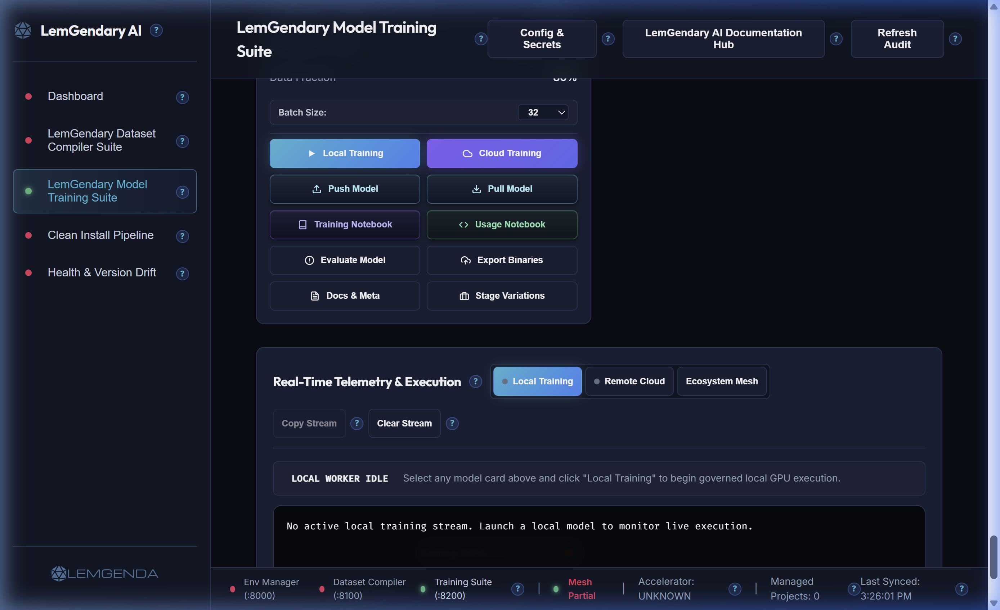

#### Telemetry Console Numbered Reference

1. **Local Training Telemetry Subtab**: Focuses the local training worker log stream, displaying minibatch loss, learning rate decay, gradient norms, and spatial ladder transitions.
2. **Remote Cloud Telemetry Subtab**: Focuses the remote cloud execution log stream, relaying stdout/stderr from dispatched Kaggle GPU kernels or Colab notebooks.
3. **Ecosystem Mesh Logs Subtab**: Focuses cross-daemon JSON-RPC events, HTTP health probes, and audit logs between Ports 8000, 8100, and 8200.
4. **Accessible Radix UI Progress Engine**: Displays active epoch iterations, batch counts, transfer bandwidth, and dynamic ETAs using a two-line layout: Line 1 for unconstrained numerical metrics and Line 2 for the glowing progress bar indicator. Extended with native tqdm and Ultralytics console pattern parsing (`elapsed<remaining`, e.g., `<01:29:22`), automatically stripping leading log timestamp prefixes to maintain clean `TRAINING` status classification and real-time remaining countdowns for YOLO and vision workflows.
5. **Monospace Terminal Output Stream**: High-performance scrolling container with full ANSI color parsing, in-place update roll-ups, rendering timestamps, log levels, and milestone records without redundant clutter.
6. **Stream Action Controls**:
   - `Copy Stream`: Copies the entire terminal buffer to system clipboard.
   - `Clear Stream`: Flushes the terminal display without disrupting background jobs.
   - `Halt Local Job` Dynamic Action Button: Sends an immediate abort signal (`POST /api/jobs/{id}/cancel`). The training engine hooks into inner minibatch iterations (via `on_train_batch_end`), setting `trainer.stop = True` within milliseconds, freeing GPU VRAM instantly without runaway execution.

| Callout # | UI Element | Control Type | Triggered Endpoint / Action | Operator Guide & Behavioral Safeguards |
| :--- | :--- | :--- | :--- | :--- |
| **1** | Local Training Tab | Subtab Switcher | `setActiveStreamTab("local")` | Streams local GPU worker logs, loss values, and ladder rungs. |
| **2** | Remote Cloud Tab | Subtab Switcher | `setActiveStreamTab("remote")` | Streams stdout/stderr from Kaggle and Colab cloud training jobs. |
| **3** | Ecosystem Mesh Tab | Subtab Switcher | `setActiveStreamTab("mesh")` | Streams cross-daemon RPC events and health telemetry. |
| **4** | Radix UI Progress | Accessible Widget | `@radix-ui/react-progress` | Two-line visual progress bar with unconstrained operational metrics. |
| **5** | Monospace Terminal | Log Container | Real-time WebSocket buffer | High-performance terminal container with in-place stream de-duplication. |
| **6** | Stream Controls | Action Buttons | Buffer sync / Job cancel | Copies log, clears screen, or issues sub-second training cancellation. |

---

### 6.4 Revamped Training Dashboard Topology & Interactive SOTA Inspection

The modern Training Panel employs a high-productivity split topology:

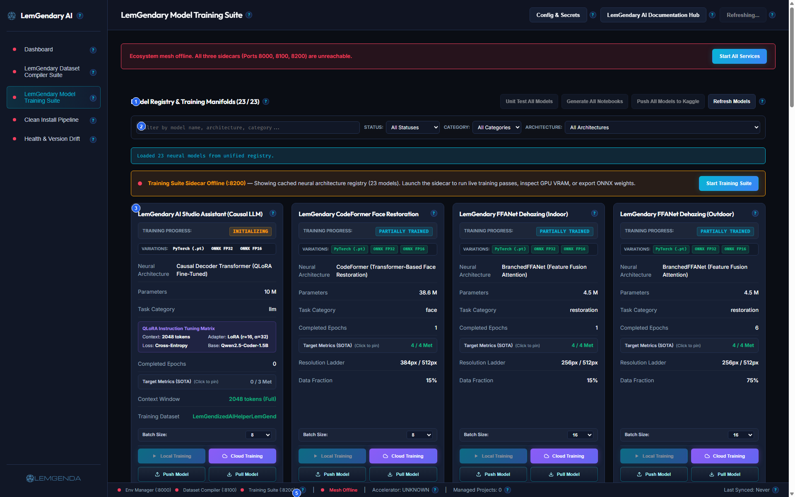

#### Training Dashboard Topology Numbered Reference

1. **Global Orchestrator Toolbar**: Houses high-level configuration controls, including real-time search, domain filtering, quick train presets, 1-epoch fleet diagnostic trigger, and batch notebook generation.
2. **Interactive Filter & Search Section**: Inline filter bar providing real-time model name search query input, machine learning domain selector (restoration, detection, classification, segmentation, forex), and spatial ladder rungs.
3. **Registered Neural Architecture Cards Grid**: Displays the active Model Card Grid with format variation badges, parameter counts, and inline ladder progress meters.
4. **Interactive Pinned/Persisted SOTA Popover**: Hovering over SOTA targets reveals all metrics, targets, and actual best scores; clicking pins the tooltip open for persistent comparison during training.
5. **Dual Local vs. Cloud Execution Triggers**: Card action buttons provide **"Local Training"** (local dispatch) and **"Cloud Training"** (opens the interactive Cloud & Registry Dispatch modal). Both triggers automatically focus the live telemetry stream below.

| Callout # | UI Element | Control Type | Triggered Endpoint / Action | Operator Guide & Behavioral Safeguards |
| :--- | :--- | :--- | :--- | :--- |
| **1** | Orchestrator Toolbar | Toolbar Container | Client-side filters & batch triggers | Controls fleet search, domain filtering, and batch automation. |
| **2** | Filter & Search Section | Input & Select Controls | Client-side filter | Filters models in real time by name, task domain, and ladder stage. |
| **3** | Model Cards Grid | Card Grid | `models_v2.json` scan | Displays architecture telemetry, ladder meters, and action buttons. |
| **4** | Pinned SOTA Popover | Popover Trigger | `HoverPinPopover.tsx` | Details convergence targets, current best scores, and baselines. |
| **5** | Execution Triggers | Action Buttons | Local training / Cloud dispatch | Dispatches local GPU execution or opens remote cloud modal. |

---

## 7. Evaluation, Export & Cloud Publishing to Kaggle and Google Drive

### 7.1 Real-Time Metrics & Live Loss Curves

During training, the GUI visualizes live training and validation loss curves:

- **Training Loss (Blue Line)**: Decreases as the model memorizes garden patterns.
- **Validation Loss (Green Line)**: Decreases as the model generalizes to new photos it has never seen before.
- **Perceptual Metrics**: PSNR (Peak Signal-to-Noise Ratio), SSIM (Structural Similarity), and mAP (mean Average Precision) are plotted in real time and recorded in `metrics.csv`.

### 7.2 Exporting to Universal Runtimes

Once training completes, you can export your trained model with a single click:

- **ONNX Export**: Generates fixed-shape `.onnx` files compatible with DirectML (Windows laptops), TensorRT (NVIDIA GPUs), OpenVINO (Intel processors), and web browsers (WebGPU).
- **Safetensors Weights**: Saves cryptographic, zero-copy weights free of arbitrary code execution vulnerabilities.

### 7.3 Publishing to Kaggle Models Hub & Cloud Registry

Clicking `Sync Kaggle Models Hub` on any registered architecture card opens the isolated multi-variation publishing workflow:

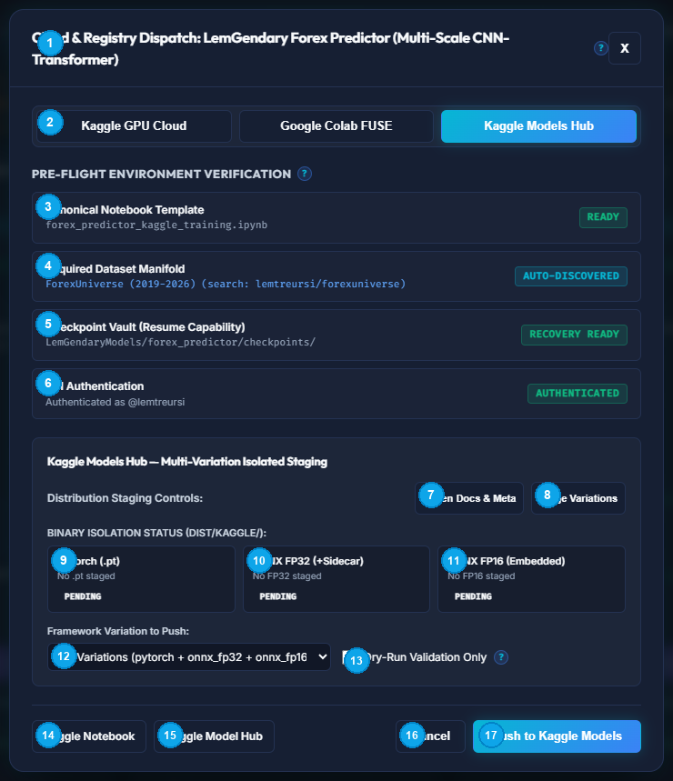

#### Cloud & Registry Dispatch Numbered Reference

1. **Modal Header & Model Identity**: Displays active model target (`LemGendary Forex Predictor`) alongside contextual guidance tooltip icon.
2. **Cloud Platform Switcher Buttons**: Three-way toggle button group switching between `Kaggle GPU Cloud`, `Google Colab FUSE`, and `Kaggle Models Hub` modes.
3. **Pre-Flight Canonical Notebook Template Row**: Verifies presence and AST syntax of canonical Kaggle training notebook template.
4. **Pre-Flight Required Dataset Manifold Row**: Confirms dataset manifold shards are registered in `unified_data.yaml` and ready for cloud mounting.
5. **Pre-Flight Checkpoint Vault Row**: Audits remote checkpoint vault status and validates cryptographic weight hashes.
6. **Pre-Flight API Authentication Row**: Verifies Kaggle API credentials (`kaggle.json`) loaded from the Secrets Vault are active and authenticated.
7. **Regen Docs & Meta Action Button**: Dispatches `POST /api/training/generate-docs`, regenerating Markdown Model Card (`README.md`) and `model-metadata.json`.
8. **Stage Variations Action Button**: Dispatches `POST /api/training/stage`, packaging binary artifacts into isolated directory trees under `dist/kaggle/`.
9. **PyTorch (.pt) Variation Card**: Displays binary isolation status, file size, and SHA256 checksum for native PyTorch weights.
10. **ONNX FP32 Variation Card**: Displays binary isolation status and verification metrics for the full-precision ONNX computational graph.
11. **ONNX FP16 Variation Card**: Displays binary isolation status and verification metrics for the half-precision ONNX graph.
12. **Framework Variation Select Dropdown**: Selects target payload to publish (`All Variations`, `PyTorch (.pt)`, `ONNX FP32`, or `ONNX FP16`).
13. **Dry-Run Validation Checkbox Toggle**: Enables dry-run validation mode to simulate isolation checks and folder verification without executing live cloud upload.
14. **Kaggle Notebook Link Button**: External navigation link opening the canonical remote training workbook on Kaggle.
15. **Kaggle Models Hub Link Button**: External navigation link opening the official model registry repository on Kaggle Models Hub.
16. **Cancel Action Button**: Dismisses the publishing dialog and returns to the Training Dashboard without mutating remote state.
17. **Push to Kaggle Models / Validate Isolation Button**: Authenticates and publishes verified multi-variation release weights to Kaggle Models Hub (or executes isolation check).

| Callout # | UI Element | Control Type | Triggered Endpoint / Action | Operator Guide & Behavioral Safeguards |
| :--- | :--- | :--- | :--- | :--- |
| **1** | Modal Header | Dialog Header | None | Confirms model identity and target publishing parameters. |
| **2** | Platform Switcher | Button Group | `setTargetPlatform()` | Switches between remote GPU compute dispatch and registry publishing. |
| **3** | Pre-Flight Notebook Template | Verification Row | Pre-flight checklist audit | Validates existence and syntax of canonical training notebook. |
| **4** | Pre-Flight Dataset Manifold | Verification Row | Pre-flight checklist audit | Confirms dataset manifold registration in `unified_data.yaml`. |
| **5** | Pre-Flight Checkpoint Vault | Verification Row | Pre-flight checklist audit | Audits remote checkpoint availability and cryptographic hashes. |
| **6** | Pre-Flight API Authentication | Verification Row | Pre-flight checklist audit | Verifies Kaggle API credentials loaded from Secrets Vault. |
| **7** | Regen Docs & Meta | Action Button | `POST /api/training/generate-docs` | Regenerates model card README and Kaggle metadata file. |
| **8** | Stage Variations | Action Button | `POST /api/training/stage` | Stages isolated variation folders under `dist/kaggle/`. |
| **9** | PyTorch Status Card | Status Card | Artifact scan | Displays isolation readiness of native PyTorch weights. |
| **10** | ONNX FP32 Status Card | Status Card | Artifact scan | Displays isolation readiness of 32-bit ONNX graph. |
| **11** | ONNX FP16 Status Card | Status Card | Artifact scan | Displays isolation readiness of half-precision ONNX graph. |
| **12** | Variation Select Dropdown | Select Dropdown | `setSelectedVariation()` | Selects target format variation to stage or publish. |
| **13** | Dry-Run Validation Toggle | Checkbox Input | `setDryRunOnly()` | Simulates isolation verification without remote cloud publishing. |
| **14** | Kaggle Notebook Link | External Link | Opens browser URL | Direct link opening remote Kaggle training notebook. |
| **15** | Kaggle Models Hub Link | External Link | Opens browser URL | Direct link opening model repository on Kaggle Models Hub. |
| **16** | Cancel Action Button | Secondary Button | `onCloseModal()` | Closes dialog cleanly without altering local or remote state. |
| **17** | Push to Kaggle / Validate | Primary Button | `POST /api/training/kaggle/push` | Publishes multi-variation release weights to Kaggle Models Hub. |

**Fleet Synchronization Note:** In addition to publishing individual model variations through the Cloud & Registry Dispatch dialog, operators can execute fleet-wide synchronization to stage, validate, and publish all 23 registered neural models and checkpoints to Kaggle Models Hub simultaneously using the `Push All Models to Kaggle` button in the Training Orchestrator Toolbar (Section 6.1) or via the Master CLI command (`lemtrain sync push --all`).

---

## 8. Health Matrix & Cross-Project Version Drift Analytics

In modern multi-project software suites, one project updating a shared library (like `torch` or `numpy`) while another stays on an older version causes insidious bugs. The LemGendary AI Studio provides continuous real-time cross-project dependency audits covering Python virtual environments and frontend desktop GUI NPM packages.

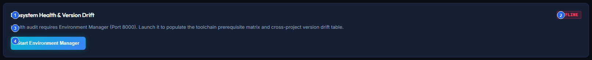

### 8.1 Toolchain Prerequisites, Python Drift Matrix & Desktop GUI NPM Packages

#### Health Matrix Numbered Reference

1. **Toolchain Prerequisites Section Header & Status**: Overview header inspecting host developer environment prerequisites with green `ALL PREREQUISITES VERIFIED` badge (Python 3.12.10, Git 2.47.1, Node 22.12.0).
2. **Cross-Project Python Version Drift Matrix**: Authoritative synchronization table comparing installed package versions across `lemgendary-env-manager`, `lemgendary-datasets`, and `lemgendary-training-suite`. Displays package names, target environments, and synchronization status pills (100% synchronized, zero version drift).
3. **Desktop GUI Project Packages (NPM) Card**: Dedicated audit card inspecting frontend dependencies of the Tauri/React desktop application (`lemgendary-ai-studio-gui`), verifying core packages such as `@tauri-apps/api`, `lucide-react`, `react`, `react-dom`, `recharts`, and `zustand`.
4. **Ecosystem Maintenance & Governance Controls**: Nuclear-hardened maintenance action buttons dispatched to port 8000 for safe package upgrades, cache purging, git hook synchronization, and multi-gate ecosystem validation.

| Callout # | UI Element | Control Type | Triggered Endpoint / Action | Operator Guide & Behavioral Safeguards |
| :--- | :--- | :--- | :--- | :--- |
| **1** | Toolchains Header | Section Heading | Platform audit | Flags whether all developer toolchains (Python, Git, Node) meet requirements. |
| **2** | Python Drift Matrix | Comparison Table | Manifest scan | Compares Python library versions across all backend sub-repositories. |
| **3** | Desktop GUI NPM Card | Package Table | `package.json` audit | Displays installed NPM package versions for the desktop GUI frontend. |
| **4** | Maintenance Controls | Action Buttons | `POST /api/...` | One-click maintenance buttons for upgrades, cache purge, and validation. |

---

### 8.2 Ecosystem Maintenance & Governance Controls

The Health and Maintenance view provides nuclear-hardened ecosystem maintenance controls backed by `lemgendary-env-manager` on port 8000:

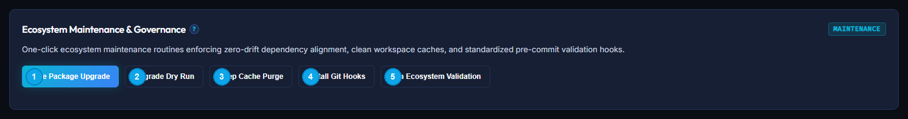

#### Ecosystem Maintenance Controls Numbered Reference

1. **Safe Package Upgrade Button**: Dispatches `POST /api/update` (`dry_run: false`), applying dependency upgrades in dependency-safe reverse topological order with automated rollback if `pip check` fails.
2. **Upgrade Dry Run Button**: Dispatches `POST /api/update` (`dry_run: true`), computing the safe upgrade plan and highlighting potential reverse dependency blockers without touching installed packages.
3. **Deep Cache Purge Button**: Dispatches `POST /api/clean`, recursively purging `__pycache__`, temporary files, build residues, and staging directories across all ecosystem repositories, reporting total bytes reclaimed.
4. **Install Git Hooks Button**: Dispatches `POST /api/hooks/install`, ensuring pre-commit hooks are active across all repositories to prevent commits that fail zero-emoji, compilation, or linting gates.
5. **Run Ecosystem Validation Button**: Dispatches `POST /api/validate`, executing the full multi-gate validation suite across all repositories and reporting per-project gate status.

| Callout # | UI Element | Control Type | Triggered Endpoint / Action | Operator Guide & Behavioral Safeguards |
| :--- | :--- | :--- | :--- | :--- |
| **1** | Safe Package Upgrade | Action Button | `POST /api/update` (`dry_run: false`) | Upgrades outdated packages safely with automated snapshot rollback. |
| **2** | Upgrade Dry Run | Action Button | `POST /api/update` (`dry_run: true`) | Previews candidate package upgrades without altering disk state. |
| **3** | Deep Cache Purge | Action Button | `POST /api/clean` | Purges bytecode, build caches, and temporary staging artifacts. |
| **4** | Install Git Hooks | Action Button | `POST /api/hooks/install` | Synchronizes and repairs mandatory pre-commit validation hooks. |
| **5** | Run Ecosystem Validation | Action Button | `POST /api/validate` | Executes multi-gate compilation, zero-emoji, and schema validation. |

---

## 9. Contextual UX Help & Interactive Hover Guidance System

Every single visual control across the AI Studio Desktop GUI features contextual interactive hover guidance engineered according to the Gardening Model Rule:

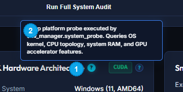

### 9.1 Interactive Hover Popovers & Safety Diagnostics

#### Contextual Help Numbered Reference

1. **Contextual Help Trigger Icon (`?`)**: Subtle, non-intrusive icon button positioned adjacent to card headers, input selectors, and action triggers. Focusing or hovering this trigger instantly opens the contextual guidance card.
2. **Interactive Floating Tooltip Bubble**: High-elevation guidance card detailing:
   - What the action does in plain English with zero jargon.
   - The underlying API endpoint or CLI script executed (`POST /api/...` or `python tools/...`).
   - Memory, disk, and hardware considerations (e.g. temporary staging requirements, VRAM allocation).
   - Practical recommendations and safety boundaries for non-technical users.

| Callout # | UI Element | Control Type | Triggered Endpoint / Action | Operator Guide & Behavioral Safeguards |
| :--- | :--- | :--- | :--- | :--- |
| **1** | Help Trigger Icon | Action Button | `onMouseEnter` / `onFocus` | Subtle `?` icon button triggering contextual explanation card. |
| **2** | Floating Guidance Bubble | Popover Card | `HelpTooltip.tsx` | Displays plain-English explanation, endpoints, and safety rules. |

---

## 10. Permanent Offline Documentation Hub & Online Synchronization

Reliability requires that complete engineering documentation is accessible at all times including on isolated workstations, offline air-gapped lab servers, or during broadband outages.

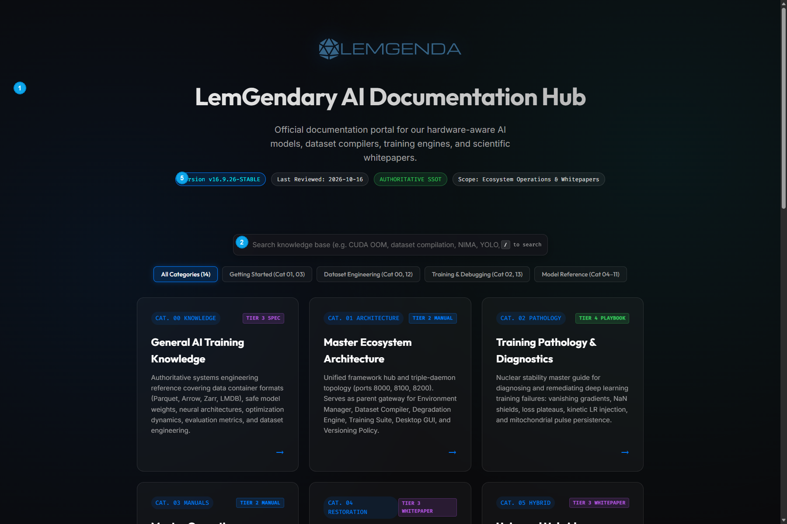

### 10.1 Local Static Offline Documentation Server

The Documentation Hub is bundled directly with the desktop client and permanently served locally at:

`http://localhost:1420/documentation-hub/index.html` (and mirrored by port 8000 at `http://127.0.0.1:8000/documentation-hub/index.html`)

#### Documentation Hub Interface Numbered Reference

1. **Documentation Hub Header & Brand Identity**: Displays the official `LemGendary AI Documentation Hub` header and verified local status pill.
2. **Live Client-Side Search Bar**: Instantaneous client-side search input filtering documents in real time across titles, descriptions, and categories (`Search documentation...`).
3. **Category Navigation Filters**: Segmented filter buttons enabling one-click category filtering across `All Documents`, `Whitepapers`, `Manuals`, `Architecture`, `Standards`, and `Guides`.
4. **Document Article Cards**: Rich documentation cards displaying canonical document titles, category tags, word counts, estimated reading times, and direct reading action links.
5. **Local Server Status & Network Indicators**: Verifies offline local serving readiness (`OFFLINE VERIFIED`), guaranteeing zero external network dependencies.

| Callout # | UI Element | Control Type | Triggered Endpoint / Action | Operator Guide & Behavioral Safeguards |
| :--- | :--- | :--- | :--- | :--- |
| **1** | Hub Header | Header Title | None | Displays official documentation hub identity and offline badge. |
| **2** | Live Search Bar | Search Input | Client-side filter | Filters all 46 scientific documents and manuals in real time. |
| **3** | Category Filters | Filter Buttons | `setCategoryFilter()` | Restricts article display by document category. |
| **4** | Document Cards | Article Card | Direct Link | Rich cards linking to full-text papers and operator manuals. |
| **5** | Offline Status Indicator | Status Pill | Local server health | Confirms 100% offline document availability with zero external assets. |

---

### 10.2 Live GitHub Pages Online Synchronization

For external collaboration, mobile reading, and research sharing, the Documentation Hub is synchronized with GitHub Pages:

`https://lemgenda.github.io/ai-training-whitepapers/index.html`

Both local and web documentation portals share identical CSS styling, SVG typography, and structural content, ensuring total parity across offline and online environments.

---

## 11. Tripartite Multi-Sidecar Network Architecture

The AI Studio GUI operates as a unified visual client communicating across three specialized background microservices. Endpoints are dynamically configured via a single source of truth registry (`src/api/config.ts`), supporting local execution, intranet microservices, or hosted cloud instances:

```text
+-----------------------------------------------------------------------+
|                 LemGendary AI Studio Desktop GUI                      |
|                  (Tauri / Rust / React / Vite)                        |
+-------------------+-------------------+-------------------------------+
                    |                   |
                    v                   v
+-----------------------+   +-----------------------+   +-----------------------+
|  Environment Manager  |   |    Dataset Compiler   |   |     Training Suite    |
|   (Default Port 8000) |   |  (Default Port 8100)  |   |  (Default Port 8200)  |
+-----------------------+   +-----------------------+   +-----------------------+
| * Hardware Probing    |   | * Manifold Synthesis  |   | * Architecture Models |
| * Venv Provisioning   |   | * WebP Transcoding    |   | * Sawtooth Governor   |
| * Secrets Vault       |   | * WebDataset Shards   |   | * Dynamic Ladders     |
| * Offline Docs Server |   | * Cloud Sync (Kaggle) |   | * Live Loss Curves    |
+-----------------------+   +-----------------------+   +-----------------------+
```

### 11.1 Dynamic Configuration & Environment Overrides

Endpoint addresses and ports are completely decoupled from code literals. Production and remote environments can override service locations via standard environment variables:

- `VITE_ENV_MANAGER_URL`: Base HTTP URL for the Environment Manager (default: `http://127.0.0.1:8000`).
- `VITE_DATASET_COMPILER_URL`: Base HTTP URL for the Dataset Compiler Suite (default: `http://127.0.0.1:8100`).
- `VITE_TRAINING_SUITE_URL`: Base HTTP URL for the Model Training Suite (default: `http://127.0.0.1:8200`).

The `toWebSocketUrl()` utility parses HTTP/HTTPS URLs and maps them automatically to corresponding `ws://` or `wss://` protocols, providing seamless transition from local loopback ports to secure TLS cloud deployments.

### 11.2 Semantic Origin Routing & Telemetry Stream Governance

Telemetry event streams are classified using semantic origin routing rather than brittle port number or regex guessing:

- Training Suite logs attach connection origin `training-suite` and route exclusively to the Model Training telemetry console.
- Dataset Compiler logs attach connection origin `dataset-compiler` and route exclusively to the Compiler panel.
- Consecutive rapid carriage-return progress ticks (`\r`) roll up in-place via `rollupTelemetryEvents()`, keeping the active progress state visible at the terminal cursor while preserving discrete loss metrics, learning rates, checkpoint saves, and milestone events in terminal history.

---

## 12. Automated Testing & Ecosystem Quality Assurance

To guarantee system stability, the LemGendary ecosystem includes extensive automated test batteries across all projects. You can verify the health of the entire suite at any time:

### Desktop GUI Test Battery

The Desktop GUI includes dedicated Vitest unit and integration test suites:

```bash
cd lemgendary-ai-studio-gui
npm test
```

Verifies that the Centralized Zustand Store, Sidecar Service Probes, Telemetry Stream Buffers, and Navigation Matrix execute with zero failures.

### Python Ecosystem Quality Assurance

You can run automated validation across all backend projects using the unified CLI:

```bash
# Validate individual projects
lem-env validate --project lemgendary-env-manager
lem-env validate --project lemgendary-datasets
lem-env validate --project lemgendary-training-suite
lem-env validate --project lemgendary-ai-studio-gui
lem-env validate --project lemgendary-docs

# Or run complete multi-project ecosystem audit
lem-env validate --all
```

### Documentation & Whitepaper Integrity Verification

The documentation test suite executes 36 automated validation gates:

```bash
pytest lemgendary-docs/tests/test_documentation.py
```

Every test verifies strict code compliance, dependency lockfile validity, markdown link integrity, LaTeX formula rendering, and the absolute absence of emojis across all codebases and documentation.
