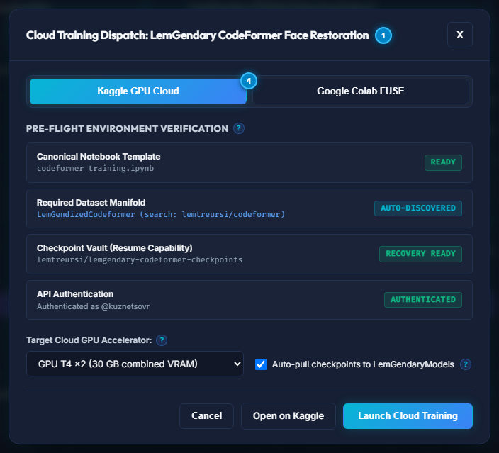

# LemGendary AI Studio GUI: Comprehensive Operator Manual

## Category 03 | LemGendary AI Documentation Hub | Master Operations Manual

**Authoritative Desktop Client Release**: `v2.0.0` (Tauri v2 Native Desktop Cockpit)
**Target Backend Ecosystem**: `v16.9.16-STABLE` (Tripartite Sidecar Topology: Ports 8000, 8100, 8200)
**Parent Authority**: [Master Ecosystem Architecture](file:///c:/Development/python/model-training/lemgendary-docs/MD-Papers/ECOSYSTEM_ARCHITECTURE.md) · [Document Authority Hierarchy & Versioning Policy](file:///c:/Development/python/model-training/lemgendary-docs/MD-Papers/VERSIONING_POLICY.md)

---

## Table of Contents

- [1. Abstract & The Gardening Model Philosophy](#1-abstract--the-gardening-model-philosophy)
- [2. Interface Topology & Visual Navigation Matrix](#2-interface-topology--visual-navigation-matrix)
  - [2.1 Workspace Global Shell Elements & Numbered Navigation Guide](#21-workspace-global-shell-elements--numbered-navigation-guide)
  - [2.5 Tripartite Sidecar Process Control & Auto-Start](#25-tripartite-sidecar-process-control--auto-start)
  - [2.6 Centralized State Architecture (Zustand) & Modular Micro-Components](#26-centralized-state-architecture-zustand--modular-micro-components)
- [3. Universal Configuration & Secrets Vault](#3-universal-configuration--secrets-vault)
  - [3.1 Central Manifest Registry Editor](#31-central-manifest-registry-editor)
  - [3.2 Secrets & Cloud Tokens Vault](#32-secrets--cloud-tokens-vault)
- [4. One-Click Environment Setup: The 7-Stage Clean Install Pipeline](#4-one-click-environment-setup-the-7-stage-clean-install-pipeline)
  - [4.1 Pipeline Orchestrator Control Card](#41-pipeline-orchestrator-control-card)
  - [4.2 Individual Pipeline Step Execution Cards](#42-individual-pipeline-step-execution-cards)
  - [4.3 Hardware Acceleration Sentinel Card](#43-hardware-acceleration-sentinel-card)
  - [4.4 Managed Workspace Projects Health Cards](#44-managed-workspace-projects-health-cards)
- [5. Dataset Compilation Pipeline: Modernization, Direct Kaggle Ingestion & Streaming Manifolds](#5-dataset-compilation-pipeline-modernization-direct-kaggle-ingestion--streaming-manifolds)
  - [5.1 Dataset Compiler & Modernization Control Card](#51-dataset-compiler--modernization-control-card)
  - [5.2 Production Manifolds Catalog, Upstream Lineage & One-Click Cloud Sync](#52-production-manifolds-catalog-upstream-lineage--one-click-cloud-sync)
  - [5.3 Modernization Queue & Scale Reduction Workflows](#53-modernization-queue--scale-reduction-workflows)
  - [5.4 Embedded Dataset Telemetry Console](#54-embedded-dataset-telemetry-console)
- [6. Model Training Pipeline: Architectures, Ladders & Sawtooth Governor](#6-model-training-pipeline-architectures-ladders--sawtooth-governor)
  - [6.1 Model Training Suite & Model Orchestration Toolbar](#61-model-training-suite--model-orchestration-toolbar)
  - [6.2 Registered Architectures & Checkpoint Telemetry Grid](#62-registered-architectures--checkpoint-telemetry-grid)
  - [6.3 Interactive Cloud Training Modal](#63-interactive-cloud-training-modal)
  - [6.4 Three-Tab Real-Time Telemetry Stream & Responsive Cancellation](#64-three-tab-real-time-telemetry-stream--responsive-cancellation)
  - [6.5 Revamped Training Dashboard Topology & Interactive SOTA Inspection](#65-revamped-training-dashboard-topology--interactive-sota-inspection)
- [7. Evaluation, Export & Cloud Publishing to Kaggle and Google Drive](#7-evaluation-export--cloud-publishing-to-kaggle-and-google-drive)
- [8. Health Matrix & Cross-Project Version Drift Analytics](#8-health-matrix--cross-project-version-drift-analytics)
  - [8.1 Toolchain Prerequisites, Python Drift Matrix & Desktop GUI NPM Packages](#81-toolchain-prerequisites-python-drift-matrix--desktop-gui-npm-packages)
  - [8.2 Ecosystem Maintenance & Governance Controls](#82-ecosystem-maintenance--governance-controls)
- [9. Contextual UX Help & Interactive Hover Guidance System](#9-contextual-ux-help--interactive-hover-guidance-system)
  - [9.1 Interactive Hover Popovers & Safety Diagnostics](#91-interactive-hover-popovers--safety-diagnostics)
- [10. Permanent Offline Documentation Hub & Online Synchronization](#10-permanent-offline-documentation-hub--online-synchronization)
  - [10.1 Local Static Offline Documentation Server](#101-local-static-offline-documentation-server)
  - [10.2 Live GitHub Pages Online Synchronization](#102-live-github-pages-online-synchronization)
- [11. Tripartite Multi-Sidecar Network Architecture](#11-tripartite-multi-sidecar-network-architecture)
- [12. Automated Testing & Ecosystem Quality Assurance](#12-automated-testing--ecosystem-quality-assurance)

---

## 1. Abstract & The Gardening Model Philosophy

The **LemGendary AI Studio Desktop GUI** is a hardware-aware, nuclear-hardened command center engineered to make deep learning dataset synthesis, neural network training, and cloud deployment accessible to everyone from senior machine learning researchers to high school students and non-technical hobbyists.

### The Gardening Model Rule

To ensure absolute operational clarity, every control, workflow, and safeguard in this manual is designed according to the **Gardening Model Rule**:

> *If a 75-year-old grandmother wants to train an AI model using photos of her garden roses, tomato plants, and soil to automatically detect plant diseases and enhance low-light garden photographs, she should be able to complete the entire pipeline from environment setup to Kaggle cloud publishing purely by clicking intuitive buttons in the GUI, with zero command-line commands, zero code editing, and zero risk of freezing her computer.*

The system achieves this through three foundational engineering principles:

1. **Deterministic One-Click Automation**: All complex toolchains, Python virtual environments, CUDA drivers, wheel resolutions, and dependencies are provisioned automatically through the 7-Stage Clean Install Pipeline.
2. **Nuclear Memory Protection (The Sawtooth Governor)**: When training complex vision models, the GUI continuously probes hardware VRAM. If memory approaches capacity, the system automatically downscales batch sizes and applies dynamic gradient accumulation, guaranteeing that your machine never suffers an Out-of-Memory (OOM) crash or system freeze.
3. **Comprehensive Contextual Guidance**: Every single interactive button, switch, input field, and status indicator is accompanied by a contextual hover icon (`?`) delivering instant, plain-English explanations of what the control does, what files are affected, and what safeguards are active.


---

## 2. Interface Topology & Visual Navigation Matrix

The AI Studio interface is organized into persistent visual regions designed for ergonomic operation. Every element, card, and control in the live interface is indexed below with corresponding operational workflows and safety boundaries.


### 2.1 Workspace Global Shell Elements & Numbered Navigation Guide

The live screen capture above displays the complete primary application frame including header, persistent sidebar navigation, active dashboard viewport, and the sticky status footer:

1. **Brand Title & Brand Icon**: Displays `LemGendary AI` alongside the official vector icon (`lemgenda-icon.svg`). Clicking the header identity opens the official portal `https://www.lemgenda.hr/`.
2. **Config & Secrets Header Action Button**: Opens the Universal Configuration, Registry Editor & Secrets Vault Modal for editing YAML manifests and managing Kaggle, Google Drive, GitHub, and MT5 API tokens directly from the top navigation bar.
3. **Docs Hub (Offline) Action Button**: Launches the local offline Documentation Hub served by the desktop client and Environment Manager sidecar at `http://localhost:1420/documentation-hub/index.html`. Guarantees full offline documentation access during field deployments.
4. **Refresh Audit Telemetry Button**: Triggers an instantaneous asynchronous background scan across physical accelerators, GPU VRAM, system memory, project virtual environments, and manifest version drift.
5. **Dashboard Tab Selector**: Switches primary viewport to the main system dashboard, rendering hardware sentinel cards, sidecar process tiles, project health cards, and the real-time event console.
6. **Dataset Compiler Tab Selector**: Switches primary viewport to the LemGendary Dataset Compiler Suite (`.\lemgendary-datasets\`), streaming manifold compiler, direct Kaggle ingestion interface, Kaggle synchronization hub, and verified manifold catalog.
7. **Model Training Tab Selector**: Switches primary viewport to the LemGendary Model Training Suite (`.\lemgendary-training-suite\`), neural architecture matrix, Sawtooth Governor VRAM controls, progressive spatial ladders, and training dispatch orchestrator.
8. **Clean Install Pipeline Tab Selector**: Switches primary viewport to the dedicated 7-stage deterministic environment provisioning and toolchain verification sequence.
9. **Health & Version Drift Tab Selector**: Switches primary viewport to host prerequisite audits, Python cross-project version drift comparison matrix, Desktop GUI Project Packages (NPM) audit, and ecosystem maintenance actions.
10. **Brand Signature Logo Sidebar Footer**: Anchors the persistent sidebar with the official vector brand signature (`lemgenda-logo.svg`), providing a direct link to `https://www.lemgenda.hr/`.
11. **System Status Bar Indicator**: Live sticky footer status indicator permanently visible at the bottom of the viewport, reporting real-time connectivity and operational health across all active sidecar services.

| Callout # | UI Element | Control Type | Triggered Endpoint / Action | Operator Guide & Behavioral Safeguards |
| :--- | :--- | :--- | :--- | :--- |
| **1** | Brand Title & Icon | Navigation Link | `window.open('https://www.lemgenda.hr/')` | Displays official brand icon and title; links to web home. |
| **2** | Config & Secrets | Header Action Button | `setIsConfigEditorOpen(true)` | Launches modal dialog for manifest editing and secret management. |
| **3** | Docs Hub (Offline) | Action Button | `window.open('/documentation-hub/')` | Opens browser window to local offline documentation server. |
| **4** | Refresh Audit | Action Button | `POST /api/audit` | Queries all three sidecars to refresh hardware metrics and venv health. |
| **5** | Dashboard Tab | Navigation Button | `setCurrentTab("dashboard")` | Navigates to central system overview, hardware sentinel, and launcher tiles. |
| **6** | Dataset Compiler Tab | Navigation Button | `setCurrentTab("datasets")` | Navigates to LemGendary Dataset Compiler Suite and manifold catalog. |
| **7** | Model Training Tab | Navigation Button | `setCurrentTab("training")` | Navigates to LemGendary Model Training Suite and model orchestration grid. |
| **8** | Clean Install Tab | Navigation Button | `setCurrentTab("pipeline")` | Navigates to the automated 7-step clean install pipeline. |
| **9** | Health & Drift Tab | Navigation Button | `setCurrentTab("health")` | Navigates to Python drift matrix, Desktop GUI NPM packages, and maintenance. |
| **10** | Brand Signature Logo | Navigation Link | `window.open('https://www.lemgenda.hr/')` | Persistent sidebar brand signature linking to corporate portal. |
| **11** | System Status Bar | Status Indicator | Real-time WebSocket Heartbeat | Sticky footer reporting global operational health and network readiness. |

---

### 2.5 Tripartite Sidecar Process Control & Auto-Start

The Ecosystem Sidecar Services grid permanently monitors and coordinates the three local microservices:

- **LemGendary Environment Manager (`Port 8000`)**: Core orchestrator and validation authority (`.\lemgendary-env-manager\`).
- **LemGendary Dataset Compiler Suite (`Port 8100`)**: Manifold compiler and streaming storage server (`.\lemgendary-datasets\`).
- **LemGendary Model Training Suite (`Port 8200`)**: Neural architecture training and evaluation engine (`.\lemgendary-training-suite\`).


#### Ecosystem Sidecar Cards Numbered Reference

1. **Environment Manager Service Card**: Identifies the primary port 8000 governance daemon governing virtual environments, hardware discovery, and registry validation (`ONLINE`, PID, uptime, active endpoints).
2. **Dataset Compiler Suite Service Card**: Identifies the port 8100 service managing WebDataset, Parquet, and MDS manifolds (`ONLINE`, PID, uptime, direct navigation button).
3. **Model Training Suite Service Card**: Identifies the port 8200 service managing PyTorch neural architectures, Sawtooth Governor VRAM safeguards, and training ladders (`ONLINE`, PID, uptime, direct navigation button).
4. **Run Full System Audit Action Button**: Dispatches deterministic hardware, dependency, and manifest inspection across all workspace projects (`POST /api/audit`).

| Callout # | UI Element | Control Type | Triggered Endpoint / Action | Operator Guide & Behavioral Safeguards |
| :--- | :--- | :--- | :--- | :--- |
| **1** | Env Manager Card | Service Tile | `GET http://127.0.0.1:8000/health` | Shows connection readiness, PID, and uptime. Probed every 4 seconds. |
| **2** | Compiler Suite Card | Service Tile | `GET http://127.0.0.1:8100/health` | Shows compiler daemon readiness with direct navigation button. |
| **3** | Training Suite Card | Service Tile | `GET http://127.0.0.1:8200/health` | Shows training daemon readiness with direct navigation button. |
| **4** | Run Full System Audit | Action Button | `POST http://127.0.0.1:8000/api/audit` | Dispatches non-blocking complete audit across all workspace repositories. |

---

### 2.6 Centralized State Architecture (Zustand) & Modular Micro-Components

To ensure instantaneous UI responsiveness, eliminate prop drilling, and prevent race conditions when streaming high-frequency training metrics, the application state is managed by a centralized Zustand store (`src/store/useStudioStore.ts`):

1. **Ecosystem Mesh Health**: Persists real-time connection status across the tripartite sidecars (Ports 8000, 8100, 8200) with automatic re-poll triggers.
2. **Global Telemetry Ring Buffer**: Maintains high-throughput terminal events with ANSI color parsing, regex filtering, and clipboard synchronization.
3. **Hardware Accelerators**: Caches GPU VRAM profiles, temperature sensors, and compute utilization matrices.
4. **Active Job Management**: Coordinates running training and compilation processes with instant stop signals.
5. **Shared Micro-Components**:
   - `ValidationBanner.tsx`: Centralized banner component with auto-detected severity (`info`, `success`, `warning`, `error`), dismiss handlers, and full accessibility semantics.
   - `HoverPinPopover.tsx`: High-performance CSS hover and native semantic `<button>` pin popovers for SOTA targets and upstream sources.

---

## 3. Universal Configuration & Secrets Vault

Deep learning workflows require interacting with external registries, storage backends, and cloud repositories. The AI Studio GUI integrates an in-app Universal Configuration & Secrets Vault modal accessible via the `Config & Secrets` header button.

### 3.1 Central Manifest Registry Editor


#### Manifest Registry Editor Numbered Reference

1. **Configuration Editor Modal Title**: Header identifying the central configuration and manifest governance workspace.
2. **Registry Manifests Subtab Switcher**: Selects the central YAML configuration and registry manifest editing workspace.
3. **Secrets & Tokens Vault Subtab Switcher**: Switches modal view to encrypted cloud credentials and API token management.
4. **Target Manifest Selector Dropdown**: Selects from ecosystem manifests including `unified_data.yaml` (dataset definitions), `unified_models_v2.yaml` (architecture registry), `unified_requirements.yaml` (dependency SSOT), and `.secrets.yaml`.
5. **Validate Syntax Button**: Executes in-memory YAML parsing and schema validation without writing to disk, reporting structural errors before persistence.
6. **Hot-Reload Services Button**: Triggers in-flight configuration reload across active sidecar daemons without restarting processes.
7. **Create Backup Button**: Generates a timestamped snapshot of the active configuration manifest prior to edits.
8. **Save Manifest Button**: Persists verified modifications to disk using atomic temporary write staging and creates a backup copy.
9. **Monospace Manifest Code Editor**: Full-height in-browser text editor providing direct inspection and modification of central configuration files.
10. **Modal Close Button**: Safely dismisses configuration modal and returns to previous workspace view.

| Callout # | UI Element | Control Type | Triggered Endpoint / Action | Operator Guide & Behavioral Safeguards |
| :--- | :--- | :--- | :--- | :--- |
| **1** | Modal Title | Modal Heading | None | Identifies configuration workspace and active target file. |
| **2** | Manifests Tab | Subtab Button | `setActiveTab("manifests")` | Activates central YAML code editor and schema linter. |
| **3** | Secrets Tab | Subtab Button | `setActiveTab("secrets")` | Activates credentials and token management profiles. |
| **4** | Manifest Dropdown | Select Dropdown | `fetchManifest(selected)` | Loads selected file into memory and populates editor view. |
| **5** | Validate Syntax | Action Button | `POST /api/manifests/validate` | Validates YAML syntax and schema without altering files on disk. |
| **6** | Hot-Reload Services | Action Button | `POST /api/manifests/reload` | Triggers sidecar configuration reload without process restarts. |
| **7** | Create Backup | Action Button | `POST /api/manifests/backup` | Writes timestamped backup copy to `backups/` directory. |
| **8** | Save Manifest | Primary Button | `POST /api/manifests/save` | Writes changes atomically and triggers hot-reload across active sidecars. |
| **9** | Monospace Editor | Textarea Editor | `setCurrentContent(e.target.value)` | Displays raw configuration text with monospaced indentation. |
| **10** | Modal Close | Action Button | `setIsConfigEditorOpen(false)` | Closes dialog without persisting uncommitted text. |

---

### 3.2 Secrets & Cloud Tokens Vault


#### Secrets & Tokens Vault Numbered Reference

1. **Configuration Editor Modal Title**: Header confirming active credentials and token management workspace.
2. **Active Cloud Service Profile Badge**: Visual badge identifying service provider (e.g. `Kaggle`, `Google Drive`, `GitHub`, `MetaTrader 5`).
3. **Requirement Level Badge**: Clearly flags mandatory vs optional platform dependencies (`MANDATORY` for Kaggle API access, `OPTIONAL` for secondary mirrors).
4. **Toggle Add New Secret Form Button**: Expands interactive credential registration form to add additional service accounts.
5. **Save All Secrets & Synchronize Button**: Persists all registered credentials to encrypted `.secrets.yaml` and propagates legacy single-token files (`.kaggle_token`, `.kaggle_users`, `.mt5_credentials`).
6. **New Secret Service Type Dropdown**: Selects target cloud platform for new credential entry.
7. **Secret Label / Description Input**: Human-readable label for credential identification (e.g. `Personal Primary Account`).
8. **Account Username / Identifier Input**: Cloud service username or account identifier.
9. **API Token / Credential Secret Input Field**: Cloud API token, key, or private secret password.
10. **Add Secret Submit Button**: Adds the validated credential pair to the active in-memory vault profile.

| Callout # | UI Element | Control Type | Triggered Endpoint / Action | Operator Guide & Behavioral Safeguards |
| :--- | :--- | :--- | :--- | :--- |
| **1** | Modal Title | Modal Heading | None | Identifies secrets management dialog. |
| **2** | Service Badge | Status Pill | None | Displays service profile identity. |
| **3** | Requirement Level | Badge Indicator | None | Differentiates mandatory core services from optional cloud mirrors. |
| **4** | + Add New Secret | Action Button | `setIsAddingSecret(!isAddingSecret)` | Toggles new credential registration form with service dropdown. |
| **5** | Save All Secrets | Primary Button | `POST /api/secrets/save` | Encrypts vault to disk, writes backup, and syncs legacy credential files. |
| **6** | Service Type | Select Dropdown | `setNewService(e.target.value)` | Selects target cloud platform: Kaggle, Google Drive, GitHub, MT5. |
| **7** | Secret Label | Text Input | `setNewLabel(e.target.value)` | Descriptive tag for account differentiation. |
| **8** | Account Username | Text Input | `setNewUsername(e.target.value)` | Service login or API user identifier. |
| **9** | Secret Token | Password Input | `setNewSecret(e.target.value)` | Secret token or private key string. Masked in UI. |
| **10** | Add Secret Submit | Primary Button | Form Submission | Appends verified credential to active profile staging area. |

---

## 4. One-Click Environment Setup: The 7-Stage Clean Install Pipeline

Before training an AI model, your computer must have the correct software libraries installed. Traditionally, this required typing dozens of cryptic terminal commands. The AI Studio eliminates this completely through the automated 7-Stage Clean Install Pipeline.

### 4.1 Pipeline Orchestrator Control Card


#### Clean Install Pipeline Numbered Reference

1. **Pipeline Orchestrator Title & Help Glyph**: Header detailing deterministic 7-step environment recreation and toolchain verification.
2. **Execute Full Clean Install Pipeline Button**: Launches sequential execution of all seven stages in background worker threads without opening terminal consoles.
3. **Active Stage Progress Bar**: Visual meter showing real-time pipeline execution progress from Stage 1 through Stage 7.
4. **Pipeline Execution State Badge**: Displays cyan `READY` when idle, or amber `PIPELINE ACTIVE` during background execution.

| Callout # | UI Element | Control Type | Triggered Endpoint / Action | Operator Guide & Behavioral Safeguards |
| :--- | :--- | :--- | :--- | :--- |
| **1** | Pipeline Title | Section Heading | None | Contextual heading explaining zero-command environment setup. |
| **2** | Execute Full Pipeline | Primary Button | `POST /api/pipeline/trigger` | Starts autonomous 7-step provisioning sequence without terminal commands. |
| **3** | Progress Bar | Visual Meter | Real-time WebSocket updates | Displays active completion percentage across all steps. |
| **4** | State Badge | Status Badge | `GET /api/pipeline/status` | Confirms whether pipeline workers are idle or running. |

---

### 4.2 Individual Pipeline Step Execution Cards

In addition to running the full automated sequence, operators can execute individual stages in isolation for granular troubleshooting, inspection, and rapid re-verification:


#### Pipeline Step Execution Cards Numbered Reference

1. **Stage 1 Card Title (Hardware & Platform Discovery)**: Probes host platform, CPU architecture, system RAM, NVIDIA driver levels, CUDA compute capabilities, cuDNN, and TensorRT availability.
2. **Stage 1 Run Step Action Button**: Dispatches isolated execution of Step 1 (`POST /api/pipeline/run-step?step=1`), refreshing system hardware telemetry without touching virtual environments.
3. **Stage 2 Card Title (Ecosystem Prerequisites Audit)**: Validates host toolchain requirements (Python 3.10+, Git SCM, Node.js, and npm).
4. **Stage 2 Run Step Action Button**: Dispatches isolated execution of Step 2 (`POST /api/pipeline/run-step?step=2`), verifying host prerequisites against ecosystem requirements.
5. **Stage 3 Card Title (Virtual Environments Provisioning)**: Audits and safely provisions isolated Python virtual environments (`.venv`) across all managed repositories.
6. **Stage 3 Run Step Action Button**: Dispatches isolated execution of Step 3 (`POST /api/pipeline/run-step?step=3`), recreating missing or corrupted `.venv` folders idempotently.
7. **Stage 4 Card Title (Requirements Sync & Wheel Installation)**: Propagates centralized dependencies from `unified_requirements.yaml` and installs verified binary wheels.
8. **Stage 4 Run Step Action Button**: Dispatches isolated execution of Step 4 (`POST /api/pipeline/run-step?step=4`), synchronizing packages and installing missing dependencies.

*Note: Stages 5 (Cross-Project Dependencies Reconciliation), 6 (Manifest & Storage Directory Alignment), and 7 (System Health Matrix Certification) feature identical dedicated execution cards enabling single-click granular validation.*

| Callout # | UI Element | Control Type | Triggered Endpoint / Action | Operator Guide & Behavioral Safeguards |
| :--- | :--- | :--- | :--- | :--- |
| **1** | Stage 1 Title | Card Heading | None | Identifies hardware and compute acceleration discovery stage. |
| **2** | Stage 1 Run Step | Action Button | `POST /api/pipeline/run-step?step=1` | Runs hardware probe in background worker thread. |
| **3** | Stage 2 Title | Card Heading | None | Identifies toolchain prerequisite verification stage. |
| **4** | Stage 2 Run Step | Action Button | `POST /api/pipeline/run-step?step=2` | Runs toolchain prerequisites audit. |
| **5** | Stage 3 Title | Card Heading | None | Identifies virtual environments provisioning stage. |
| **6** | Stage 3 Run Step | Action Button | `POST /api/pipeline/run-step?step=3` | Recreates and verifies project `.venv` structures. |
| **7** | Stage 4 Title | Card Heading | None | Identifies requirements synchronization and wheel install stage. |
| **8** | Stage 4 Run Step | Action Button | `POST /api/pipeline/run-step?step=4` | Installs verified dependencies from unified manifests. |

---

### 4.3 Hardware Acceleration Sentinel Card

The Hardware Acceleration Sentinel Card is permanently visible on the central Dashboard, delivering an un-truncated live readout of physical compute capabilities:


#### Hardware Architecture Card Numbered Reference

1. **Primary Accelerator Backend Badge**: Highlights active execution engine (`CUDA`, `DIRECTML`, `ROCM`, or `CPU`) alongside the `System & Hardware Architecture` section header.
2. **Host Operating System & Python Runtime**: Confirms operating system release (`Windows 11, AMD64`) and active Python interpreter binary (`3.12.10`).
3. **Host Memory Allocation & Recommended PyTorch Index**: Displays physical host RAM capacity (`32,486 MB`), CPU core allocation (`12 / 6 Cores`), and the authoritative PyTorch CUDA 12.6 binary wheel index link.
4. **Detected Physical Accelerators & Dedicated VRAM**: Displays GPU device model (`NVIDIA GeForce RTX 3060 Laptop GPU`), installed driver revision (`576.88`), and dedicated video memory capacity (`6,144 MB`).

| Callout # | UI Element | Control Type | Triggered Endpoint / Action | Operator Guide & Behavioral Safeguards |
| :--- | :--- | :--- | :--- | :--- |
| **1** | Accelerator Badge | Status Pill | `env_manager.system_probe` | Displays primary execution backend and sentinel header. |
| **2** | OS & Python Runtime | Metric Row | `platform.platform()` / `sys.version` | Verifies operating system and Python 3.10+ requirement compliance. |
| **3** | RAM & PyTorch Index | Metric Row | `psutil.virtual_memory()` | Displays host memory capacity and official PyTorch CUDA index link. |
| **4** | GPU & Dedicated VRAM | Device Metric | CUDA / DirectML hardware probe | Details physical GPU model, driver level, and dedicated video memory. |

---

### 4.4 Managed Workspace Projects Health Cards

The Project Environments overview on the Dashboard displays dedicated cards for each sub-project in the ecosystem. All cards display clean relative paths without exposing sensitive host absolute paths:


#### Managed Projects Grid Numbered Reference

1. **Managed Workspace Project Title**: Card identifying the managed project with canonical uniform naming (e.g. `1. LemGendary Environment Manager`, `2. LemGendary Dataset Compiler Suite`, `3. LemGendary Model Training Suite`, `4. LemGendary AI Studio GUI`, `5. LemGendary AI Documentation Hub`).
2. **Project Health Badge**: Displays green `HEALTHY` when virtual environment and installed packages match manifest specifications.
3. **Installed Packages & Status Metric Row**: Displays total installed library count and environment synchronization status.
4. **Reconcile Virtual Environment Button**: Triggers single-project dependency alignment to restore missing wheels and reconcile version drift.

| Callout # | UI Element | Control Type | Triggered Endpoint / Action | Operator Guide & Behavioral Safeguards |
| :--- | :--- | :--- | :--- | :--- |
| **1** | Project Title | Card Heading | None | Canonical uniform project title; relative path shown. |
| **2** | Health Badge | Status Badge | `GET /api/health` | Shows isolated `.venv` validity and manifest conformance. |
| **3** | Packages Metric | Metric Row | `pip list` / manifest scan | Displays total installed package count and synchronization status. |
| **4** | Reconcile Button | Action Button | `POST /api/pipeline/reconcile?project={name}` | Recreates `.venv` and reconciles missing wheels for selected project. |

---

## 5. Dataset Compilation Pipeline: Modernization, Direct Kaggle Ingestion & Streaming Manifolds

High-velocity deep learning requires converting raw, loose image files into modern streaming containers. Traditional loose-image folders cause OS filesystem freezes when training models on hundreds of thousands of images. The LemGendary Dataset Compiler tab provides a complete visual control center for dataset synthesis, direct cloud ingestion, and bidirectional Kaggle synchronization.

### 5.1 Dataset Compiler & Modernization Control Card

The top card of the Dataset Compiler tab governs manifold synthesis and streaming storage conversion:


#### Dataset Compiler Control Card Numbered Reference

1. **Dataset Compiler & Storage Modernization Title & Help Glyph**: Header detailing streaming container synthesis alongside the interactive hover guidance tooltip (`?`).
2. **Compilation Mode Switcher**: Toggles between `Standard Manifold Presets` (compiling registered manifests) and `Direct Kaggle Ingestion` (pulling external Kaggle datasets directly into streaming containers).
3. **Target Manifold Dropdown Selector**: Selects dataset to modernize from registered definitions in `unified_data.yaml` (e.g. `LemGendized Super-Resolution Master`).
4. **Storage Preset & Partition Parameters**: Selects container architecture (`Streaming WebDataset Shards`, `Columnar Parquet`, `MosaicML MDS`, `LitData`), `Samples Per Shard` (default: `5,000` samples per shard yielding 300MB–400MB archives), and the `Purge Loose Images` toggle.
5. **Compile Manifold Primary Action Button**: Dispatches multi-threaded background workers (`POST /api/gui/quick-compile`) executing in-flight 12-thread WebP transcoding and container partition writing.

| Callout # | UI Element | Control Type | Triggered Endpoint / Action | Operator Guide & Behavioral Safeguards |
| :--- | :--- | :--- | :--- | :--- |
| **1** | Compiler Title & Help | Section Heading | None | Contextual heading explaining streaming container compilation. |
| **2** | Compilation Mode Switcher | Segmented Control | `setCompileMode("standard" \| "kaggle")` | Toggles between registered preset compilation and direct Kaggle ingestion. |
| **3** | Target Manifold | Select Dropdown | `setSelectedManifold(e.target.value)` | Chooses dataset registered in `unified_data.yaml`. |
| **4** | Preset & Parameters | Form Group | `setSelectedPreset()` / `setShardSize()` | Configures container architecture, chunk size, and raw purge safety. |
| **5** | Compile Manifold | Primary Button | `POST http://127.0.0.1:8100/api/gui/quick-compile` | Initiates parallel container compilation and WebP transcoding. |

#### Direct Kaggle Ingestion Mode

When switching the Compilation Mode Switcher to `Direct Kaggle Ingestion`, the form dynamically reveals a direct Kaggle URL / slug input (`https://kaggle.com/datasets/owner/slug` or `owner/slug`). Operators can ingest remote cloud datasets directly into local WebDataset shards in a single click, automatically appending the verified manifold entry to `unified_data.yaml`.

---

### 5.2 Production Manifolds Catalog, Upstream Lineage & One-Click Cloud Sync

The Production Manifolds section catalogs all verified streaming datasets inside `./LemGendaryDatasets/`, providing instant access to upstream lineage and integrated card-level Kaggle synchronization:


#### Production Manifolds Catalog Numbered Reference

1. **Production Manifolds Section Header & Counter**: Displays section title alongside total verified dataset count (`Production Manifolds (20 Verified Datasets)`).
2. **Sub-Tab Navigation Switcher**: Selects between `Manifolds Catalog`, `Modernization Queue (0)`, and `Scale Reduction` workflows.
3. **Global Header Action Buttons**:
   - `Update All Kaggle Metadata`: Synchronizes titles, descriptions, and column schemas across all 20 Kaggle datasets in a single non-blocking call (`POST /api/kaggle/update-metadata` with `all_datasets: true`).
   - `Regenerate Manifolds Index`: Rescans on-disk datasets and refreshes `manifolds.json` and `dataset-metadata.json` (`POST /api/modernize/regenerate-manifolds`).
4. **Manifold Search & Task Domain Filter Bar**: Real-time search filter (`Search 20 manifolds...`) paired with domain dropdown (`All Domains`, `restoration`, `detection`, `classification`, `segmentation`, `forex`).
5. **Verified Manifold Card Identity & Metrics**: Displays canonical dataset title, green `COMPILED` status badge, container format (`webdataset`), total sample count (`788,034`), disk footprint (`67.6 GB`), and shard partition count (`158`).
6. **Upstream Sources & Lineage Popover**: Interactive hover/pinned popover detailing raw upstream dataset provenance, original licenses, and source archives.
7. **Card-Level Kaggle Cloud Actions**: Every manifold card integrates dedicated one-click action buttons:
   - `Update Metadata`: Pushes JSON schema updates to Kaggle without data re-upload.
   - `Download from Kaggle`: Pulls remote shards with checksum verification.
   - `Upload to Kaggle`: Packages and publishes local compiled shards to Kaggle Datasets.

| Callout # | UI Element | Control Type | Triggered Endpoint / Action | Operator Guide & Behavioral Safeguards |
| :--- | :--- | :--- | :--- | :--- |
| **1** | Manifolds Header | Section Heading | None | Labels verified manifold inventory and total dataset count. |
| **2** | Sub-Tabs Switcher | Tab Switcher | `setActiveTab()` | Toggles catalog, transcode modernization queue, and scale reduction. |
| **3** | Global Sync Actions | Action Buttons | `POST /api/kaggle/update-metadata` | Triggers batch cloud metadata synchronization across all datasets. |
| **4** | Search & Domain Filter | Input & Select | Client-side filter | Filters manifolds in real time by key, title, or task domain. |
| **5** | Manifold Identity Card | Card Element | Sourced from `manifolds.json` | Displays verified samples, disk storage footprint, format, and shards. |
| **6** | Upstream Sources | Popover Pin | `HoverPinPopover.tsx` | Displays upstream provenance, licensing, and raw data lineage. |
| **7** | Card Cloud Actions | Action Buttons | `POST /api/kaggle/{action}` | One-click Download, Upload, or Update Metadata directly per dataset. |

---

### 5.3 Modernization Queue & Scale Reduction Workflows

The additional sub-tabs in the Production Manifolds section provide advanced dataset operations:

1. **Modernization Queue & Transcode Tab**: Detects datasets containing legacy PNG/JPEG images that need transcoding to modern WebP format. Operators can adjust the parallel worker thread pool count (1 to 16, default 8), run a simulated dry run, or batch transcode all datasets with optional automated push to Kaggle.
2. **Scale Reduction (Downsample) Tab**: Derives spatially downscaled and sample-reduced dataset variants for rapid experimentation (`10% Preview`, `25% Fast Test`, `50% Balanced`, `75% High Res`) using Lanczos-3 spatial downsampling.

---

### 5.4 Embedded Dataset Telemetry Console

The Dataset Compiler panel features a dedicated live streaming telemetry console docked directly at the bottom of the viewport. When compilation or Kaggle transfer jobs are launched, operators can monitor real-time WebP conversion speeds, shard partition writes, checksum audits, and transfer bandwidth without navigating away from the compiler controls.

---

## 6. Model Training Pipeline: Architectures, Ladders & Sawtooth Governor

Once your dataset is compiled, you are ready to train a production-grade neural network. The LemGendary Model Training Suite (`.\lemgendary-training-suite\`) provides dynamic hyperparameter management and nuclear memory safeguards.

### 6.1 Model Training Suite & Model Orchestration Toolbar

The top toolbar of the Model Training panel provides high-level search, domain filtering, and global batch automation across all 22 registered neural architectures:


#### Training Orchestrator Toolbar Numbered Reference

1. **Model Name Search & Filter Input Field**: Real-time search filter allowing instant narrowing of the registered architecture catalog by model key or architecture name (`Search 22 models...`).
2. **Machine Learning Task Domain & Ladder Filters**: Multi-level dropdown selectors (`All Domains`, `restoration`, `detection`, `classification`, `segmentation`, `forex`) and spatial ladder selectors (`All Ladders`).
3. **Global Batch Operations Toolbar Buttons**:
   - `Run 1-Epoch Diagnostic (All 22 Models)`: Submits an asynchronous background job (`POST /api/training/unit-test-all`) executing a rapid 1-epoch smoke test sequentially across all 22 models via `tools/train_all.py`.
   - `Generate All Notebooks`: Batch regenerates and synchronizes Jupyter training, inference, and usage notebooks across all 22 models (`POST /api/notebooks/generate-all`).

| Callout # | UI Element | Control Type | Triggered Endpoint / Action | Operator Guide & Behavioral Safeguards |
| :--- | :--- | :--- | :--- | :--- |
| **1** | Model Search Filter | Text Input | Client-side filter | Filters architecture catalog in real time by name or keyword. |
| **2** | Domain & Ladder Filter | Select Dropdowns | Client-side filter | Restricts catalog display to specific ML task domains and ladders. |
| **3** | Batch Toolbar Buttons | Action Buttons | `POST /api/training/...` | Dispatches 1-epoch smoke tests or batch notebook generation. |

---

### 6.2 Registered Architectures & Checkpoint Telemetry Grid

Each registered model card provides comprehensive telemetry, binary export readiness, and interactive SOTA target inspection:


#### Architecture Telemetry Card Numbered Reference

1. **Model Identity, Task Domain & 3-Pillar Training Status**: Displays canonical model title (e.g. `LemGendary UPN v2 Parameter Predictor`), domain badge (`forex`), and verified training completion status (`FULLY TRAINED`).
2. **Spatial Ladder Progress Meter**: Visual meter displaying active spatial ladder stage and training completion percentage (`Full (120 epochs)` / `100%`).
3. **Binary Format Variations**: Visual indicators confirming compiled formats ready for inference (`PT`, `ONNX FP32`, `ONNX FP16`).
4. **Neural Backbone & Pinned SOTA Targets**: Displays network architecture type (`UPN v2`), trainable parameter count (`14.2 M Params`), and the interactive SOTA targets popover displaying target convergence metrics, current best scores, and evaluation baselines.
5. **Primary Training Dispatch Controls**:
   - `Start Training`: Dispatches local training loop (`POST /api/gui/quick-train`) and focuses the live telemetry stream.
   - `Cloud Training`: Opens the interactive Cloud Training modal for deploying jobs to Kaggle or Colab GPU clusters.
6. **Secondary Model Action Buttons**: Granular controls including `Evaluate` (`POST /api/training/evaluate`), `Export` (`POST /api/training/export`), `Push Weights`, `Pull Weights`, `Regenerate Training Notebook`, and `Usage Notebook`.

| Callout # | UI Element | Control Type | Triggered Endpoint / Action | Operator Guide & Behavioral Safeguards |
| :--- | :--- | :--- | :--- | :--- |
| **1** | Model Identity & Status | Card Header | Multi-pillar verification | Labels architecture name, task domain, and verified training status. |
| **2** | Ladder Progress Meter | Visual Meter | Sourced from checkpoint | Displays active spatial ladder stage and completion percentage. |
| **3** | Format Variations | Status Badges | On-disk binary scan | Confirms PyTorch, ONNX FP32, and ONNX FP16 artifact readiness. |
| **4** | Backbone & SOTA Popover | Metric Readout | `HoverPinPopover.tsx` | Details network topology, parameter count, and pinned SOTA metrics. |
| **5** | Primary Dispatch | Action Buttons | `quick-train` / `btn-cloud` | Triggers local training execution or opens cloud training modal. |
| **6** | Secondary Actions | Action Buttons | `POST /api/training/...` | Evaluates models, exports binaries, pushes/pulls weights, and builds notebooks. |

---

### 6.3 Interactive Cloud Training Modal

The Cloud Training modal enables zero-friction dispatch of intensive neural training workloads to remote GPU compute clusters:



#### Cloud Training Modal Numbered Reference

1. **Cloud Training Modal Header**: Displays modal title and active model name selected for remote dispatch.
2. **Kaggle GPU Kernel Option Card**: Selects Kaggle compute environment supporting Dual-T4 (`nvidia-tesla-t4-x2`) and P100 (`nvidia-tesla-p100`) accelerators with automatic manifold attaching and checkpoint syncing.
3. **Google Colab Enterprise Option Card**: Selects Google Colab runtime with Google Drive checkpoint mirroring and GPU acceleration.
4. **Upload Checkpoints Tab (`VariationIsolationChecker.tsx`)**: Stages, validates, and uploads trained model weights directly to Kaggle Models (`lemtrain sync push` / API dispatch) with progress tracking:
   - **Multi-Variation Checklist**: Inspects readiness for PyTorch (`pytorch`), standard ONNX (`onnx_fp32`), and edge ONNX (`onnx_fp16`).
   - **Strict Isolation Gate**: Automatically verifies that each variation folder contains strictly its expected binary types with zero cross-contamination.
   - **Stage Model Variations Button**: Dispatches `POST /api/training/models/{key}/stage-variations` to prepare isolated binary directories.
   - **Regenerate Documentation Button**: Dispatches `POST /api/training/models/{key}/generate-docs` to update model README cards with SOTA metrics and bibtex citations.
   - **Dry-Run Validation Toggle**: Runs local verification rules without making network calls to Kaggle.
5. **Dispatch Cloud Training Primary Button**: Authenticates using active Secrets Vault credentials, compiles remote launch manifest, and dispatches the cloud training kernel.
6. **Close Modal Action Button**: Dismisses the cloud training dialog without dispatching remote workloads.

| Callout # | UI Element | Control Type | Triggered Endpoint / Action | Operator Guide & Behavioral Safeguards |
| :--- | :--- | :--- | :--- | :--- |
| **1** | Modal Header | Modal Title | None | Confirms model selection and target deployment workflow. |
| **2** | Kaggle Option Card | Selection Card | `setSelectedCloudProvider("kaggle")` | Configures Kaggle GPU cluster deployment. |
| **3** | Colab Option Card | Selection Card | `setSelectedCloudProvider("colab")` | Configures Google Colab enterprise runtime deployment. |
| **4** | Upload Checkpoints | Subtab Navigation | `setSelectedCloudProvider("upload")` | Stages, verifies isolation, and publishes model weights to Kaggle Models repository. |
| **5** | Dispatch Cloud Run | Primary Button | `POST /api/training/cloud/dispatch` | Dispatches authenticated cloud training job. |
| **6** | Close Dialog | Action Button | `setIsCloudModalOpen(false)` | Dismisses modal safely. |

---

### 6.4 Three-Tab Real-Time Telemetry Stream & Responsive Cancellation

The redesigned Live Telemetry Console is embedded directly on the Model Training panel, providing a tabbed terminal interface for complete observability across local training, remote cloud execution, and ecosystem mesh daemons:


#### Telemetry Console Numbered Reference

1. **Local Training Telemetry Subtab**: Focuses the local training worker log stream, displaying minibatch loss, learning rate decay, gradient norms, and spatial ladder transitions.
2. **Remote Cloud Telemetry Subtab**: Focuses the remote cloud execution log stream, relaying stdout/stderr from dispatched Kaggle GPU kernels or Colab notebooks.
3. **Ecosystem Mesh Logs Subtab**: Focuses cross-daemon JSON-RPC events, HTTP health probes, and audit logs between Ports 8000, 8100, and 8200.
4. **Monospace Terminal Output Stream**: High-performance scrolling container with full ANSI color parsing, rendering timestamps, log levels, and progress bars.
5. **Stream Action Controls**:
   - `Copy Log`: Copies the entire terminal buffer to system clipboard.
   - `Clear Terminal`: Flushes the terminal display without disrupting background jobs.
   - `Stop Training` Dynamic Action Button: Sends an immediate abort signal (`POST /api/jobs/{id}/cancel`). The training engine hooks into inner minibatch iterations (via `on_train_batch_end`), setting `trainer.stop = True` within milliseconds, freeing GPU VRAM instantly without runaway execution.

| Callout # | UI Element | Control Type | Triggered Endpoint / Action | Operator Guide & Behavioral Safeguards |
| :--- | :--- | :--- | :--- | :--- |
| **1** | Local Training Tab | Subtab Switcher | `setActiveStreamTab("local")` | Streams local GPU worker logs, loss values, and ladder rungs. |
| **2** | Remote Cloud Tab | Subtab Switcher | `setActiveStreamTab("cloud")` | Streams stdout/stderr from Kaggle and Colab cloud training jobs. |
| **3** | Ecosystem Mesh Tab | Subtab Switcher | `setActiveStreamTab("mesh")` | Streams cross-daemon RPC events and health telemetry. |
| **4** | Monospace Terminal | Log Container | Real-time WebSocket buffer | High-performance terminal container auto-scrolling to newest events. |
| **5** | Stream Controls | Action Buttons | Buffer sync / Job cancel | Copies log, clears screen, or issues sub-second training cancellation. |

---

### 6.5 Revamped Training Dashboard Topology & Interactive SOTA Inspection

The modern Training Panel employs a high-productivity split topology:

1. **Global Orchestrator Toolbar**: Houses high-level configuration controls, including real-time search, domain filtering, and global batch execution triggers.
2. **Model Card Grid**: Displays the active Model Card Grid with format variation badges, parameter counts, and inline ladder progress meters.
3. **Interactive Pinned/Persisted SOTA Tooltip**: Hovering over SOTA targets reveals all metrics, targets, and actual best scores; clicking pins the tooltip open for persistent comparison during training.
4. **Dual Local vs. Cloud Execution Triggers**: Card action buttons provide **"Start Training"** (local dispatch) and **"Cloud Training"** (opens the interactive Cloud Training modal). Both triggers automatically scroll down to focus the bottom Telemetry console.
5. **Interactive Cloud Training Modal**: Dedicated dialog allowing users to choose target cloud notebooks (`Kaggle`, `Colab`), verify manifold bindings, review required secrets (`SUITE_PAT`, `KAGGLE_KEY`), and launch cloud runs with zero manual setup.

---

## 7. Evaluation, Export & Cloud Publishing to Kaggle and Google Drive

### 7.1 Real-Time Metrics & Live Loss Curves

During training, the GUI visualizes live training and validation loss curves:

- **Training Loss (Blue Line)**: Decreases as the model memorizes garden patterns.
- **Validation Loss (Green Line)**: Decreases as the model generalizes to new photos it has never seen before.
- **Perceptual Metrics**: PSNR (Peak Signal-to-Noise Ratio), SSIM (Structural Similarity), and mAP (mean Average Precision) are plotted in real time and recorded in `metrics.csv`.

### 7.2 Exporting to Universal Runtimes

Once training completes, you can export your trained model with a single click:

- **ONNX Export**: Generates fixed-shape `.onnx` files compatible with DirectML (Windows laptops), TensorRT (NVIDIA GPUs), OpenVINO (Intel processors), and web browsers (WebGPU).
- **Safetensors Weights**: Saves cryptographic, zero-copy weights free of arbitrary code execution vulnerabilities.

### 7.3 Publishing to Kaggle & Google Drive

Click `Publish Model Package` in the GUI:

1. Select target cloud repository (Kaggle Model Hub or Google Drive).
2. The studio automatically bundles the model weights, model card (`README.md`), evaluation metrics graphs (`metrics.csv`), and before-and-after visual demonstration images.
3. Authenticates using your active credentials from the Secrets Vault and uploads the package as a new release version into the **LemGendary Trained Models Repo** (`.\LemGendaryModels\`).

---

## 8. Health Matrix & Cross-Project Version Drift Analytics

In modern multi-project software suites, one project updating a shared library (like `torch` or `numpy`) while another stays on an older version causes insidious bugs. The LemGendary AI Studio provides continuous real-time cross-project dependency audits covering Python virtual environments and frontend desktop GUI NPM packages.


### 8.1 Toolchain Prerequisites, Python Drift Matrix & Desktop GUI NPM Packages

#### Health Matrix Numbered Reference

1. **Toolchain Prerequisites Section Header & Status**: Overview header inspecting host developer environment prerequisites with green `ALL PREREQUISITES VERIFIED` badge (Python 3.12.10, Git 2.47.1, Node 22.12.0).
2. **Cross-Project Python Version Drift Matrix**: Authoritative synchronization table comparing installed package versions across `lemgendary-env-manager`, `lemgendary-datasets`, and `lemgendary-training-suite`. Displays package names, target environments, and synchronization status pills (100% synchronized, zero version drift).
3. **Desktop GUI Project Packages (NPM) Card**: Dedicated audit card inspecting frontend dependencies of the Tauri/React desktop application (`lemgendary-ai-studio-gui`), verifying core packages such as `@tauri-apps/api`, `lucide-react`, `react`, `react-dom`, `recharts`, and `zustand`.
4. **Ecosystem Maintenance & Governance Controls**: Nuclear-hardened maintenance action buttons dispatched to port 8000 for safe package upgrades, cache purging, git hook synchronization, and multi-gate ecosystem validation.

| Callout # | UI Element | Control Type | Triggered Endpoint / Action | Operator Guide & Behavioral Safeguards |
| :--- | :--- | :--- | :--- | :--- |
| **1** | Toolchains Header | Section Heading | Platform audit | Flags whether all developer toolchains (Python, Git, Node) meet requirements. |
| **2** | Python Drift Matrix | Comparison Table | Manifest scan | Compares Python library versions across all backend sub-repositories. |
| **3** | Desktop GUI NPM Card | Package Table | `package.json` audit | Displays installed NPM package versions for the desktop GUI frontend. |
| **4** | Maintenance Controls | Action Buttons | `POST /api/...` | One-click maintenance buttons for upgrades, cache purge, and validation. |

---

### 8.2 Ecosystem Maintenance & Governance Controls

The Health and Maintenance view provides nuclear-hardened ecosystem maintenance controls backed by `lemgendary-env-manager` on port 8000:

1. **Safe Package Upgrade Button**: Dispatches `POST /api/update` (`dry_run: false`), applying dependency upgrades in dependency-safe reverse topological order with automated rollback if `pip check` fails.
2. **Upgrade Dry Run Button**: Dispatches `POST /api/update` (`dry_run: true`), computing the safe upgrade plan and highlighting potential reverse dependency blockers without touching installed packages.
3. **Deep Cache Purge Button**: Dispatches `POST /api/clean`, recursively purging `__pycache__`, temporary files, build residues, and staging directories across all ecosystem repositories, reporting total bytes reclaimed.
4. **Install Git Hooks Button**: Dispatches `POST /api/hooks/install`, ensuring pre-commit hooks are active across all repositories to prevent commits that fail zero-emoji, compilation, or linting gates.
5. **Run Ecosystem Validation Button**: Dispatches `POST /api/validate`, executing the full multi-gate validation suite across all repositories and reporting per-project gate status.

| Callout # | UI Element | Control Type | Triggered Endpoint / Action | Operator Guide & Behavioral Safeguards |
| :--- | :--- | :--- | :--- | :--- |
| **1** | Safe Package Upgrade | Action Button | `POST /api/update` (`dry_run: false`) | Upgrades outdated packages safely with automated snapshot rollback. |
| **2** | Upgrade Dry Run | Action Button | `POST /api/update` (`dry_run: true`) | Previews candidate package upgrades without altering disk state. |
| **3** | Deep Cache Purge | Action Button | `POST /api/clean` | Purges bytecode, build caches, and temporary staging artifacts. |
| **4** | Install Git Hooks | Action Button | `POST /api/hooks/install` | Synchronizes and repairs mandatory pre-commit validation hooks. |
| **5** | Run Ecosystem Validation | Action Button | `POST /api/validate` | Executes multi-gate compilation, zero-emoji, and schema validation. |

---

## 9. Contextual UX Help & Interactive Hover Guidance System

Every single visual control across the AI Studio Desktop GUI features contextual interactive hover guidance engineered according to the Gardening Model Rule:


### 9.1 Interactive Hover Popovers & Safety Diagnostics

#### Contextual Help Numbered Reference

1. **Contextual Help Trigger Icon (`?`)**: Subtle, non-intrusive icon button positioned adjacent to card headers, input selectors, and action triggers. Focusing or hovering this trigger instantly opens the contextual guidance card.
2. **Interactive Floating Tooltip Bubble**: High-elevation guidance card detailing:
   - What the action does in plain English with zero jargon.
   - The underlying API endpoint or CLI script executed (`POST /api/...` or `python tools/...`).
   - Memory, disk, and hardware considerations (e.g. temporary staging requirements, VRAM allocation).
   - Practical recommendations and safety boundaries for non-technical users.

| Callout # | UI Element | Control Type | Triggered Endpoint / Action | Operator Guide & Behavioral Safeguards |
| :--- | :--- | :--- | :--- | :--- |
| **1** | Help Trigger Icon | Action Button | `onMouseEnter` / `onFocus` | Subtle `?` icon button triggering contextual explanation card. |
| **2** | Floating Guidance Bubble | Popover Card | `HelpTooltip.tsx` | Displays plain-English explanation, endpoints, and safety rules. |

---

## 10. Permanent Offline Documentation Hub & Online Synchronization

Reliability requires that complete engineering documentation is accessible at all times including on isolated workstations, offline air-gapped lab servers, or during broadband outages.


### 10.1 Local Static Offline Documentation Server

The Documentation Hub is bundled directly with the desktop client and permanently served locally at:

`http://localhost:1420/documentation-hub/index.html` (and mirrored by port 8000 at `http://127.0.0.1:8000/documentation-hub/index.html`)

#### Documentation Hub Interface Numbered Reference

1. **Documentation Hub Header & Brand Identity**: Displays the official `LemGendary AI Documentation Hub` header and verified local status pill.
2. **Live Client-Side Search Bar**: Instantaneous client-side search input filtering documents in real time across titles, descriptions, and categories (`Search documentation...`).
3. **Category Navigation Filters**: Segmented filter buttons enabling one-click category filtering across `All Documents`, `Whitepapers`, `Manuals`, `Architecture`, `Standards`, and `Guides`.
4. **Document Article Cards**: Rich documentation cards displaying canonical document titles, category tags, word counts, estimated reading times, and direct reading action links.
5. **Local Server Status & Network Indicators**: Verifies offline local serving readiness (`OFFLINE VERIFIED`), guaranteeing zero external network dependencies.

| Callout # | UI Element | Control Type | Triggered Endpoint / Action | Operator Guide & Behavioral Safeguards |
| :--- | :--- | :--- | :--- | :--- |
| **1** | Hub Header | Header Title | None | Displays official documentation hub identity and offline badge. |
| **2** | Live Search Bar | Search Input | Client-side filter | Filters all 46 scientific documents and manuals in real time. |
| **3** | Category Filters | Filter Buttons | `setCategoryFilter()` | Restricts article display by document category. |
| **4** | Document Cards | Article Card | Direct Link | Rich cards linking to full-text papers and operator manuals. |
| **5** | Offline Status Indicator | Status Pill | Local server health | Confirms 100% offline document availability with zero external assets. |

---

### 10.2 Live GitHub Pages Online Synchronization

For external collaboration, mobile reading, and research sharing, the Documentation Hub is synchronized with GitHub Pages:

`https://lemgenda.github.io/ai-training-whitepapers/index.html`

Both local and web documentation portals share identical CSS styling, SVG typography, and structural content, ensuring total parity across offline and online environments.

---

## 11. Tripartite Multi-Sidecar Network Architecture

The AI Studio GUI operates as a unified visual client communicating across three specialized local background microservices:

```text
+-----------------------------------------------------------------------+
|                 LemGendary AI Studio Desktop GUI                      |
|                  (Tauri / Rust / React / Vite)                        |
+-------------------+-------------------+-------------------------------+
                    |                   |
                    v                   v
+-----------------------+   +-----------------------+   +-----------------------+
|  Environment Manager  |   |    Dataset Compiler   |   |     Training Suite    |
|     Port :8000        |   |      Port :8100       |   |       Port :8200      |
+-----------------------+   +-----------------------+   +-----------------------+
| * Hardware Probing    |   | * Manifold Synthesis  |   | * Architecture Models |
| * Venv Provisioning   |   | * WebP Transcoding    |   | * Sawtooth Governor   |
| * Secrets Vault       |   | * WebDataset Shards   |   | * Dynamic Ladders     |
| * Offline Docs Server |   | * Cloud Sync (Kaggle) |   | * Live Loss Curves    |
+-----------------------+   +-----------------------+   +-----------------------+
```

The frontend client (`src/api/client.ts`) automatically multiplexes API calls across the three ports, providing unified error recovery, daemon health indicators, and transparent connection fallbacks.

---

## 12. Automated Testing & Ecosystem Quality Assurance

To guarantee system stability, the LemGendary ecosystem includes extensive automated test batteries across all projects. You can verify the health of the entire suite at any time:

### Desktop GUI Test Battery

The Desktop GUI includes dedicated Vitest unit and integration test suites:

```bash
cd lemgendary-ai-studio-gui
npm test
```

Verifies that the Centralized Zustand Store, Sidecar Service Probes, Telemetry Stream Buffers, and Navigation Matrix execute with zero failures.

### Python Ecosystem Quality Assurance

You can run automated validation across all backend projects using the unified CLI:

```bash
# Validate individual projects
lem-env validate --project lemgendary-env-manager
lem-env validate --project lemgendary-datasets
lem-env validate --project lemgendary-training-suite
lem-env validate --project lemgendary-ai-studio-gui
lem-env validate --project lemgendary-docs

# Or run complete multi-project ecosystem audit
lem-env validate --all
```

### Documentation & Whitepaper Integrity Verification

The documentation test suite executes 36 automated validation gates:

```bash
pytest lemgendary-docs/tests/test_documentation.py
```

Every test verifies strict code compliance, dependency lockfile validity, markdown link integrity, LaTeX formula rendering, and the absolute absence of emojis across all codebases and documentation.
