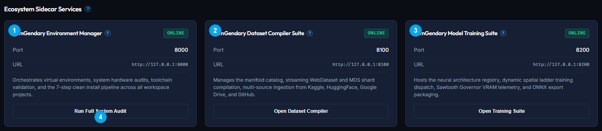
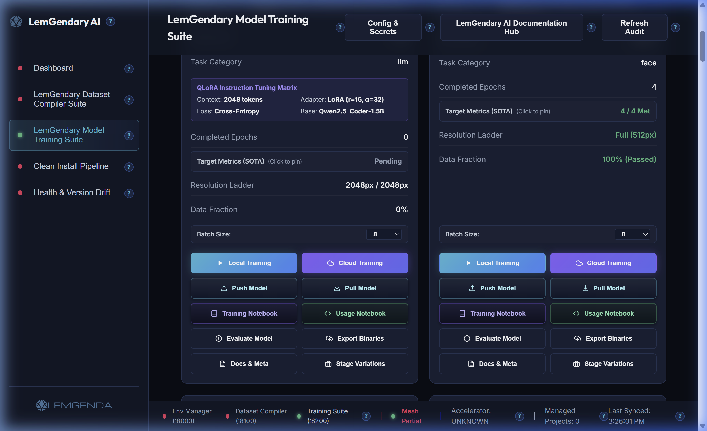
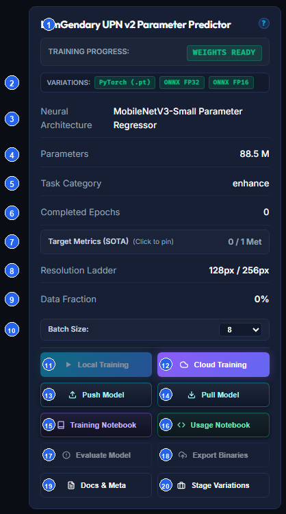
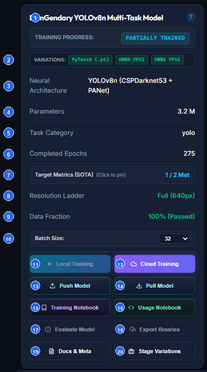
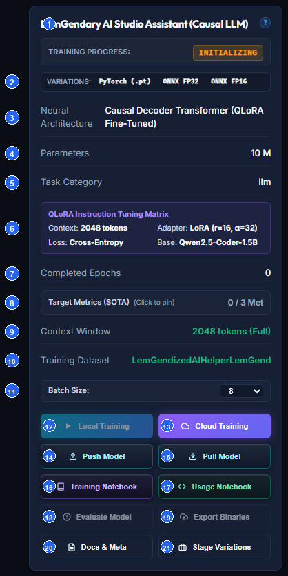
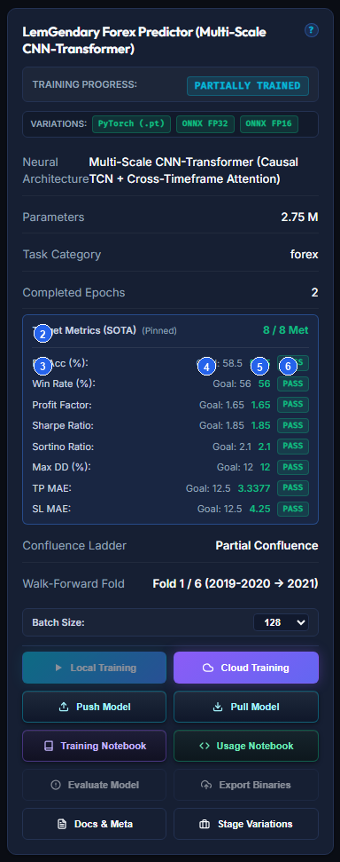

# LemGendary AI Studio GUI: Comprehensive Operator Manual

## Category 03 | LemGendary AI Documentation Hub | Master Operations Manual

**Version**: `v2.10.57` (LemGendary AI Studio GUI) · **Last audited**:
2026-11-12 · **Sidecars**: LemGendary Environment Manager (port 8000),
LemGendary Dataset Compiler Suite (port 8100), LemGendary Model Training Suite
(port 8200); each keeps its own `v16.x` release line · **Parent Authority**:
[Master Ecosystem Architecture](./ECOSYSTEM_ARCHITECTURE.md) · [Document
Authority Hierarchy & Versioning Policy](./VERSIONING_POLICY.md) · [GUI Control
ID Registry](./GUI_CONTROL_REGISTRY.md)

---

## Table of Contents

- [1. Abstract](#1-abstract)
- [2. Interface Topology & Visual Navigation
  Matrix](#2-interface-topology--visual-navigation-matrix)
  - [2.1 Workspace Global Shell Elements & Numbered Navigation
    Guide](#21-workspace-global-shell-elements--numbered-navigation-guide)
  - [2.2 Tripartite Sidecar Process Control &
    Auto-Start](#22-tripartite-sidecar-process-control--auto-start)
  - [2.3 Centralized State (Zustand) & Modular
    Micro-Components](#23-centralized-state-zustand--modular-micro-components)
- [3. Universal Configuration & Secrets
  Vault](#3-universal-configuration--secrets-vault)
  - [3.1 Central Manifest Registry Editor](#31-central-manifest-registry-editor)
  - [3.2 Write-Only Secrets & Cloud
    Tokens](#32-write-only-secrets--cloud-tokens)
  - [3.3 Tests & Diagnostics](#33-tests--diagnostics)
- [4. One-Click Environment Setup: The 7-Stage Clean Install
  Pipeline](#4-one-click-environment-setup-the-7-stage-clean-install-pipeline)
  - [4.1 Pipeline Orchestrator Control
    Card](#41-pipeline-orchestrator-control-card)
  - [4.2 Individual Pipeline Step Execution
    Cards](#42-individual-pipeline-step-execution-cards)
  - [4.3 Hardware Acceleration Sentinel
    Card](#43-hardware-acceleration-sentinel-card)
  - [4.4 Managed Workspace Projects Health
    Cards](#44-managed-workspace-projects-health-cards)
- [5. Dataset Compilation: Modernization, Kaggle Ingestion & Streaming
  Manifolds](#5-dataset-compilation-modernization-kaggle-ingestion--streaming-manifolds)
  - [5.1 Dataset Compiler & Modernization Control
    Card](#51-dataset-compiler--modernization-control-card)
  - [5.2 Production Manifolds Catalog, Upstream Lineage & One-Click Cloud
    Sync](#52-production-manifolds-catalog-upstream-lineage--one-click-cloud-sync)
  - [5.3 Modernization Queue & Scale Reduction
    Workflows](#53-modernization-queue--scale-reduction-workflows)
  - [5.4 Embedded Dataset Telemetry
    Console](#54-embedded-dataset-telemetry-console)
- [6. Model Training Pipeline: Architectures, Ladders & Sawtooth
  Governor](#6-model-training-pipeline-architectures-ladders--sawtooth-governor)
  - [6.1 Model Training Suite & Model Orchestration
    Toolbar](#61-model-training-suite--model-orchestration-toolbar)
  - [6.2 Registered Architectures & Checkpoint Telemetry
    Grid](#62-registered-architectures--checkpoint-telemetry-grid)
  - [6.2.1 Domain-Specific Neural Architecture Model
    Cards](#621-domain-specific-neural-architecture-model-cards)
  - [6.2.2 Interactive SOTA Target Pinning & Metric
    Inspection](#622-interactive-sota-target-pinning--metric-inspection)
  - [6.3 Three-Tab Real-Time Telemetry Stream & Responsive
    Cancellation](#63-three-tab-real-time-telemetry-stream--responsive-cancellation)
  - [6.4 Revamped Training Dashboard Topology & Interactive SOTA
    Inspection](#64-revamped-training-dashboard-topology--interactive-sota-inspection)
- [7. Evaluation, Export & Cloud Publishing to Kaggle and Google
  Drive](#7-evaluation-export--cloud-publishing-to-kaggle-and-google-drive)
  - [7.1 Real-Time Metrics & Live Loss
    Curves](#71-real-time-metrics--live-loss-curves)
  - [7.2 Exporting to Universal Runtimes](#72-exporting-to-universal-runtimes)
  - [7.3 Publishing to Kaggle Models Hub & Cloud
    Registry](#73-publishing-to-kaggle-models-hub--cloud-registry)
- [8. Health Matrix & Cross-Project Version Drift
  Analytics](#8-health-matrix--cross-project-version-drift-analytics)
  - [8.1 Toolchain Prerequisites, Python Drift Matrix & Desktop GUI NPM
    Packages](#81-toolchain-prerequisites-python-drift-matrix--desktop-gui-npm-packages)
  - [8.2 Ecosystem Maintenance & Governance
    Controls](#82-ecosystem-maintenance--governance-controls)
- [9. Contextual UX Help & Interactive Hover Guidance
  System](#9-contextual-ux-help--interactive-hover-guidance-system)
  - [9.1 Interactive Hover Popovers & Safety
    Diagnostics](#91-interactive-hover-popovers--safety-diagnostics)
- [10. Permanent Offline Documentation Hub & Online
  Synchronization](#10-permanent-offline-documentation-hub--online-synchronization)
  - [10.1 Local Static Offline Documentation
    Server](#101-local-static-offline-documentation-server)
  - [10.2 Live GitHub Pages Online
    Synchronization](#102-live-github-pages-online-synchronization)
- [11. Tripartite Multi-Sidecar Network
  Architecture](#11-tripartite-multi-sidecar-network-architecture)
  - [11.1 Dynamic Configuration & Environment
    Overrides](#111-dynamic-configuration--environment-overrides)
  - [11.2 Semantic Origin Routing & Telemetry Stream
    Governance](#112-semantic-origin-routing--telemetry-stream-governance)
  - [11.3 Typed API Client Contracts
    (src/api/client.ts)](#113-typed-api-client-contracts-srcapiclientts)
- [12. Automated Testing & Ecosystem Quality
  Assurance](#12-automated-testing--ecosystem-quality-assurance)
- [13. Reporting an Issue](#13-reporting-an-issue)
  - [13.1 Opening the Report Issue Form](#131-opening-the-report-issue-form)
  - [13.2 Screenshots & Annotation](#132-screenshots--annotation)
  - [13.3 Telemetry](#133-telemetry)
  - [13.4 Sending & the Local ZIP Report](#134-sending--the-local-zip-report)
  - [13.5 When Sending Fails](#135-when-sending-fails)
  - [13.6 Screen Recording](#136-screen-recording)

---

## 1. Abstract

The **LemGendary AI Studio GUI** is a hardware-aware command center engineered
to make deep learning dataset synthesis, neural network training, and cloud
deployment accessible to everyone from senior machine learning researchers to
high school students and non-technical hobbyists. When something goes wrong, the
Report Issue button packages a description, annotated screenshots and recent
telemetry for the maintainers (chapter 13).

Release `v2.10.57` routes every failed training action to the red error banner
instead of the green notice (v2.10.48), and `npm run verify` uses the portable
script of the central manifest, which finds `lem-env` on Windows, macOS and
Linux.

### The Gardening Model Rule

To ensure absolute operational clarity, every control, workflow, and safeguard
in this manual is designed according to the **Gardening Model Rule**:

> *If a 75-year-old grandmother wants to train an AI model using photos of her
> garden roses, tomato plants, and soil to automatically detect plant diseases and
> enhance low-light garden photographs, she should be able to complete the entire
> pipeline from environment setup to Kaggle cloud publishing purely by clicking
> intuitive buttons in the GUI, with zero command-line commands, zero code
> editing, and zero risk of freezing her computer.*

The system achieves this through three foundational engineering principles:

1. **Deterministic One-Click Automation**: All complex toolchains, Python
   virtual environments, CUDA drivers, wheel resolutions, and dependencies are
   provisioned automatically through the 7-Stage Clean Install Pipeline.
2. **Nuclear Memory Protection (The Sawtooth Governor)**: When training complex
   vision models, the GUI continuously probes hardware VRAM. If memory
   approaches capacity, the system automatically downscales batch sizes and
   applies dynamic gradient accumulation, guaranteeing that your machine never
   suffers an Out-of-Memory (OOM) crash or system freeze.
3. **Comprehensive Contextual Guidance**: Every single interactive button,
   switch, input field, and status indicator is accompanied by a contextual
   hover icon (`?`) delivering instant, plain-English explanations of what the
   control does, what files are affected, and what safeguards are active.


---

## 2. Interface Topology & Visual Navigation Matrix

The AI Studio interface is organized into persistent visual regions designed for
ergonomic operation. Every element, card, and control in the live interface is
indexed below with corresponding operational workflows and safety boundaries.


### 2.1 Workspace Global Shell Elements & Numbered Navigation Guide

The live screen capture above displays the complete primary application frame
including header, persistent sidebar navigation, active dashboard viewport, and
the sticky status footer:

1. **Brand Title & Brand Icon**: Displays LemGendary AI alongside the official
   vector icon (lemgenda-icon.svg). The title is not a link; the sidebar footer
   logo (item 12) links to the portal.
2. **Config & Secrets Header Button**: Opens the Universal Configuration,
   Registry Editor & Secrets Vault modal for editing YAML manifests and managing
   Kaggle, Google Drive, GitHub and MetaTrader 5 credentials (chapter 3).
3. **Report Issue Header Button** (`header-btn-report-issue`): Opens the Report
   Issue form with the module set to the current tab. You describe the problem,
   attach annotated screenshots and recent telemetry, and the LemGendary
   Environment Manager saves a ZIP report and opens your mail client (chapter
   13).
4. **Tests & Diagnostics Header Button** (`header-btn-test-modal`): Opens the
   Test & Diagnostic Orchestrator, which runs the 1-epoch fleet smoke test or
   the in-process unit tests of the LemGendary Model Training Suite and
   LemGendary Dataset Compiler Suite (section 3.3).
5. **LemGendary AI Documentation Hub Button**: Opens the local Documentation Hub
   in your browser. The address comes from the LemGendary Environment Manager
   (`GET /api/docs/status`), which serves the hub; the button is disabled, with
   the reason as tooltip, while the Environment Manager is offline or has no
   docs checkout (chapter 10).
6. **Refresh Audit Button** (`dash-btn-refresh-audit`): Reloads hardware, health
   and pipeline state from the Environment Manager and re-probes all three
   sidecars.
7. **Dashboard Tab** (`tab-dashboard`): Shows hardware cards, sidecar service
   tiles, project health cards and the live event console.
8. **LemGendary Dataset Compiler Suite Tab** (`tab-datasets`): Shows the
   manifold compiler, Kaggle synchronization and the manifold catalog
   (`./lemgendary-datasets/`).
9. **LemGendary Model Training Suite Tab** (`tab-training`): Shows the model
   cards, Sawtooth Governor VRAM controls, spatial ladders and training dispatch
   (`./lemgendary-training-suite/`).
10. **Clean Install Pipeline Tab** (`tab-pipeline`): Shows the 7-step
    provisioning sequence, Run Pipeline and the Clean Install confirmation
    (chapter 4).
11. **Health & Version Drift Tab** (`tab-health`): Shows host prerequisites, the
    Python drift matrix, the GUI's npm packages and the maintenance actions
    (chapter 8).
12. **Brand Signature Logo (Sidebar Footer)**: The official brand signature
    (lemgenda-logo.svg), linking to <https://www.lemgenda.hr/>.
13. **System Status Bar**: Sticky footer reporting the connection state of each
    sidecar.

Callout bindings (control type; endpoint or action):

- **1. Brand Title & Icon** (Brand Heading; None): Shows the product name and
  icon.
- **2. Config & Secrets** (Header Button; Opens the config modal): Manifest
  editing and write-only secrets.
- **3. Report Issue** (Header Button; `POST /api/bug-report` on send): Opens the
  Report Issue form.
- **4. Tests & Diagnostics** (Header Button; Opens the test modal): Fleet smoke
  test and unit tests.
- **5. Documentation Hub** (Header Button; `GET /api/docs/status`): Opens the
  hub address in the browser.
- **6. Refresh Audit** (Header Button; `GET /api/hardware`, `/api/health`):
  Reloads state and re-probes sidecars.
- **7. Dashboard Tab** (Navigation Button; None): Opens the dashboard view.
- **8. Dataset Compiler Tab** (Navigation Button; None): Opens the compiler
  view.
- **9. Model Training Tab** (Navigation Button; None): Opens the training view.
- **10. Clean Install Tab** (Navigation Button; None): Opens the pipeline view.
- **11. Health & Drift Tab** (Navigation Button; None): Opens the health view.
- **12. Brand Signature Logo** (Navigation Link; <https://www.lemgenda.hr/>):
  Opens the portal.
- **13. System Status Bar** (Status Indicator; Liveness probes): Shows each
  sidecar's connection state.

> [!TIP]
> **New in this release**: the Report Issue and Tests & Diagnostics buttons sit
> next to Config & Secrets in the header. The screenshot above predates them.

---

### 2.2 Tripartite Sidecar Process Control & Auto-Start

The Ecosystem Sidecar Services grid permanently monitors and coordinates the
three local microservices:

- **LemGendary Environment Manager (`Port 8000`)**: Core orchestrator and
  validation authority (`./lemgendary-env-manager/`).
- **LemGendary Dataset Compiler Suite (`Port 8100`)**: Manifold compiler and
  streaming storage server (`./lemgendary-datasets/`).
- **LemGendary Model Training Suite (`Port 8200`)**: Neural architecture
  training and evaluation engine (`./lemgendary-training-suite/`).



Stopping a sidecar on macOS and Linux sends SIGTERM and waits up to 3 s before
SIGKILL, so the sidecar can flush its logs; Linux falls back to `ss -tlpnH` when
`lsof` is missing, and Windows uses `taskkill /T /F` (v2.10.54). Sibling
projects are found from the working directory and from the executable's folders,
so a build started outside the GUI folder still finds the sidecars.

#### Ecosystem Sidecar Cards Numbered Reference

1. **Environment Manager Service Card**: Identifies the primary port 8000
   governance daemon governing virtual environments, hardware discovery, and
   registry validation (`ONLINE`, PID, uptime, active endpoints).
2. **Dataset Compiler Suite Service Card**: Identifies the port 8100 service
   managing WebDataset, Parquet, and MDS manifolds (`ONLINE`, PID, uptime,
   direct navigation button).
3. **Model Training Suite Service Card**: Identifies the port 8200 service
   managing PyTorch neural architectures, Sawtooth Governor VRAM safeguards, and
   training ladders (`ONLINE`, PID, uptime, direct navigation button).
4. **Run Full System Audit Action Button**: Runs the 7-step pipeline without
   deleting anything (`POST /api/pipeline/run` with `clean: false`), which
   audits hardware, toolchain, environments and dependencies across all
   workspace projects.
5. **Bidirectional Sidecar Controls (Start / Stop Service)**: Offline cards show
   "Start Service"; online cards show "Stop Service". Both go to the Environment
   Manager (`POST /api/services/{id}/start` or `/stop`) when it answers. If the
   Environment Manager itself is offline, the desktop app starts sidecars
   through its native launcher; in a plain browser session you get a clear error
   instead.

Callout bindings (control type; endpoint or action):

- **1. Env Manager Card** (Service Tile; `GET /api/ping` (8000)): Shows
  readiness, PID and uptime. Probed every 4 seconds.
- **2. Compiler Suite Card** (Service Tile; `GET /api/health` (8100)): Shows
  compiler readiness with a navigation button.
- **3. Training Suite Card** (Service Tile; `GET /api/health` (8200)): Shows
  training readiness with a navigation button.
- **4. Run Full System Audit** (Action Button; `POST /api/pipeline/run`):
  Non-destructive pipeline run (`clean: false`).
- **5. Start / Stop Service** (Action Button; `POST /api/services/{id}/start` or
  `/stop`): Starts or stops one sidecar.

---

### 2.3 Centralized State (Zustand) & Modular Micro-Components

To ensure instantaneous UI responsiveness, eliminate prop drilling, and prevent
race conditions when streaming high-frequency training metrics, the application
state is governed by a unified Single Source of Truth (SSOT) Zustand store
(`src/store/useStudioStore.ts`):

1. **Ecosystem Mesh Health**: Persists real-time connection status across the
   tripartite sidecars (Ports 8000, 8100, 8200) with automatic re-poll triggers
   and autonomous cold boot controls.
2. **Global Telemetry Ring Buffer**: Keeps the latest 200 log events with ANSI
   color parsing, filtering and clipboard export; the Report Issue form attaches
   them as telemetry.
3. **Hardware Accelerators**: Caches GPU VRAM profiles, temperature sensors,
   compute utilization matrices, and Sawtooth Governor headroom telemetry.
4. **Active Job Management**: Tracks running training and compilation jobs; a
   stop request counts only when the sidecar confirms it (section 6.3).
5. **Open Modal**: One store field (`activeModal`) records which dialog is open:
   `config`, `tests` or `bug-report`.
6. **Offline Catalogs**: The model and manifold catalogs come only from the
   sidecars; there are no hand-written fallback lists (removed in v2.10.34).
   While the LemGendary Model Training Suite or the LemGendary Dataset Compiler
   Suite is offline or returns an empty list, the view shows an empty state
   with a message to start the sidecar (the training view also has **Retry**)
   and reloads the real list once the sidecar answers.
7. **Control ID Registry**: Interactive controls carry stable DOM IDs, listed
   with their endpoints in
   [`GUI_CONTROL_REGISTRY.md`](./GUI_CONTROL_REGISTRY.md) (for example
   `tab-dashboard`, `header-btn-report-issue`, `dash-btn-run-pipeline`). Tests
   and the Report Issue module select rely on them.
8. **Shared Micro-Components & Utilities**:
   - `Modal.tsx`: Shared dialog used by Report Issue, the annotator and the
     Clean Install confirmation: focus stays inside, Escape closes only the
     innermost dialog, and focus returns to the button that opened it.
   - `ValidationBanner.tsx`: Centralized banner component with auto-detected
     severity (`info`, `success`, `warning`, `error`), dismiss handlers, and
     full accessibility semantics.
   - `HoverPinPopover.tsx`: High-performance CSS hover and native semantic
     `<button>` pin popovers for SOTA targets and upstream sources.
   - `src/utils/clipboard.ts`: Dedicated zero-loss clipboard export utility
     supporting modern asynchronous `navigator.clipboard.writeText` with legacy
     fallback for sandboxed webviews.

---

## 3. Universal Configuration & Secrets Vault

Deep learning workflows require interacting with external registries, storage
backends, and cloud repositories. The LemGendary AI Studio GUI integrates a
Universal Configuration & Secrets Vault modal, opened with the
`Config & Secrets` header button.

### 3.1 Central Manifest Registry Editor


The Python and npm dependency manifests open the central files in
`lemgendary-env-manager/requirements/`; saving one makes the Environment Manager
sync it to every sibling project (Environment Manager v16.9.79). When the
registry is unreachable the list stays empty and an offline banner shows; when a
manifest cannot be read the editor stays empty and an error banner names the
failure. In both cases **Validate Syntax**, **Save Manifest** and the text area
are disabled (v2.10.47).

#### Manifest Registry Editor Numbered Reference

1. **Configuration Editor Modal Title**: Header identifying the central
   configuration and manifest governance workspace.
2. **Registry Manifests Subtab Switcher**: Selects the central YAML
   configuration and registry manifest editing workspace.
3. **Secrets & Tokens Vault Subtab Switcher**: Switches the modal to credential
   and API token management.
4. **Target Manifest Selector Dropdown** (`manifest-select`): Selects one of the
   ecosystem manifests reported by the Environment Manager, for example
   `unified_data.yaml` (dataset definitions), `unified_models_v2.yaml`
   (architecture registry) and the dependency manifests
   `lemgendary-env-manager/requirements/*.txt` (dependency SSOT).
5. **Validate Syntax Button**: Sends the current text to the Environment Manager
   for YAML or JSON parsing without writing to disk and reports structural
   errors.
6. **Preview Diff Button**: Shows your pending edits against the version saved
   on disk.
7. **Revert Button**: Discards unsaved edits and restores the content stored on
   disk.
8. **Save Manifest Button**: Writes the file atomically after creating an
   automatic `.bak` snapshot.
9. **Monospace Manifest Text Editor**: A plain text area for direct inspection
   and editing of the configuration file.
10. **Modal Close Button**: Safely dismisses configuration modal and returns to
    previous workspace view.

Callout bindings (control type; endpoint or action):

- **1. Modal Title** (Modal Heading; None): Identifies configuration workspace
  and active target file.
- **2. Manifests Tab** (Subtab Button; `setActiveTab("manifests")`): Activates
  central YAML code editor and schema linter.
- **3. Secrets Tab** (Subtab Button; `setActiveTab("secrets")`): Activates
  credentials and token management profiles.
- **4. Manifest Dropdown** (Select Dropdown; `GET /api/manifests/read`): Loads
  the selected file into the editor.
- **5. Validate Syntax** (Action Button; `POST /api/manifests/validate`):
  Validates YAML syntax and schema without altering files on disk.
- **6. Preview Diff** (Action Button; None): Compares edits with the saved file.
- **7. Revert** (Action Button; None): Restores the saved content.
- **8. Save Manifest** (Primary Button; `POST /api/manifests/save`): Writes
  atomically after a `.bak` snapshot.
- **9. Monospace Editor** (Textarea Editor;
  `setCurrentContent(e.target.value)`): Displays raw configuration text with
  monospaced indentation.
- **10. Modal Close** (Action Button; None): Closes the dialog without saving
  unsaved text.

---

### 3.2 Write-Only Secrets & Cloud Tokens

Secrets are write-only from the GUI. The Environment Manager never sends a
stored value back: `GET /api/secrets` returns for each credential only whether
it is set (`has_value`) and its last 4 characters (`value_hint`). Each
credential therefore shows `set (••••1234)`, `set` or `not set`, and there is no
Show/Hide toggle.

- **Replace a value**: Type the new value in the credential's password field
  (`replace-secret-{secret_id}`) and save.
- **Keep a value**: Leave the password field blank; saving keeps the stored
  value.
- **Add a credential**: Use "+ Add New Secret", fill in the service, label,
  username and secret, then save.
- **After saving**: The masked list is reloaded, so the values you typed leave
  memory. Save errors show the server's message (for example a failed Kaggle
  check), and legacy credential files that were skipped or failed are listed.


#### Secrets & Tokens Vault Numbered Reference

1. **Configuration Editor Modal Title**: Header confirming active credentials
   and token management workspace.
2. **Active Cloud Service Profile Badge**: Visual badge identifying service
   provider (e.g. `Kaggle`, `Google Drive`, `GitHub`, `MetaTrader 5`).
3. **Requirement Level Badge**: Clearly flags mandatory vs optional platform
   dependencies (`MANDATORY` for Kaggle API access, `OPTIONAL` for secondary
   mirrors).
4. **Toggle Add New Secret Form Button**: Expands interactive credential
   registration form to add additional service accounts.
5. **Save Secrets to Ecosystem Button**: Sends new and replaced values to the
   Environment Manager (`POST /api/secrets`), which stores them in
   `.secrets.yaml` and propagates the legacy single-token files
   (`.kaggle_token`, `.kaggle_users`, `.mt5_credentials`). Blank fields keep the
   stored values.
6. **New Secret Service Type Dropdown**: Selects target cloud platform for new
   credential entry.
7. **Secret Label / Description Input**: Human-readable label for credential
   identification (e.g. `Personal Primary Account`).
8. **Account Username / Identifier Input**: Cloud service username or account
   identifier.
9. **Secret Token / API Key / Password Field** (`new-secret-input`): A password
   field; the value is sent on save and never shown again.
10. **Add Secret Submit Button**: Adds the credential to the list; it is stored
    only when you save.

Callout bindings (control type; endpoint or action):

- **1. Modal Title** (Modal Heading; None): Identifies secrets management
  dialog.
- **2. Service Badge** (Status Pill; None): Displays service profile identity.
- **3. Requirement Level** (Badge Indicator; None): Differentiates mandatory
  core services from optional cloud mirrors.
- **4. + Add New Secret** (Action Button; `setIsAddingSecret(!isAddingSecret)`):
  Toggles new credential registration form with service dropdown.
- **5. Save Secrets** (Primary Button; `POST /api/secrets`): Stores new values;
  blank fields keep stored ones.
- **6. Service Type** (Select Dropdown; `setNewService(e.target.value)`):
  Selects target cloud platform: Kaggle, Google Drive, GitHub, MT5.
- **7. Secret Label** (Text Input; `setNewLabel(e.target.value)`): Descriptive
  tag for account differentiation.
- **8. Account Username** (Text Input; `setNewUsername(e.target.value)`):
  Service login or API user identifier.
- **9. Secret Token** (Password Input; None until save): Write-only; never read
  back.
- **10. Add Secret Submit** (Primary Button; None until save): Adds the
  credential to the list.

---

### 3.3 Tests & Diagnostics

The "Tests & Diagnostics" header button (`header-btn-test-modal`) opens the Test
& Diagnostic Orchestrator. Pick a tab, then click its run button; results appear
in the output console (`test-modal-output-console`). Escape or the X button
closes the dialog.

1. **Fleet 1-Epoch Smoke Test** (`test-modal-btn-run-fleet`): Queues a 1-epoch
   pass over all 23 registered models on the LemGendary Model Training Suite
   (`POST /api/training/unit-test-all`). The console shows `QUEUED` and the job
   id; follow progress in the training telemetry console.
2. **Training Suite Unit Tests** (`test-modal-btn-run-training-unit`): Runs the
   unit tests in `lemgendary-training-suite/tests/unit/` in-process
   (`POST /api/training/unit-test-run`) and prints the summary.
3. **Dataset Compiler Tests** (`test-modal-btn-run-dataset-unit`): Runs the
   tests in `lemgendary-datasets/tests/` in-process (`POST /api/llm/test-suite`)
   and prints the summary.

The dialog finds both sidecars through the shared service configuration, so it
works with the addresses set by the `VITE_*_URL` variables. A sidecar that is
offline produces an error message in the console instead of a crash.

---

## 4. One-Click Environment Setup: The 7-Stage Clean Install Pipeline

Before training an AI model, your computer must have the correct software
libraries installed. Traditionally, this required typing dozens of cryptic
terminal commands. The AI Studio eliminates this completely through the
automated 7-Stage Clean Install Pipeline.

### 4.1 Pipeline Orchestrator Control Card


#### Clean Install Pipeline Numbered Reference

1. **Pipeline Orchestrator Title & Help Glyph**: Header detailing deterministic
   7-step environment recreation and toolchain verification.
2. **Run Pipeline Button** (`dash-btn-run-pipeline`): Runs all seven steps in
   the background without deleting anything (`clean: false`). Existing virtual
   environments and `node_modules` folders are kept and repaired where needed.
   The button is disabled while the Environment Manager is offline.
3. **Clean Install... Button** (`pipeline-btn-clean-install`): Opens a
   confirmation dialog before the destructive run (see below).
4. **Active Stage Progress Bar**: Shows pipeline progress from step 1 through
   step 7.
5. **Pipeline Execution State Badge**: Shows `READY` when idle or
   `PIPELINE ACTIVE` while running.

Callout bindings (control type; endpoint or action):

- **1. Pipeline Title** (Section Heading; None): Contextual heading explaining
  zero-command environment setup.
- **2. Run Pipeline** (Primary Button; `POST /api/pipeline/run`):
  Non-destructive run (`clean: false`).
- **3. Clean Install...** (Danger Button; Opens the dialog): Nothing is deleted
  until you confirm.
- **4. Progress Bar** (Visual Meter; Log WebSocket updates): Shows progress
  across all steps.
- **5. State Badge** (Status Badge; `GET /api/pipeline/status`): Shows whether
  the pipeline is running.

#### Clean Install Confirmation

A clean install deletes and rebuilds environments, so it always asks first. The
dialog (`pipeline-dialog-clean-install`) lists what will be deleted across all
workspace projects:

- The `.venv` virtual environment of every managed Python project (recreated
  from the manifests).
- The `node_modules` folder of every Node project (reinstalled with npm).
- Every process running from those virtual environments, including running
  sidecars (stopped first).

Focus starts on **Cancel** (`pipeline-btn-clean-cancel`); Cancel or Escape
closes the dialog without sending anything. Only **Delete and reinstall**
(`pipeline-btn-clean-confirm`) starts the run with `clean: true`. The run can
take a long time and cannot be undone.

#### Real-Time Telemetry Progress Tracker & Installation Safeguards

During Step 4 requirements and package synchronization, dependency installations
can take several minutes to resolve and compile binary wheels. To provide
continuous visual feedback and guarantee operators know the pipeline is actively
working rather than stuck, an animated progress tracker
(`TelemetryProgressTracker`) mounts directly above the monospace telemetry
stream:

- **Amber Pipeline Theme**: Highlights active pipeline operations with
  high-contrast amber styling (`var(--accent-amber, #ffd166)`) and a glowing
  gradient progress bar
  (`linear-gradient(90deg, #f59e0b 0%, #ffd166 60%, #00f0ff 100%)`).
- **Real-Time Requirement Counts**: Live progress ratio metrics (e.g.
  `[12/28 requirements]`) show precisely how many dependencies have been
  processed.
- **Wheel Download Metrics & ETA**: Displays active package names, download
  transfer speeds (e.g. `14.2 MB/s`), byte ratios, and estimated time remaining.
- **Indeterminate In-Flight Indicators**: When dependencies are resolving or
  building wheels, the progress bar displays an animated in-flight pulse,
  assuring operators of active execution.
- **Card-Level Progress Indicators**: Each running step card in the 7-stage grid
  displays an animated progress bar along its bottom edge while executing.

---

### 4.2 Individual Pipeline Step Execution Cards

In addition to running the full automated sequence, operators can execute
individual stages in isolation for granular troubleshooting, inspection, and
rapid re-verification:


Each step pill (WAIT, RUN, DONE, FAILED) follows only that step's latest
Environment Manager event. Compiler, training and console events no longer reset
the pills, a single-step run no longer marks the steps before it as DONE, and a
failed step shows a FAILED pill (v2.10.49).

#### Pipeline Step Execution Cards Numbered Reference

1. **Stage 1 Card Title (Hardware Discovery)**: Probes host platform, CPU
   architecture, system RAM, NVIDIA driver levels, CUDA compute capabilities,
   cuDNN, and TensorRT availability.
2. **Stage 1 Run Step Action Button**: Dispatches isolated execution of Step 1
   (`POST /api/pipeline/run-step`, step 1, `clean: false`), refreshing system
   hardware telemetry without touching virtual environments.
3. **Stage 2 Card Title (Toolchain Audit)**: Validates host toolchain
   requirements (Python 3.12+, Git SCM, Node.js, and npm).
4. **Stage 2 Run Step Action Button**: Dispatches isolated execution of Step 2
   (`POST /api/pipeline/run-step`, step 2, `clean: false`), verifying host
   prerequisites against ecosystem requirements.
5. **Stage 3 Card Title (Virtual Environments)**: Audits and safely provisions
   isolated Python virtual environments (`.venv`) across all managed
   repositories.
6. **Stage 3 Run Step Action Button**: Dispatches isolated execution of Step 3
   (`POST /api/pipeline/run-step`, step 3, `clean: false`), recreating missing
   or corrupted `.venv` folders idempotently.
7. **Stage 4 Card Title (Requirements Sync & Install)**: Propagates centralized
   dependencies from `lemgendary-env-manager/requirements/*.txt`, installs
   binary wheels, and normalizes OpenCV.
8. **Stage 4 Run Step Action Button**: Dispatches isolated execution of Step 4
   (`POST /api/pipeline/run-step`, step 4, `clean: false`), synchronizing
   packages and installing missing dependencies.
9. **Stage 5 Card Title (Dependency Audit & Upgrades)**: Audits outdated
   packages, detects version drift, and applies safe non-breaking upgrades
   across workspaces.
10. **Stage 5 Run Step Action Button**: Dispatches isolated execution of Step 5
    (`POST /api/pipeline/run-step`, step 5, `clean: false`), validating package
    upgrade paths without touching live installations.
11. **Stage 6 Card Title (Codebase Verification)**: Compiles Python bytecode
    across all repositories, verifies AST syntax, and enforces zero-emoji
    compliance.
12. **Stage 6 Run Step Action Button**: Dispatches isolated execution of Step 6
    (`POST /api/pipeline/run-step`, step 6, `clean: false`), running bytecode
    compilation and linting verification gates.
13. **Stage 7 Card Title (Health Matrix)**: Generates complete ecosystem health
    report, evaluates cross-project drift, and certifies overall system
    integrity.
14. **Stage 7 Run Step Action Button**: Dispatches isolated execution of Step 7
    (`POST /api/pipeline/run-step`, step 7, `clean: false`), executing full
    ecosystem certification and emitting consolidated health metrics.

Callout bindings (control type; endpoint or action):

- **1. Stage 1 Title** (Card Heading; None): Identifies hardware and compute
  acceleration discovery stage.
- **2. Stage 1 Run Step** (Action Button; `run-step` 1): Runs hardware probe in
  background worker thread.
- **3. Stage 2 Title** (Card Heading; None): Identifies toolchain prerequisite
  verification stage.
- **4. Stage 2 Run Step** (Action Button; `run-step` 2): Runs toolchain
  prerequisites audit.
- **5. Stage 3 Title** (Card Heading; None): Identifies virtual environments
  provisioning stage.
- **6. Stage 3 Run Step** (Action Button; `run-step` 3): Recreates and verifies
  project `.venv` structures.
- **7. Stage 4 Title** (Card Heading; None): Identifies requirements
  synchronization and wheel install stage.
- **8. Stage 4 Run Step** (Action Button; `run-step` 4): Installs verified
  dependencies from unified manifests.
- **9. Stage 5 Title** (Card Heading; None): Identifies dependency audit and
  upgrade analysis stage.
- **10. Stage 5 Run Step** (Action Button; `run-step` 5): Executes dry-run
  dependency checks across workspaces.
- **11. Stage 6 Title** (Card Heading; None): Identifies bytecode compilation
  and syntax verification stage.
- **12. Stage 6 Run Step** (Action Button; `run-step` 6): Verifies syntax
  compilation and enforces zero-emoji compliance.
- **13. Stage 7 Title** (Card Heading; None): Identifies system health matrix
  certification stage.
- **14. Stage 7 Run Step** (Action Button; `run-step` 7): Generates complete
  ecosystem health report and certifies status.

---

### 4.3 Hardware Acceleration Sentinel Card

The Hardware Acceleration Sentinel Card is permanently visible on the central
Dashboard, delivering an un-truncated live readout of physical compute
capabilities:


#### Hardware Architecture Card Numbered Reference

1. **Primary Accelerator Backend Badge & Header**: Highlights active execution
   engine (`CUDA`, `DIRECTML`, `ROCM`, or `CPU`) alongside the
   `System & Hardware Architecture` section header and contextual probe guidance
   tooltip.
2. **Host Operating System Row**: Confirms operating system release and kernel
   architecture (`Windows (11, AMD64)`).
3. **Python Runtime Row**: Displays active Python interpreter revision
   (`3.12.10`), verifying compliance with the 3.12+ ecosystem baseline.
4. **CPU Cores Allocation Row**: Reports available host processor allocation
   across logical threads and physical compute cores (`12 / 6`).
5. **System RAM Capacity Row**: Displays physical host RAM capacity
   (`32,486 MB`) available for data streaming and dataset decompression.
6. **Recommended PyTorch Wheel Index Row**: Authoritative repository link for
   the wheel index the hardware probe selects for the detected driver
   (`https://download.pytorch.org/whl/cu134` for driver `610.74`).
7. **Detected Accelerators & Dedicated VRAM Row**: Details physical GPU device
   model (`NVIDIA GeForce GTX 1650`), installed driver level (`610.74`), and
   dedicated video memory capacity (`4096 MB VRAM`).

Callout bindings (control type; endpoint or action):

- **1. Accelerator Badge & Header** (Status Pill & Header;
  `env_manager.system_probe`): Displays primary execution backend and sentinel
  header.
- **2. Operating System** (Metric Row; `platform.platform()`): Confirms
  operating system version and kernel architecture.
- **3. Python Runtime** (Metric Row; `sys.version`): Verifies Python 3.12+
  interpreter compliance.
- **4. CPU Cores (Logical / Physical)** (Metric Row; `os.cpu_count()` /
  `psutil`): Reports available logical threads and physical cores.
- **5. System RAM** (Metric Row; `psutil.virtual_memory()`): Displays host
  memory capacity for batch streaming.
- **6. Recommended Torch Index** (Metric Row; `env_manager.system_probe`):
  Official PyTorch binary wheel repository URL.
- **7. Detected Accelerators & VRAM** (Device Metric Row; NVML / CUDA probe):
  Details physical GPU model, driver level, and dedicated VRAM.

---

### 4.4 Managed Workspace Projects Health Cards

The Project Environments overview on the Dashboard displays dedicated cards for
each sub-project in the ecosystem. All cards display clean relative paths
without exposing sensitive host absolute paths:


#### Managed Projects Grid Numbered Reference

1. **Managed Workspace Project Title**: Card identifying the managed project
   with canonical uniform naming (e.g. `1. LemGendary Environment Manager`,
   `2. LemGendary Dataset Compiler Suite`, `3. LemGendary Model Training Suite`,
   `4. LemGendary AI Studio GUI`, `5. LemGendary AI Documentation Hub`).
2. **Project Health Badge**: Displays green `HEALTHY` when virtual environment
   and installed packages match manifest specifications.
3. **Installed Packages & Status Metric Row**: Displays total installed library
   count and environment synchronization status.
4. **Reconcile Virtual Environment Button**: Triggers single-project dependency
   alignment to restore missing wheels and reconcile version drift.

Callout bindings (control type; endpoint or action):

- **1. Project Title** (Card Heading; None): Canonical uniform project title;
  relative path shown.
- **2. Health Badge** (Status Badge; `GET /api/health`): Shows isolated `.venv`
  validity and manifest conformance.
- **3. Packages Metric** (Metric Row; `pip list` / manifest scan): Displays
  total installed package count and synchronization status.
- **4. Reconcile Button** (Action Button; `POST /api/pipeline/run` with
  `target_project` and `clean: false`): Runs the non-destructive pipeline for
  the selected project; valid `.venv` folders are kept and missing wheels are
  reconciled.

---

## 5. Dataset Compilation: Modernization, Kaggle Ingestion & Streaming Manifolds

High-velocity deep learning requires converting raw, loose image files into
modern streaming containers. Traditional loose-image folders cause OS filesystem
freezes when training models on hundreds of thousands of images. The LemGendary
Dataset Compiler Suite tab provides a complete visual control center for dataset
synthesis, direct cloud ingestion, and bidirectional Kaggle synchronization.

### 5.1 Dataset Compiler & Modernization Control Card

The top card of the Dataset Compiler tab governs manifold synthesis and
streaming storage conversion:


#### Dataset Compiler Control Card Numbered Reference

1. **Dataset Compilation Engine Title & Help Glyph**: Header detailing container
   synthesis alongside the contextual guidance tooltip (`?`).
2. **Standard Preset Mode Toggle Button**: Switches to standard preset mode
   compiling pre-configured datasets registered in `unified_data.yaml`.
3. **Custom Multi-Source Mode Toggle Button**: Switches to custom multi-source
   mode, enabling custom dataset naming, multi-directory aggregation, and format
   selection.
4. **Target Manifold Dropdown Selector**: Selects source manifold to compile
   from registered definitions in `unified_data.yaml`.
5. **Compilation Preset Dropdown Selector** (`preset-select`): Lists the
   presets from the sidecar's `presets.yaml` (`GET /api/gui/presets`) plus
   "Server default", which lets the sidecar apply its default preset. While the
   sidecar is offline only "Server default" is shown.
6. **Compile Manifold Primary Action Button** (`comp-btn-compile`): Starts a
   compile job (`POST /api/gui/quick-compile` with `model` and `preset`) and
   shows the returned job id. An unknown preset shows the server's message with
   the valid names.

Shard size and loose-image purging are not part of the standard form; the
preset defines them. The custom multi-source form keeps both fields.

Callout bindings (control type; endpoint or action):

- **1. Title & Help Glyph** (Section Heading; None): Contextual heading
  explaining streaming container compilation.
- **2. Standard Preset Button** (Mode Button;
  `onChangeCompileMode("standard")`): Sets compilation form to standard manifest
  preset workflow.
- **3. Custom Multi-Source Button** (Mode Button;
  `onChangeCompileMode("custom")`): Reveals custom source aggregation and format
  customization fields.
- **4. Target Manifold** (Select Dropdown; `onSelectManifold(e.target.value)`):
  Chooses dataset registered in `unified_data.yaml`.
- **5. Compilation Preset** (Select Dropdown; `GET /api/gui/presets`): Server
  presets plus "Server default".
- **6. Compile Manifold** (Primary Button; `POST /api/gui/quick-compile`):
  Starts the compile job and shows its id.

---

### 5.2 Production Manifolds Catalog, Upstream Lineage & One-Click Cloud Sync

The Production Manifolds section catalogs all verified streaming datasets inside
`./LemGendaryDatasets/`, providing instant access to upstream lineage and
integrated card-level Kaggle synchronization:



#### Production Manifolds Catalog Numbered Reference

1. **Production Manifolds Section Header & Total Counter**: Displays hub section
   title alongside active and total verified dataset count
   (`Dataset Compiler & Manifold Hub (21 / 21)`).
2. **Sub-Tab Navigation Switcher Buttons**: Three-way tab switcher selecting
   between `Manifolds Catalog`, `Modernization Queue`, and `Scale Reduction`
   views.
3. **Global Header Action Buttons**:
   - `Update All Kaggle Metadata`: Synchronizes descriptors across all
     registered datasets in Kaggle Cloud (`POST /api/kaggle/update-metadata`
     with `all_datasets: true`).
   - `Regen Index`: Rescans `./LemGendaryDatasets/` on disk and regenerates
     `unified_data.yaml` index.
   - `Refresh Catalog`: Polls port 8100 sidecar to detect local disk changes and
     remote cloud sync status.
4. **Live Search Input & Multi-Dimension Filter Dropdowns**: Real-time manifold
   name search paired with `Status` (All, Compiled, Uncompiled), `Format` (All,
   WebDataset, Parquet, MDS), and `Task` (All, Restoration, Detection,
   Classification, Segmentation, Forex) dropdowns.
5. **Verified Manifold Card Identity & Status Badge**: Displays canonical
   dataset display name, green `COMPILED` status pill, storage format, sample
   count, and disk footprint.
6. **Upstream Sources & Lineage Popover Button**: Interactive popover trigger
   revealing raw source dataset provenance, sample contributions, licensing, and
   raw data lineage.
7. **Manifold Card Action Buttons Group**:
   - `Update Metadata` (Button): Dispatches `POST /api/kaggle/update-metadata`
     for the single selected manifold.
   - `Audit Notebooks` (Link): Direct external link opening Kaggle Registry
     Metadata Training audit notebook.
   - `Download` (Button): Pulls remote streaming shards from Kaggle Cloud
     Storage with hash validation (`POST /api/kaggle/download`).
   - `Upload` (Button): Packages and uploads local compiled shards directly to
     Kaggle Cloud Datasets (`POST /api/kaggle/upload`).

Callout bindings (control type; endpoint or action):

- **1. Hub Header & Count** (Section Heading; None): Labels verified manifold
  inventory and total dataset count.
- **2. Sub-Tabs Switcher** (Tab Buttons; `onTabChange()`): Toggles catalog,
  transcode modernization queue, and scale reduction.
- **3. Global Header Actions** (Action Buttons; `POST /api/kaggle/...`): Batch
  metadata update, index regeneration, and catalog refresh.
- **4. Search & Filter Dropdowns** (Input & Selects; Client-side filter):
  Filters manifolds by search query, compilation status, format, and task.
- **5. Manifold Identity & Status** (Card Header; Sourced from
  `unified_data.yaml`): Displays verified samples, disk storage footprint,
  format, and shards.
- **6. Upstream Sources Popover** (Popover Trigger; `HoverPinPopover.tsx`):
  Displays upstream provenance, licensing, and raw data lineage.
- **7. Card Action Buttons** (Button Group; `POST /api/kaggle/...`):
  Single-dataset metadata update, audit link, cloud download, and shard upload.

---

### 5.3 Modernization Queue & Scale Reduction Workflows

The additional sub-tabs in the Production Manifolds section provide advanced
dataset operations:

1. **Modernization Queue & Transcode Tab**: Detects datasets containing legacy
   PNG/JPEG images that need transcoding to modern WebP format. Operators can
   adjust the parallel worker thread pool count (1 to 16, default 8), run a
   simulated dry run, or batch transcode all datasets with optional automated
   push to Kaggle.
2. **Scale Reduction (Downsample) Tab**: Derives spatially downscaled and
   sample-reduced dataset variants for rapid experimentation (`10% Preview`,
   `25% Fast Test`, `50% Balanced`, `75% High Res`) using Lanczos-3 spatial
   downsampling.

---

### 5.4 Embedded Dataset Telemetry Console

The Dataset Compiler panel features a dedicated live streaming telemetry console
docked directly at the bottom of the viewport. Integrated with the modern
`@radix-ui/react-progress` engine (installed and governed via LemGendary
Environment Manager), active operations feature an accessible, glowing two-line
progress architecture:

1. **Line 1 (Unconstrained Operational Metrics)**: Displays operation title,
   target dataset archive, exact percentage, transfer size / file counts,
   real-time bandwidth transfer rate, and dynamic ETA cleanly spaced without
   text clipping or truncation.
2. **Line 2 (Visual Progress Bar Only)**: Full-width hardware-accelerated
   glowing progress indicator strictly isolating the visual progress bar on its
   own dedicated line.
3. **In-Place Stream De-duplication**: Intermediate progress updates for
   in-flight archiving, extraction, and cloud synchronization are rolled up
   in-place, eliminating scrolling clutter while preserving discrete step start,
   verification, and completion records.

---

## 6. Model Training Pipeline: Architectures, Ladders & Sawtooth Governor

Once your dataset is compiled, you are ready to train a production-grade neural
network. The LemGendary Model Training Suite (`.\lemgendary-training-suite\`)
provides dynamic hyperparameter management and nuclear memory safeguards.

### 6.1 Model Training Suite & Model Orchestration Toolbar

The top toolbar of the Model Training panel provides search, domain filtering
and batch actions across all 23 registered models. The fleet-wide 1-epoch smoke
test moved to the Test & Diagnostic Orchestrator (section 3.3).


#### Training Orchestrator Toolbar Numbered Reference

1. **Model Name Search Input Field**: Real-time live search filter narrowing the
   architecture catalog by model key, architecture, or category
   (`Filter by model name, architecture, category...`).
2. **Status Filter Dropdown**: Dropdown selector filtering architectures by
   training and weights status (`All Statuses`, `Fully Trained`,
   `Partially Trained`, `Weights Ready`, `Initializing`).
3. **Category Filter Dropdown**: Dropdown selector restricting catalog display
   to specific ML task domains (`All Categories`, `enhance`, `face`, `forex`,
   `llm`, `restoration`, `yolo`).
4. **Architecture Filter Dropdown**: Dropdown selector filtering the registry by
   specific neural backbone architecture.
5. **Generate All Notebooks Action Button**
   (`train-btn-generate-all-notebooks`): Batch regenerates the Jupyter
   notebooks of all models (`POST /api/notebooks/generate-all`).
6. **Push All Models to Kaggle Action Button**
   (`training-toolbar-push-all-models-btn`): Enqueues background fleet
   synchronization (`POST /api/training/kaggle/push-all`) staging isolated
   variations, verifying isolation, and publishing all registered models,
   checkpoints, and variations to Kaggle Models Hub.
7. **Refresh Models Action Button** (`train-btn-refresh-models`): Reloads the
   models with their latest metrics from the LemGendary Model Training Suite
   on port 8200 in one request (`GET /api/gui/models/with-stats`).

The batch buttons are disabled while the Model Training Suite is offline. When
any filter is active, a **Reset Filters** button clears them.

Callout bindings (control type; endpoint or action):

- **1. Model Search Filter** (Text Input; Client-side filter): Filters
  architecture catalog in real time by name, architecture, or category.
- **2. Status Filter** (Select Dropdown; Client-side filter): Restricts catalog
  display by training lifecycle and weights state.
- **3. Category Filter** (Select Dropdown; Client-side filter): Restricts
  catalog display to specific ML task domains.
- **4. Architecture Filter** (Select Dropdown; Client-side filter): Restricts
  catalog display to specific neural backbone architecture.
- **5. Generate All Notebooks** (Secondary Button;
  `POST /api/notebooks/generate-all`): Batch regenerates the notebooks of all
  models.
- **6. Push All Models to Kaggle** (Secondary Button;
  `POST /api/training/kaggle/push-all`): Stages isolated variations and
  publishes all registered models to Kaggle Models Hub.
- **7. Refresh Models** (Secondary Button; `GET /api/gui/models/with-stats`):
  Reloads weights status, metrics and ladder completion.

> [!NOTE]
> The toolbar screenshot above predates this release and still shows the
> removed "Unit Test All Models" button.

---

### 6.2 Registered Architectures & Checkpoint Telemetry Grid

Each registered model card provides comprehensive telemetry, binary export
readiness, and interactive SOTA target inspection:


The PyTorch, ONNX FP32 and ONNX FP16 badges follow their own readiness flags
(`pytorch_ready`, `onnx_fp32_ready`, `onnx_fp16_ready`); a flag the Training
Suite does not send shows the badge as not ready with a "not reported" tooltip
(v2.10.51). While the Training Suite sidecar is offline, every card action
except Stop Training is disabled (v2.10.52). **Blend Soup**
(`train-btn-soup-{model_key}`, `POST /api/models/{model_key}/soup`) blends the
checkpoints in the model's vault into one Model Soup checkpoint with uniform
weights (v2.10.55).

#### Architecture Telemetry Card Numbered Reference

1. **Model Identity, Help Glyph & Target Pin**: Displays canonical model title
   (`LemGendary Forex Predictor`), contextual help tooltip (`?`), and target
   pinning toggle button.
2. **Training Progress & Checkpoint State Pill**: Displays the training
   status the LemGendary Model Training Suite reports (`training_status`):
   `FULLY TRAINED`, `PARTIALLY TRAINED`, `WEIGHTS READY`, `INITIALIZING`, or
   `UNKNOWN` with the reason (`stats_error`) when the sidecar could not read the
   model's stats; metrics are hidden for `UNKNOWN`. The GUI does not derive the
   status itself.
3. **Binary Format Variations Badges**: Visual indicators confirming compiled
   formats ready for inference (`PyTorch (.pt)`, `ONNX FP32`, `ONNX FP16`).
4. **Neural Architecture Backbone Row**: Displays network architecture type
   (`Multi-Scale CNN-Transformer (Causal TCN + Cross-Timeframe Attention)`).
5. **Trainable Parameters Metric Row**: Displays total parameter allocation
   across backbone and attention heads (`2.75 M`).
6. **Task Category Metric Row**: Displays registered domain classification
   (`forex`).
7. **Completed Epochs Counter Row**: Reports cumulative trained epochs recorded
   in checkpoint metadata (`42`).
8. **Target Metrics (SOTA) Interactive Popover Trigger**: Interactive popover
   button (`(Click to pin) Pending` or `0 / 3 Met`) detailing target convergence
   metrics, current best scores, and evaluation baselines.
9. **Spatial / Confluence / Context Window Progression Row**: Displays active
   ladder rung (`Resolution Ladder: Full (512px)` for vision,
   `Confluence Ladder: Partial Confluence` for forex, or
   `Context Window: 2048 tokens (Full)` for causal LLM architectures).
10. **Dataset Scaling Fraction / Walk-Forward Fold / Training Corpus Row**:
    Displays active training dataset sampling fraction (`Data Fraction: 100%`)
    for vision models, dynamic Walk-Forward fold progression
    (`Walk-Forward Fold: Fold 1 / 6 (2019-2020 -> 2021)`) for quantitative
    financial models, or instruction dataset manifold
    (`Training Dataset: LemGendizedAIHelperLemGend`) for causal LLM assistants.
11. **Batch Size Selector**: Dropdown selector configuring mini-batch dimension
    (8, 16, 32, 64, 128, 256, 512, 1024) optimized for available GPU VRAM
    headroom (`Batch Size: 256`).
12. **Local Training Action Button**: Dispatches local training loop
    (`POST /api/gui/quick-train`) and focuses the live telemetry stream below.
    When training is active, transforms into **Stop Training** abort trigger.
13. **Cloud Training Action Button**: Opens the interactive Cloud & Registry
    Dispatch dialog to deploy workloads to Kaggle GPU clusters.
14. **Push Model Action Button**: Stages isolated variations and publishes the
    model (PyTorch default/fp32, ONNX fp16/fp32) and YAML metadata to Kaggle
    Models Hub (`POST /api/training/kaggle/push`). Automatically enriches model
    metadata with the official architecture whitepaper citation on GitHub Pages
    and file descriptions across all 4 variations. Runs in an isolated
    background thread without clobbering active local GPU training sessions.
15. **Pull Model Action Button**: Downloads all 4 canonical model variations
    from Kaggle Models Hub into local `LemGendaryModels/`
    (`POST /api/training/kaggle/pull`).
16. **Training Notebook Action Button**: Regenerates self-contained Jupyter
    training notebooks for Colab and Kaggle environments
    (`POST /api/notebooks/generate`).
17. **Usage Notebook Action Button**: Builds standalone usage guide and
    inference walkthrough notebooks (`POST /api/notebooks/usage`).
18. **Evaluate Model Action Button**: Dispatches validation benchmark
    (`POST /api/training/evaluate`) across test splits.
19. **Export Binaries Action Button**: Compiles checkpoint into deployment
    binaries (`.onnx` FP32/FP16 and TorchScript) via
    `POST /api/training/export`.
20. **Docs & Meta Action Button**: Regenerates Markdown Model Card (`README.md`)
    and Kaggle `model_metadata.yaml` / `model-metadata.json`
    (`POST /api/training/generate-docs`). Populates the Citations & Technical
    Documentation section with live links to the GitHub Pages whitepaper,
    academic literature references, and complete variation file manifests.
21. **Stage Variations Action Button**: Stages isolated format variations into
    dedicated subdirectories under `dist/kaggle/` (`POST /api/training/stage`).

Callout bindings (control type; endpoint or action):

- **1. Model Identity & Pin** (Card Header; `onToggleTargetPin()`): Labels
  architecture name, tooltip help, and pins active model target.
- **2. Training Progress** (Status Pill; Multi-pillar verification): Labels
  verified training completion and checkpoint readiness.
- **3. Format Variations** (Status Badges; On-disk binary scan): Confirms
  PyTorch, ONNX FP32, and ONNX FP16 artifact readiness.
- **4. Neural Architecture** (Metric Row; Architecture SSOT): Details network
  topology and layer configuration.
- **5. Parameters** (Metric Row; Architecture SSOT): Reports total trainable
  parameter count (`parameters_m` from the training registry); `N/A` when the
  registry has no count.
- **6. Task Category** (Metric Row; Architecture SSOT): Identifies ML problem
  domain classification.
- **7. Completed Epochs** (Metric Row; Checkpoint telemetry): Displays verified
  training iterations completed.
- **8. Target Metrics (SOTA)** (Popover Trigger; `HoverPinPopover.tsx`): Details
  convergence targets, current best scores, and baselines.
- **9. Spatial / Confluence / Context Ladder** (Progress Metric; Checkpoint
  telemetry): Displays active spatial ladder rung (vision), timeframe confluence
  (forex), or context window token limit (LLM).
- **10. Data Fraction / Walk-Forward Fold / Corpus** (Progress Metric;
  Checkpoint telemetry): Reports active dataset sampling percentage (vision),
  Walk-Forward fold status (forex), or instruction manifold name (LLM).
- **11. Batch Size Selector** (Dropdown Select; Local State): Selects mini-batch
  dimension (8 to 1024) matched to GPU VRAM capacity.
- **12. Local Training** (Primary Button; `POST /api/gui/quick-train`): Starts
  local GPU training pass and focuses telemetry terminal below.
- **13. Cloud Training** (Action Button; `onOpenCloudModal()`): Opens Cloud
  Training dialog for Kaggle/Colab GPU cluster dispatch.
- **14. Push Model** (Action Button; `POST /api/training/kaggle/push`): Stages
  and publishes all variations and metadata (with whitepaper citations) to
  Kaggle Models in background.
- **15. Pull Model** (Action Button; `POST /api/training/kaggle/pull`):
  Downloads canonical variations from Kaggle into local model directory.
- **16. Training Notebook** (Action Button; `POST /api/notebooks/generate`):
  Generates self-contained training notebooks for Kaggle and Colab.
- **17. Usage Notebook** (Action Button; `POST /api/notebooks/usage`): Builds
  standalone usage guide and inference notebooks.
- **18. Evaluate Model** (Action Button; `POST /api/training/evaluate`):
  Executes validation benchmark and streams evaluation metrics.
- **19. Export Binaries** (Action Button; `POST /api/training/export`): Compiles
  checkpoint into ONNX FP32, FP16, and TorchScript formats.
- **20. Docs & Meta** (Action Button; `POST /api/training/generate-docs`):
  Regenerates README.md and model_metadata.yaml with citations and file
  manifests.
- **21. Stage Variations** (Action Button; `POST /api/training/stage`): Stages
  binaries into isolated Kaggle variation subdirectories.

---

### 6.2.1 Domain-Specific Neural Architecture Model Cards

To provide precise guidance across distinct ML task categories, the AI Studio
GUI renders domain-tailored card rows dynamically:

#### 1. Quantitative Finance (Forex) Card

- **Confluence Ladder**: Displays multi-timeframe consensus progression
  (`Partial Confluence` or `Full Confluence (D1)` across M1, M5, M15, H1, H4,
  D1).
- **Walk-Forward Fold**: Tracks financial validation cross-folds
  (`Fold 1 / 6 (2019-2020 -> 2021)`) rather than traditional data sampling
  fractions.
- **SOTA Convergence**: Evaluates multi-objective targets including Directional
  Accuracy (%), Profit Factor, Sharpe Ratio, Sortino Ratio, and Drawdown.

#### 2. Computer Vision & Super-Resolution Card (`UPN v2`, `CodeFormer`, `MIRNet`)



- **Resolution Ladder**: Visualizes spatial rung stepping
  (`Stage 1: 256px / 512px` or `Full (512px)`).
- **Data Fraction**: Tracks data scale ramp-up (`100% (Passed)` or staged
  percentages).
- **Convergence Baselines**: Tracks PSNR (dB) and SSIM restoration fidelity
  baselines.

#### 3. Object Detection & Spatial Perception Card (`YOLOv8n Multi-Task`)



- **Input Resolution**: Dynamically scales spatial inputs (`640px` multi-scale
  anchor grids).
- **Multi-Task Metrics**: Simultaneously monitors box mAP50-95, classification
  accuracy, and mask loss.

#### 4. Large Language Model Card (`AI Studio Assistant - Causal LLM`)



- **QLoRA Instruction Tuning Matrix**: Dedicated matrix displaying context
  tokens (`2048 tokens`), adapter rank (`LoRA r=16, alpha=32`), loss function
  (`Cross-Entropy`), and base weights (`Qwen2.5-Coder-1.5B`).
- **Context Window**: Displays active token attention window
  (`2048 tokens (Full)`).
- **Training Dataset**: References the domain instruction corpus
  (`LemGendizedAIHelperLemGend`).

---

### 6.2.2 Interactive SOTA Target Pinning & Metric Inspection

Clicking the **Target Metrics (SOTA)** header on any active card pins the metric
inspection popover in place:



The pinned popover details all convergence parameters, goal thresholds, achieved
validation scores, and real-time pass/fail indicators.

---

### 6.3 Three-Tab Real-Time Telemetry Stream & Responsive Cancellation

The redesigned Live Telemetry Console is embedded directly on the Model Training
panel, providing a tabbed terminal interface for complete observability across
local training, remote cloud execution, and ecosystem mesh daemons:


The Local Process and Remote Cloud streams follow the newest line when events
arrive or their tab is shown (v2.10.53). Live log events and progress ticks
share one event buffer with one rule for collapsing progress ticks (v2.10.55).

#### Telemetry Console Numbered Reference

1. **Local Training Telemetry Subtab**: Focuses the local training worker log
   stream, displaying minibatch loss, learning rate decay, gradient norms, and
   spatial ladder transitions.
2. **Remote Cloud Telemetry Subtab**: Shows events of the attached remote job
   and of Kaggle training, Kaggle monitoring and cloud push jobs.
3. **Ecosystem Mesh Logs Subtab**: Focuses cross-daemon JSON-RPC events, HTTP
   health probes, and audit logs between Ports 8000, 8100, and 8200.
4. **Accessible Radix UI Progress Engine**: Displays active epoch iterations,
   batch counts, transfer bandwidth, and dynamic ETAs using a two-line layout:
   Line 1 for unconstrained numerical metrics and Line 2 for the glowing
   progress bar indicator. Extended with native tqdm and Ultralytics console
   pattern parsing (`elapsed<remaining`, e.g., `<01:29:22`), automatically
   stripping leading log timestamp prefixes to maintain clean `TRAINING` status
   classification and real-time remaining countdowns for YOLO and vision
   workflows.
5. **Monospace Terminal Output Stream**: High-performance scrolling container
   with full ANSI color parsing, in-place update roll-ups, rendering timestamps,
   log levels, and milestone records without redundant clutter.
6. **Stream Action Controls**:
   - `Copy Stream`: Copies the entire terminal buffer to system clipboard.
   - `Clear Stream`: Flushes the terminal display without disrupting background
     jobs.
   - `Halt Local Job` Dynamic Action Button: Sends a cancel request
     (`POST /api/jobs/{job_id}/cancel`). The job is cleared only when the
     LemGendary Model Training Suite confirms it was cancelled; otherwise an
     error banner shows the sidecar's message and the job stays attached. While
     a local job runs, the panel also checks its status every 3 seconds and
     clears it when it completes, fails or is cancelled.

Callout bindings (control type; endpoint or action):

- **1. Local Training Tab** (Subtab Switcher; `setActiveStreamTab("local")`):
  Streams local GPU worker logs, loss values, and ladder rungs.
- **2. Remote Cloud Tab** (Subtab Switcher; `setActiveStreamTab("remote")`):
  Shows events of the attached remote job and of Kaggle jobs.
- **3. Ecosystem Mesh Tab** (Subtab Switcher; `setActiveStreamTab("mesh")`):
  Streams cross-daemon RPC events and health telemetry.
- **4. Radix UI Progress** (Accessible Widget; `@radix-ui/react-progress`):
  Two-line visual progress bar with unconstrained operational metrics.
- **5. Monospace Terminal** (Log Container; Real-time WebSocket buffer):
  High-performance terminal container with in-place stream de-duplication.
- **6. Stream Controls** (Action Buttons; Buffer sync / Job cancel): Copies log,
  clears screen, or issues sub-second training cancellation.

---

### 6.4 Revamped Training Dashboard Topology & Interactive SOTA Inspection

The modern Training Panel employs a high-productivity split topology:


#### Training Dashboard Topology Numbered Reference

1. **Global Orchestrator Toolbar**: Houses high-level configuration controls,
   including real-time search, domain filtering, quick train presets, 1-epoch
   fleet diagnostic trigger, and batch notebook generation.
2. **Interactive Filter & Search Section**: Inline filter bar providing
   real-time model name search query input, machine learning domain selector
   (restoration, detection, classification, segmentation, forex), and spatial
   ladder rungs.
3. **Registered Neural Architecture Cards Grid**: Displays the active Model Card
   Grid with format variation badges, parameter counts, and inline ladder
   progress meters.
4. **Interactive Pinned/Persisted SOTA Popover**: Hovering over SOTA targets
   reveals all metrics, targets, and actual best scores; clicking pins the
   tooltip open for persistent comparison during training.
5. **Dual Local vs. Cloud Execution Triggers**: Card action buttons provide
   **"Local Training"** (local dispatch) and **"Cloud Training"** (opens the
   interactive Cloud & Registry Dispatch modal). Both triggers automatically
   focus the live telemetry stream below.

Callout bindings (control type; endpoint or action):

- **1. Orchestrator Toolbar** (Toolbar Container; Client-side filters & batch
  triggers): Controls fleet search, domain filtering, and batch automation.
- **2. Filter & Search Section** (Input & Select Controls; Client-side filter):
  Filters models in real time by name, task domain, and ladder stage.
- **3. Model Cards Grid** (Card Grid; `models_v2.json` scan): Displays
  architecture telemetry, ladder meters, and action buttons.
- **4. Pinned SOTA Popover** (Popover Trigger; `HoverPinPopover.tsx`): Details
  convergence targets, current best scores, and baselines.
- **5. Execution Triggers** (Action Buttons; Local training / Cloud dispatch):
  Dispatches local GPU execution or opens remote cloud modal.

---

## 7. Evaluation, Export & Cloud Publishing to Kaggle and Google Drive

### 7.1 Real-Time Metrics & Live Loss Curves

During training, the GUI visualizes live training and validation loss curves:

- **Training Loss (Blue Line)**: Decreases as the model memorizes garden
  patterns.
- **Validation Loss (Green Line)**: Decreases as the model generalizes to new
  photos it has never seen before.
- **Perceptual Metrics**: PSNR (Peak Signal-to-Noise Ratio), SSIM (Structural
  Similarity), and mAP (mean Average Precision) are plotted in real time and
  recorded in `metrics.csv`.

### 7.2 Exporting to Universal Runtimes

Once training completes, you can export your trained model with a single click:

- **ONNX Export**: Generates fixed-shape `.onnx` files compatible with DirectML
  (Windows laptops), TensorRT (NVIDIA GPUs), OpenVINO (Intel processors), and
  web browsers (WebGPU).
- **Safetensors Weights**: Saves cryptographic, zero-copy weights free of
  arbitrary code execution vulnerabilities.

### 7.3 Publishing to Kaggle Models Hub & Cloud Registry

Clicking `Sync Kaggle Models Hub` on any registered architecture card opens the
isolated multi-variation publishing workflow:


The Kaggle tab can also attach to a kernel that is already running: enter
`owner/kernel-slug` in `kaggle-monitor-slug` and press **Attach Monitor**
(`kaggle-monitor-btn`, `POST /api/training/kaggle/monitor`); the kernel is then
tracked as the remote job (v2.10.55). A running cloud job is restored when the
Training panel opens, and the remote job is polled (`GET /api/jobs/{job_id}`)
until it completes, fails or is cancelled, which shows a notice or an error
(v2.10.50).

#### Cloud & Registry Dispatch Numbered Reference

1. **Modal Header & Model Identity**: Displays active model target
   (`LemGendary Forex Predictor`) alongside contextual guidance tooltip icon.
2. **Cloud Platform Switcher Buttons**: Three-way toggle button group switching
   between `Kaggle GPU Cloud`, `Google Colab FUSE`, and `Kaggle Models Hub`
   modes.
3. **Pre-Flight Canonical Notebook Template Row**: Verifies presence and AST
   syntax of canonical Kaggle training notebook template.
4. **Pre-Flight Required Dataset Manifold Row**: Confirms dataset manifold
   shards are registered in `unified_data.yaml` and ready for cloud mounting.
5. **Pre-Flight Checkpoint Vault Row**: Audits remote checkpoint vault status
   and validates cryptographic weight hashes.
6. **Pre-Flight API Authentication Row**: Verifies Kaggle API credentials
   (`kaggle.json`) loaded from the Secrets Vault are active and authenticated.
7. **Regen Docs & Meta Action Button**: Dispatches
   `POST /api/training/generate-docs`, regenerating Markdown Model Card
   (`README.md`) and `model-metadata.json`.
8. **Stage Variations Action Button**: Dispatches `POST /api/training/stage`,
   packaging binary artifacts into isolated directory trees under
   `dist/kaggle/`.
9. **PyTorch (.pt) Variation Card**: Displays binary isolation status, file
   size, and SHA256 checksum for native PyTorch weights.
10. **ONNX FP32 Variation Card**: Displays binary isolation status and
    verification metrics for the full-precision ONNX computational graph.
11. **ONNX FP16 Variation Card**: Displays binary isolation status and
    verification metrics for the half-precision ONNX graph.
12. **Framework Variation Select Dropdown**: Selects target payload to publish
    (`All Variations`, `PyTorch (.pt)`, `ONNX FP32`, or `ONNX FP16`).
13. **Dry-Run Validation Checkbox Toggle**: Enables dry-run validation mode to
    simulate isolation checks and folder verification without executing live
    cloud upload.
14. **Kaggle Notebook Link Button**: External navigation link opening the
    canonical remote training workbook on Kaggle.
15. **Kaggle Models Hub Link Button**: External navigation link opening the
    official model registry repository on Kaggle Models Hub.
16. **Cancel Action Button**: Dismisses the publishing dialog and returns to the
    Training Dashboard without mutating remote state.
17. **Push to Kaggle Models / Validate Isolation Button**: Authenticates and
    publishes verified multi-variation release weights to Kaggle Models Hub (or
    executes isolation check).

Callout bindings (control type; endpoint or action):

- **1. Modal Header** (Dialog Header; None): Confirms model identity and target
  publishing parameters.
- **2. Platform Switcher** (Button Group; `setTargetPlatform()`): Switches
  between remote GPU compute dispatch and registry publishing.
- **3. Pre-Flight Notebook Template** (Verification Row; Pre-flight checklist
  audit): Validates existence and syntax of canonical training notebook.
- **4. Pre-Flight Dataset Manifold** (Verification Row; Pre-flight checklist
  audit): Confirms dataset manifold registration in `unified_data.yaml`.
- **5. Pre-Flight Checkpoint Vault** (Verification Row; Pre-flight checklist
  audit): Audits remote checkpoint availability and cryptographic hashes.
- **6. Pre-Flight API Authentication** (Verification Row; Pre-flight checklist
  audit): Verifies Kaggle API credentials loaded from Secrets Vault.
- **7. Regen Docs & Meta** (Action Button; `POST /api/training/generate-docs`):
  Regenerates model card README and Kaggle metadata file.
- **8. Stage Variations** (Action Button; `POST /api/training/stage`): Stages
  isolated variation folders under `dist/kaggle/`.
- **9. PyTorch Status Card** (Status Card; Artifact scan): Displays isolation
  readiness of native PyTorch weights.
- **10. ONNX FP32 Status Card** (Status Card; Artifact scan): Displays isolation
  readiness of 32-bit ONNX graph.
- **11. ONNX FP16 Status Card** (Status Card; Artifact scan): Displays isolation
  readiness of half-precision ONNX graph.
- **12. Variation Select Dropdown** (Select Dropdown; `setSelectedVariation()`):
  Selects target format variation to stage or publish.
- **13. Dry-Run Validation Toggle** (Checkbox Input; `setDryRunOnly()`):
  Simulates isolation verification without remote cloud publishing.
- **14. Kaggle Notebook Link** (External Link; Opens browser URL): Direct link
  opening remote Kaggle training notebook.
- **15. Kaggle Models Hub Link** (External Link; Opens browser URL): Direct link
  opening model repository on Kaggle Models Hub.
- **16. Cancel Action Button** (Secondary Button; `onCloseModal()`): Closes
  dialog cleanly without altering local or remote state.
- **17. Push to Kaggle / Validate** (Primary Button;
  `POST /api/training/kaggle/push`): Publishes multi-variation release weights
  to Kaggle Models Hub.

**Fleet Synchronization Note:** In addition to publishing individual model
variations through the Cloud & Registry Dispatch dialog, operators can execute
fleet-wide synchronization to stage, validate, and publish all 23 registered
neural models and checkpoints to Kaggle Models Hub simultaneously using the
`Push All Models to Kaggle` button in the Training Orchestrator Toolbar (Section
6.1) or via the Master CLI command (`lemtrain sync push --all`).

---

## 8. Health Matrix & Cross-Project Version Drift Analytics

In modern multi-project software suites, one project updating a shared library
(like `torch` or `numpy`) while another stays on an older version causes
insidious bugs. The LemGendary AI Studio GUI provides continuous real-time
cross-project dependency audits covering Python virtual environments and
frontend desktop GUI NPM packages.


### 8.1 Toolchain Prerequisites, Python Drift Matrix & Desktop GUI NPM Packages

#### Health Matrix Numbered Reference

1. **Toolchain Prerequisites Section Header & Status**: Overview header
   inspecting host developer environment prerequisites with green
   `ALL PREREQUISITES VERIFIED` badge (Python 3.12.10, Git 2.47.1, Node
   22.12.0).
2. **Cross-Project Python Version Drift Matrix**: Authoritative synchronization
   table comparing installed package versions across `lemgendary-env-manager`,
   `lemgendary-datasets`, and `lemgendary-training-suite`. Displays package
   names, target environments, and synchronization status pills (100%
   synchronized, zero version drift).
3. **Desktop GUI Project Packages (NPM) Card**: Audits the frontend dependencies
   of `lemgendary-ai-studio-gui`, such as `@tauri-apps/api`,
   `@tauri-apps/plugin-shell`, `@radix-ui/react-progress`, `modern-screenshot`,
   `react`, `react-dom` and `zustand`.
4. **Ecosystem Maintenance & Governance Controls**: Nuclear-hardened maintenance
   action buttons dispatched to port 8000 for safe package upgrades, cache
   purging, git hook synchronization, and multi-gate ecosystem validation.

Callout bindings (control type; endpoint or action):

- **1. Toolchains Header** (Section Heading; Platform audit): Flags whether all
  developer toolchains (Python, Git, Node) meet requirements.
- **2. Python Drift Matrix** (Comparison Table; Manifest scan): Compares Python
  library versions across all backend sub-repositories.
- **3. Desktop GUI NPM Card** (Package Table; `package.json` audit): Displays
  installed NPM package versions for the desktop GUI frontend.
- **4. Maintenance Controls** (Action Buttons; `POST /api/...`): One-click
  maintenance buttons for upgrades, cache purge, and validation.

---

### 8.2 Ecosystem Maintenance & Governance Controls

The Health and Maintenance view provides nuclear-hardened ecosystem maintenance
controls backed by `lemgendary-env-manager` on port 8000:


#### Ecosystem Maintenance Controls Numbered Reference

1. **Safe Package Upgrade Button**: Dispatches `POST /api/update`
   (`dry_run: false`), applying dependency upgrades in dependency-safe reverse
   topological order with automated rollback if `pip check` fails.
2. **Upgrade Dry Run Button**: Dispatches `POST /api/update` (`dry_run: true`),
   computing the safe upgrade plan and highlighting potential reverse dependency
   blockers without touching installed packages.
3. **Deep Cache Purge Button**: Dispatches `POST /api/clean`, recursively
   purging `__pycache__`, temporary files, build residues, and staging
   directories across all ecosystem repositories, reporting total bytes
   reclaimed.
4. **Install Git Hooks Button**: Dispatches `POST /api/hooks/install`, ensuring
   pre-commit hooks are active across all repositories to prevent commits that
   fail zero-emoji, compilation, or linting gates.
5. **Run Ecosystem Validation Button**: Dispatches `POST /api/validate`,
   executing the full multi-gate validation suite across all repositories and
   reporting per-project gate status.

Callout bindings (control type; endpoint or action):

- **1. Safe Package Upgrade** (Action Button; `POST /api/update`
  (`dry_run: false`)): Upgrades outdated packages safely with automated snapshot
  rollback.
- **2. Upgrade Dry Run** (Action Button; `POST /api/update` (`dry_run: true`)):
  Previews candidate package upgrades without altering disk state.
- **3. Deep Cache Purge** (Action Button; `POST /api/clean`): Purges bytecode,
  build caches, and temporary staging artifacts.
- **4. Install Git Hooks** (Action Button; `POST /api/hooks/install`):
  Synchronizes and repairs mandatory pre-commit validation hooks.
- **5. Run Ecosystem Validation** (Action Button; `POST /api/validate`):
  Executes multi-gate compilation, zero-emoji, and schema validation.

---

## 9. Contextual UX Help & Interactive Hover Guidance System

Every single visual control across the LemGendary AI Studio GUI features
contextual interactive hover guidance engineered according to the Gardening
Model Rule:


### 9.1 Interactive Hover Popovers & Safety Diagnostics

#### Contextual Help Numbered Reference

1. **Contextual Help Trigger Icon (`?`)**: Subtle, non-intrusive icon button
   positioned adjacent to card headers, input selectors, and action triggers.
   Focusing or hovering this trigger instantly opens the contextual guidance
   card.
2. **Interactive Floating Tooltip Bubble**: High-elevation guidance card
   detailing:
   - What the action does in plain English with zero jargon.
   - The underlying API endpoint or CLI script executed (`POST /api/...` or
     `python tools/...`).
   - Memory, disk, and hardware considerations (e.g. temporary staging
     requirements, VRAM allocation).
   - Practical recommendations and safety boundaries for non-technical users.

Callout bindings (control type; endpoint or action):

- **1. Help Trigger Icon** (Action Button; `onMouseEnter` / `onFocus`): Subtle
  `?` icon button triggering contextual explanation card.
- **2. Floating Guidance Bubble** (Popover Card; `HelpTooltip.tsx`): Displays
  plain-English explanation, endpoints, and safety rules.

---

## 10. Permanent Offline Documentation Hub & Online Synchronization

Reliability requires that complete engineering documentation is accessible at
all times including on isolated workstations, offline air-gapped lab servers, or
during broadband outages.


### 10.1 Local Static Offline Documentation Server

The LemGendary Environment Manager serves the Documentation Hub from the local
`lemgendary-docs` checkout. The header button asks it for the address
(`GET /api/docs/status`, field `local_url`) and opens that address in your
system browser. While the Environment Manager is offline, or when it reports no
docs checkout, the button is disabled and its tooltip gives the reason.

#### Documentation Hub Interface Numbered Reference

1. **Documentation Hub Header & Brand Identity**: Displays the official
   `LemGendary AI Documentation Hub` header and verified local status pill.
2. **Live Client-Side Search Bar**: Instantaneous client-side search input
   filtering documents in real time across titles, descriptions, and categories
   (`Search documentation...`).
3. **Category Navigation Filters**: Segmented filter buttons enabling one-click
   category filtering across `All Documents`, `Whitepapers`, `Manuals`,
   `Architecture`, `Standards`, and `Guides`.
4. **Document Article Cards**: Rich documentation cards displaying canonical
   document titles, category tags, word counts, estimated reading times, and
   direct reading action links.
5. **Local Server Status & Network Indicators**: Verifies offline local serving
   readiness (`OFFLINE VERIFIED`), guaranteeing zero external network
   dependencies.

Callout bindings (control type; endpoint or action):

- **1. Hub Header** (Header Title; None): Displays official documentation hub
  identity and offline badge.
- **2. Live Search Bar** (Search Input; Client-side filter): Filters all 46
  scientific documents and manuals in real time.
- **3. Category Filters** (Filter Buttons; `setCategoryFilter()`): Restricts
  article display by document category.
- **4. Document Cards** (Article Card; Direct Link): Rich cards linking to
  full-text papers and operator manuals.
- **5. Offline Status Indicator** (Status Pill; Local server health): Confirms
  100% offline document availability with zero external assets.

---

### 10.2 Live GitHub Pages Online Synchronization

For external collaboration, mobile reading, and research sharing, the
Documentation Hub is synchronized with GitHub Pages:

`https://lemgenda.github.io/ai-training-whitepapers/index.html`

Both local and web documentation portals share identical CSS styling, SVG
typography, and structural content, ensuring total parity across offline and
online environments.

---

## 11. Tripartite Multi-Sidecar Network Architecture

The LemGendary AI Studio GUI is one visual client for three background services.
Their addresses come from one registry (`src/api/config.ts`), so the same build
works with local, intranet or hosted services. Every request carries the header
`X-LemGendary-Client: ai-studio-gui`, which the services require for browser
writes:

```text
+------------------------------------------------------------------+
|                  LemGendary AI Studio GUI                        |
|                  (Tauri / Rust / React / Vite)                   |
+------------------------------------------------------------------+
         |                     |                      |
         v                     v                      v
+------------------+  +------------------+  +------------------+
| Env Manager      |  | Dataset Compiler |  | Training Suite   |
| (Port 8000)      |  | (Port 8100)      |  | (Port 8200)      |
+------------------+  +------------------+  +------------------+
| * Hardware Probe |  | * Manifolds      |  | * Model Cards    |
| * Venv Setup     |  | * WebP Transcode |  | * Sawtooth Gov.  |
| * Secrets Store  |  | * Shards         |  | * Ladders        |
| * Docs Server    |  | * Kaggle Sync    |  | * Loss Curves    |
| * Bug Reports    |  |                  |  |                  |
+------------------+  +------------------+  +------------------+
```

### 11.1 Dynamic Configuration & Environment Overrides

Endpoint addresses and ports are completely decoupled from code literals.
Production and remote environments can override service locations via standard
environment variables:

- `VITE_ENV_MANAGER_URL`: Base HTTP URL for the Environment Manager (default:
  `http://127.0.0.1:8000`).
- `VITE_DATASET_COMPILER_URL`: Base HTTP URL for the Dataset Compiler Suite
  (default: `http://127.0.0.1:8100`).
- `VITE_TRAINING_SUITE_URL`: Base HTTP URL for the Model Training Suite
  (default: `http://127.0.0.1:8200`).

The `toWebSocketUrl()` utility parses HTTP/HTTPS URLs and maps them
automatically to corresponding `ws://` or `wss://` protocols, providing seamless
transition from local loopback ports to secure TLS cloud deployments.

### 11.2 Semantic Origin Routing & Telemetry Stream Governance

Telemetry event streams are classified using semantic origin routing rather than
brittle port number or regex guessing:

- LemGendary Model Training Suite logs carry the origin `training-suite` and
  appear in the training telemetry console.
- LemGendary Dataset Compiler Suite logs carry the origin `dataset-compiler` and
  appear in the compiler view's log panel.
- Consecutive rapid carriage-return progress ticks (`\r`) roll up in-place via
  `rollupTelemetryEvents()`, keeping the active progress state visible at the
  terminal cursor while preserving discrete loss metrics, learning rates,
  checkpoint saves, and milestone events in terminal history.

### 11.3 Typed API Client Contracts (`src/api/client.ts`)

The desktop application talks to the sidecars through typed asynchronous
TypeScript functions that all use `sidecarFetch`. For multi-objective
optimization, the client calls the Pareto Model Soup engine on the LemGendary
Model Training Suite:

```typescript
export async function blendModelSoup(
  modelKey: string,
): Promise<ModelSoupResult> {
  const res = await sidecarFetch(
    `${TRAINING_BASE}/api/models/${modelKey}/soup`,
    { method: "POST" },
  );
  if (!res.ok) {
    throw new Error(`Failed to blend model soup: ${res.statusText}`);
  }
  return res.json();
}
```

This call interpolates the weights of specialized vault checkpoints
(`vault_psnr.pth`, `vault_lpips.pth`, `vault_plcc.pth`, `vault_srcc.pth`, and
others) on disk without retraining. `ModelSoupResult` stands for the returned
object with `model_key`, `success` and `soup_checkpoint`.

---

## 12. Automated Testing & Ecosystem Quality Assurance

To guarantee system stability, the LemGendary ecosystem includes extensive
automated test batteries across all projects. You can verify the health of the
entire suite at any time:

### Desktop GUI Test Battery

The Desktop GUI includes dedicated Vitest unit and integration test suites:

```bash
cd lemgendary-ai-studio-gui
npm test
```

Release `v2.10.19` runs 136 tests, covering the store, sidecar routing and
fallbacks, request field names against each sidecar's `openapi.json`, the clean
install dialog, the write-only secrets editor, the Report Issue form and
annotator, and a check that every CSS class used in the components has a rule.

### Python Ecosystem Quality Assurance

You can run automated validation across all backend projects using the unified
CLI:

```bash
# Validate individual projects
lem-env validate --project lemgendary-env-manager
lem-env validate --project lemgendary-datasets
lem-env validate --project lemgendary-training-suite
lem-env validate --project lemgendary-ai-studio-gui
lem-env validate --project lemgendary-docs

# Or run complete multi-project ecosystem audit
lem-env validate
```

### Documentation & Whitepaper Integrity Verification

The documentation test suite runs 38 automated validation gates:

```bash
pytest lemgendary-docs/tests/test_documentation.py
```

Every test verifies strict code compliance, dependency lockfile validity,
markdown link integrity, LaTeX formula rendering, and the absolute absence of
emojis across all codebases and documentation.

---

## 13. Reporting an Issue

When something does not work, the Report Issue form collects what the
maintainers need: your description, annotated screenshots and recent telemetry.
The LemGendary Environment Manager saves everything as a ZIP file on your
computer and opens your own mail client; no password or mail account is stored
in the app.

### 13.1 Opening the Report Issue Form

Click **Report Issue** in the header (`header-btn-report-issue`). The form opens
with **Module** set to the tab you were working in; change it if the problem
belongs elsewhere.

1. **Your email** (`bug-modal-email`): The address the maintainers can reply to.
2. **Module** (`bug-modal-module`): One entry per sidebar tab.
3. **What happened?** (`bug-modal-description`): At least 50 and at most 10,000
   characters. The counter below the field shows how many you have typed.
   Describe what you did, what you expected and what happened instead.
4. **Attach telemetry** (`bug-modal-telemetry`): On by default (section 13.3).
5. **Screenshots**: Up to 5 annotated screenshots (section 13.2).
6. **Recording**: One optional recording of the app window (section 13.6).
   Outside the desktop app the field is disabled with the note "Screen
   recording is available in the desktop app".

> [!NOTE]
> The figure for this chapter (the Report Issue form, the annotator and the
> success view) will be added with the next screenshot refresh.

### 13.2 Screenshots & Annotation

Click **Capture screenshot** (`bug-modal-btn-add-screenshot`). The app takes a
picture of its own window, leaving out the Report Issue form itself, and opens
the annotator:

- Drag over the picture (`annotator-canvas`) to draw one highlight rectangle
  around the problem. A new drag replaces the previous rectangle.
- **Save** (`annotator-btn-save`) adds the picture to the form. It is stored as
  WebP, or PNG where WebP export is not available. A picture over 5 MB is
  halved in size, up to three times, until it fits.
- **Retake** (`annotator-btn-retake`) captures the window again; **Cancel**
  (`annotator-btn-cancel`) or Escape discards the capture and returns to the
  form.

Each saved screenshot appears as a thumbnail with a **Remove** button. After 5
screenshots the capture button is disabled.

### 13.3 Telemetry

With **Attach telemetry** on, the form attaches the recent log events (up to the
last 200) as a CSV file with the columns `timestamp`, `status`, `source` and
`message`. Turn it off if the log contains information you do not want to share.

### 13.4 Sending & the Local ZIP Report

Click **Send report** (`bug-modal-btn-submit`). The form is checked first;
problems are shown under the matching field. The Environment Manager then:

1. Saves the report as `bug_report_<timestamp>.zip` in the `bug-reports` folder
   at the workspace root. The archive holds `report.csv`, the screenshots, the
   telemetry file and the recording, when attached.
2. Opens your mail client with the recipient and subject filled in.
3. Opens the `bug-reports` folder in your file manager.

The success view shows the archive name and its path relative to the workspace,
the recipient and the subject. **Attach the ZIP file to the mail and send it.**
If the mail client did not open, use **Copy address**
(`bug-modal-btn-copy-address`) and **Copy subject**
(`bug-modal-btn-copy-subject`) and write the mail yourself; a note also tells
you when the folder did not open. **Done** closes the form and clears it.

Size limits: 5 screenshots of at most 5 MB each, telemetry at most 2 MB, and 80
MB for the whole report.

### 13.5 When Sending Fails

- **Environment Manager is not running**: Start it from the Dashboard service
  tiles and send again; your input stays in the form.
- **A field is rejected**: The server's message appears under the field (for
  example a description that is too short).
- **Report too large**: Remove a screenshot and try again.
- **Other server errors**: The message is shown at the top of the form.

### 13.6 Screen Recording

In the desktop app on Windows you can attach one short recording of the app
window (only this window, at most 60 seconds of recorded time):

1. Click **Start recording** (`bug-modal-btn-start-recording`). The Report Issue
   form hides and a control bar (`recording-control-bar`) shows the state and
   the elapsed time against the limit.
2. Reproduce the problem. **Pause** (`recording-btn-pause`) and **Continue**
   (`recording-btn-resume`) stop and restart the clock; paused time does not
   count.
3. Click **Stop and attach** (`recording-btn-stop`). The form returns with the
   clip summary (`bug-modal-recording-summary`: length, resolution, size,
   MP4). **Remove recording** (`bug-modal-btn-remove-recording`) discards it.

Recording stops by itself at the 60-second limit or when the capture fails; the
error appears in the form. The clip is H.264 MP4 at 24 frames per second,
scaled into 854x480, and is sent as `recording.mp4` (the Environment Manager
accepts up to 50 MB). On macOS and Linux the recorder reports that recording
is not supported on this platform yet; describe the steps in the description
instead.
