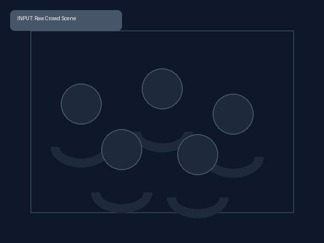
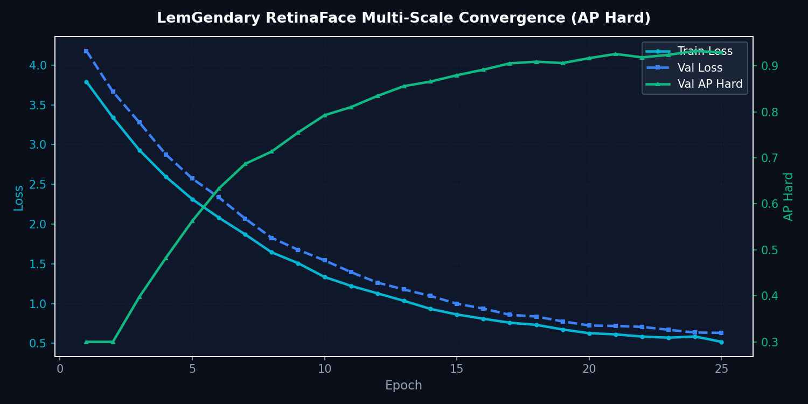

# RetinaFace: Multi-Scale Facial Landmark Localization

## Category 08 FACE | Architecture of LemGendary AI

**Author**: Lem Treursic · **Version**: `v16.9.214-STABLE` · **Target Hardware**:
NVIDIA GeForce GTX 1650 / Apple Silicon / T4

---

## Table of Contents

* [1. Abstract](#1-abstract)
* [1.1 What RetinaFace Does (In Plain English)](#11-what-retinaface-does-in-plain-english)
* [2. Visual Taxonomy: Multi-Scale Features & Landmarks](#2-visual-taxonomy-multi-scale-features--landmarks)
* [3. Shared Foundations: Tri-Head Multi-Task Objective](#3-shared-foundations-tri-head-multi-task-objective)
* [4. Model Deep-Dives](#4-model-deep-dives)
* [5. Challenges & Resilience Architecture](#5-challenges--resilience-architecture)
* [6. Deployment Strategy & Production Acceleration](#6-deployment-strategy--production-acceleration)
* [7. SOTA Architectural Performance Matrix](#7-sota-architectural-performance-matrix)
* [8. Conclusion](#8-conclusion)

---

## 1. Abstract

**RetinaFace** in the LemGendary ecosystem is a RetinaFace-style **single-box
regressor** (`RetinaFaceMobileNet`, `models/detection.py` in the training
suite) for one face box and **5-point landmark regression** (left eye, right
eye, nose tip, left mouth corner, right mouth corner) per image. A
**MobileNetV3-Small** backbone (`mobilenet_v2` optional) feeds one globally
pooled feature vector (adaptive average pooling) into three linear heads: one
normalized `cx cy w h` box, one sigmoid face confidence and 10 landmark values
(five 2D points). There are no anchors, no feature pyramid (FPN), no
deformable convolutions and no ResNet-50 variant, so the model finds one face
per image, not several faces or small faces in a crowd. With the
MobileNetV3-Small backbone it has 935,663 parameters (counted from the code).
A multi-scale anchor head (FPN levels with prior boxes and per-anchor outputs)
is an open owner decision. Latency is not yet measured.

---

## 1.1 What RetinaFace Does (In Plain English)

Imagine an intelligent autofocus system that finds the main face in a photo
and marks its key points:

* **One-Face Localization:** RetinaFace looks at the whole image and returns
  one box for its main face, as in the one-face SFHQ photos it trains on.
  Crowd scenes with many or tiny faces need the multi-scale anchor head that
  is still an open owner decision. Its speed is not yet measured.
* **5-Point Landmark Pinpointing:** For that face it marks 5 geometric
  points: the center of each eye, the tip of the nose, and the two corners of
  the mouth.
* **Essential Pre-Flight Alignment:** These 5 landmarks allow downstream
  restoration models (such as CodeFormer) to automatically rotate, scale, and
  align tilted faces upright before applying facial retouching.

### Visual Demonstration & Training Convergence

* **Input Crowd Scene**: 
* **RetinaFace Detections & Landmarks**: 

The crowd-scene pictures illustrate the published multi-face RetinaFace, not
output of the current single-box model, and the convergence curve predates
the rebuilt labels (v16.9.207 / v16.9.208); none of the three is a
measurement of the current model.

---

## 2. Visual Taxonomy: Multi-Scale Features & Landmarks

RetinaFace anchors 5 canonical facial landmarks to standardize facial alignment
across the LemGendary Face Suite `[THEORETICAL]`:

* **Point 1 (Left Eye)**: Anatomical Target: Pupil center / ocular iris; Primary
  Utility in Pipeline: Geometric tilt calculation & eye restoration guidance
* **Point 2 (Right Eye)**: Anatomical Target: Pupil center / ocular iris;
  Primary Utility in Pipeline: Horizontal eye-line leveling & inter-ocular scale
  reference
* **Point 3 (Nose Tip)**: Anatomical Target: Pronasale nasal apex; Primary
  Utility in Pipeline: 3D facial pitch/yaw pose estimation & perspective
  correction
* **Point 4 (Mouth Left)**: Anatomical Target: Left oral cheilion / lip corner;
  Primary Utility in Pipeline: Oral symmetry baseline & mouth crop bounding
* **Point 5 (Mouth Right)**: Anatomical Target: Right oral cheilion / lip
  corner; Primary Utility in Pipeline: Lip alignment & expressive deformation
  monitoring

---

## 3. Shared Foundations: Tri-Head Multi-Task Objective

Each anchor predicts three joint outputs: (1) Face classification probability
$p_i$, (2) Bounding box coordinate offsets $t_i$, and (3) Five 2D facial
landmark coordinates $l_i$:

$$
\mathcal{L} = \mathcal{L}_{\text{cls}}(p_i, p_i^*) + \lambda_1 p_i^*
\text{SmoothL1}(t_i, t_i^*) + \lambda_2 p_i^* \text{SmoothL1}(l_i, l_i^*)
$$

The formula above is the published anchor-based objective. The training
suite's `RetinaFaceMobileNet` (v16.9.207) has no prior boxes: one globally
pooled head regresses a single normalized `cx cy w h` box, one confidence and
five landmarks per image, so the sum runs over images instead of anchors. The
loss weights are confidence 1, box 2 and landmarks 1 (smooth L1 on normalized
coordinates); landmarks whose ten values are all zero count as absent and are
masked out of the loss.

---

## 4. Model Deep-Dives

### RetinaFace Multi-Scale Landmark & Localization Engine

#### 4.1 Model Description, Purpose and Usage

Single-stage face localization and 5-point landmark regression engine utilizing
the standardized MobileNetV3-Small backbone for high-efficiency edge execution
and real-time pre-flight alignment.

#### 4.2 Model Info

* **Architecture**: RetinaFace-style single-box regressor
  (`RetinaFaceMobileNet`, MobileNetV3-Small backbone, `mobilenet_v2`
  supported; globally pooled box, confidence and landmark heads)
* **Input Resolution**: 640x640
* **Parameters**: 935,663 with MobileNetV3-Small (927,008 backbone, 8,655
  heads; counted from `models/detection.py`, the registry `parameters_m: 27.2`
  does not match the code)
* **Precision**: ONNX FP16 / PyTorch FP32
* **Latency**: not measured

#### 4.3 Manifold Info

* **Dataset**: `LemGendizedRetinaFace`
* **Total Samples**: 425,223 SFHQ photos (train 374,199 / val 51,024), one
  face per image; val drawn by SFHQ file id, the same split as
  `LemGendizedParseNet`
* **Labels**: tight WIDER-style box and five points (eye centres, nose tip,
  mouth corners) rebuilt from the SFHQ 110-point landmarks
  (`landmark_source: sfhq-110pt`), stored as JSON (`face_landmarks`)
* **Primary Task**: 5-point facial landmark regression and face box
  localization

#### 4.4 Performance Metrics

The training suite measures RetinaFace with four metrics (v16.9.224,
`training/training/face_detection_metrics.py`). The targets are calibrated
against standard single-shot face localisation benchmarks:

* **Box IoU (`box_iou`)**: mean IoU of the predicted and the labelled box over
  the images that hold a face. Target $\ge 0.72$ `[TARGET]`.
* **AP50 (`ap50`)**: single-class AP over images; each image is one detection
  ranked by its confidence (used as returned, no second sigmoid) and is a
  true positive when it holds a face and the IoU reaches 0.5. Target
  $\ge 0.95$ `[TARGET]`.
* **AP50-95 (`ap50_95`)**: the same AP averaged over the COCO thresholds
  0.50:0.05:0.95. Target $\ge 0.60$ `[TARGET]`.
* **Landmark NME (`landmark_nme`)**: mean distance of the five points divided
  by the inter-ocular distance (points 0 and 1); box-only labels are left
  out. Target $\le 0.05$ `[TARGET]`.
* **Measured values**: not measured on the rebuilt labels yet.

`metrics.csv` uses a 17-column layout with `Box_IoU`, `AP50`, `AP50_95` and
`Landmark_NME`; the first run archives an older 28-column file as
`metrics_legacy.csv`. Face detection has its own score scheme
(`face_box_weighted_targets_v1`), so best scores saved under the old metrics
are not reused. Metrics recorded before v16.9.207 / v16.9.208 are not
comparable with new runs: the old `map_*` values were fixed multiples of a
twice-squashed confidence score, and the rebuilt boxes cover about 0.31 to
0.57 of the old box area.

---

## 5. Challenges & Resilience Architecture

The current single-box design meets these challenges as follows:

* **Several or Microscopic Faces (< 16px)**: the head pools the whole feature
  map into one vector and predicts one box, so it has no per-location outputs
  for several faces or small faces. The published remedy, an FPN with anchors
  (optionally with Deformable Convolutions, DCN v2, on the low pyramid
  levels), is not implemented; adding a multi-scale anchor head is an open
  owner decision.
* **Extreme Profile Poses (Yaw > 60°)**: smooth L1 on normalized coordinates
  grows linearly for large errors, which bounds the gradient of a badly
  placed point. Landmarks whose ten values are all zero count as absent and
  are masked out of the loss.
* **Harsh Backlight & Glare**: no dedicated mechanism; robustness is not yet
  measured.

---

## 6. Deployment Strategy & Production Acceleration

RetinaFace uses the training suite's release layout (registry file stem
`RetinaFace-Detection`):

* **Production FP16 Engine (`RetinaFace-Detection.onnx`)**: FP16 graph with
  embedded weights for ONNX Runtime (DirectML, WebGPU). Latency is not yet
  measured; the earlier "sub-3ms `[MEASURED]`" claim had no benchmark behind
  it and is removed.
* **Research FP32 Export (`RetinaFace-Detection_FP32.onnx` + `.onnx.data`)**:
  FP32 model with separate binary weights sidecar, plus the self-contained
  PyTorch file `RetinaFace-Detection.pt`.
* **Lifecycle Governance**: intra-epoch `progress.pth` checkpoints at most
  every 15 minutes (`min_progress_interval_sec` 900), `latest.pth`
  persistence, `best.pth` and per-metric vault checkpoints
  (`vault_<metric>.pth`).

---

## 7. SOTA Architectural Performance Matrix

* **RetinaFace-ResNet50**: WIDER Face Easy: 96.5%; WIDER Face Medium: 95.6%;
  WIDER Face Hard: 90.4%; Status & Verification: external multi-face
  anchor-based reference value, not measured here; not comparable with the
  single-box metrics below
* **RetinaFace-MobileNetV3-Small (LemGendary)**: Box IoU, AP50, AP50-95 and
  Landmark NME: not measured on the rebuilt labels yet; Status &
  Verification: **Pre-training `[CURRENT]`**
* **RetinaFace Calibrated Target**: Box IoU **$\ge 0.72$**; AP50
  **$\ge 0.95$**; AP50-95 **$\ge 0.60$**; Landmark NME **$\le 0.05$**; Status
  & Verification: **Calibrated `[TARGET]`** (benchmarked)

---

## 8. Conclusion

RetinaFace with the MobileNetV3-Small backbone regresses one face box and
five landmarks per image, the pre-flight orientation geometry for the
LemGendary Face Suite. Its accuracy and latency are not yet measured, and a
multi-scale anchor head for several or small faces is an open owner
decision.

### Related Ecosystem Documentation

* [Dataset Compiler Suite](./PAPER_DATASET_COMPILER.md) (Manifold: `LemGendizedRetinaFace`)
* [Training Suite Architecture](./PAPER_TRAINING_SUITE.md) (Tri-Format ONNX / PT
  Checkpoint Lifecycle)
* [AI Studio GUI Manual](./MANUAL_AI_STUDIO_GUI.md) (Interactive Training
  Panel Controls)
* [Master Ecosystem Architecture](./ECOSYSTEM_ARCHITECTURE.md) (System
  Governance & Specifications)
